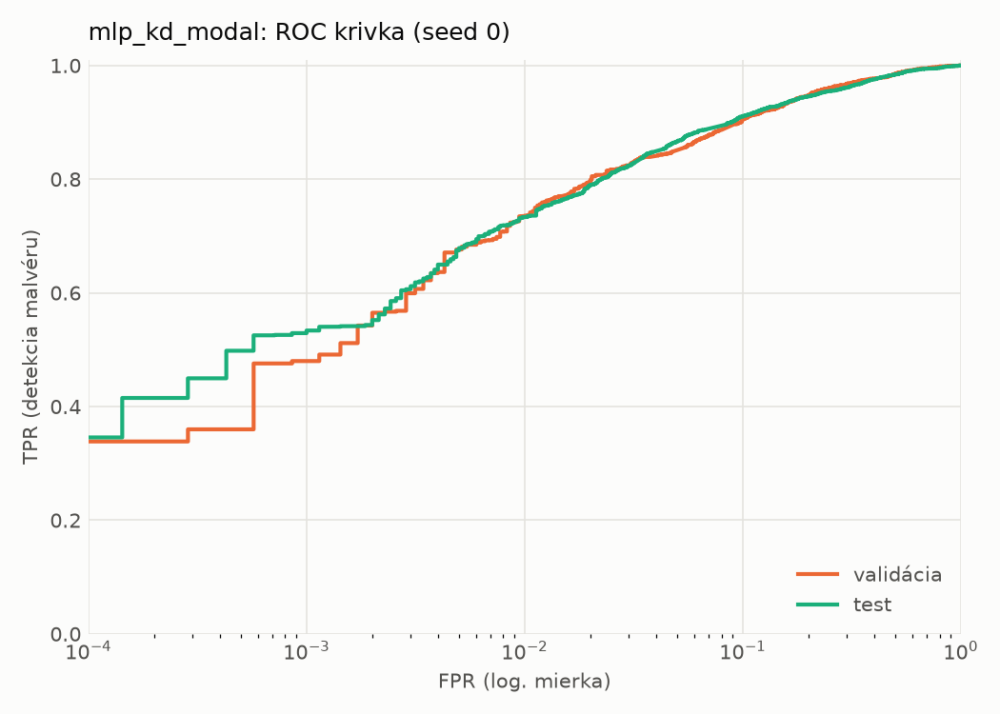
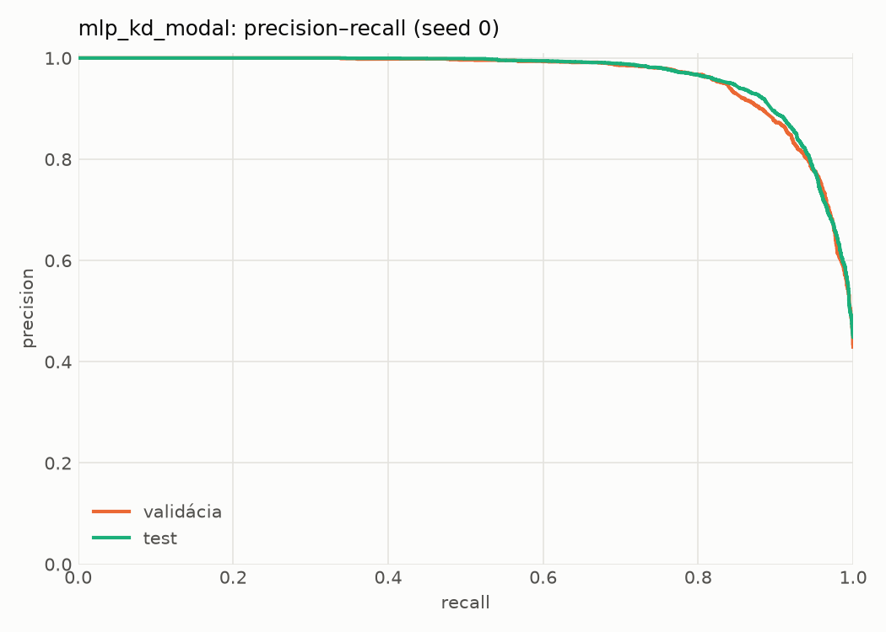
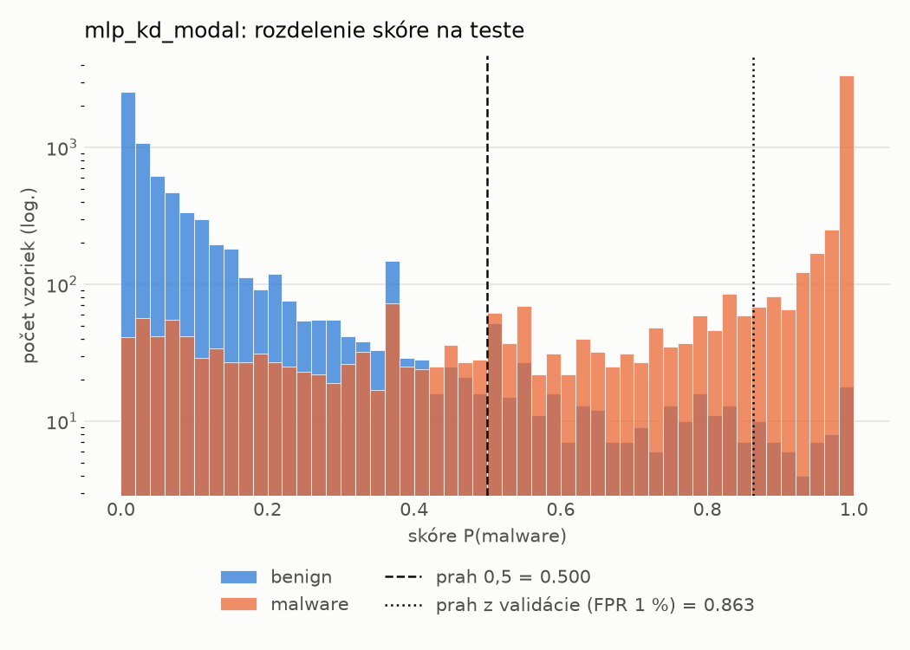
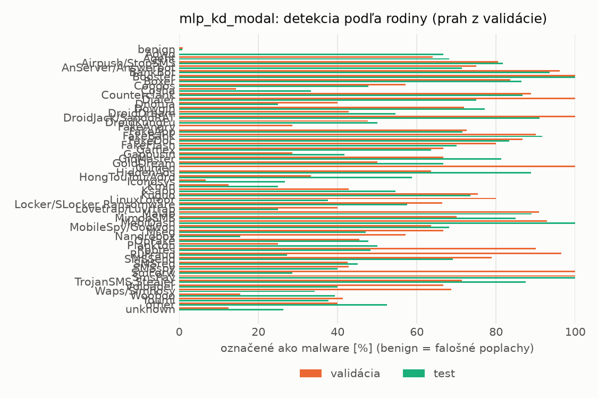
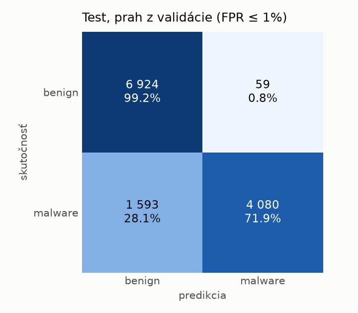
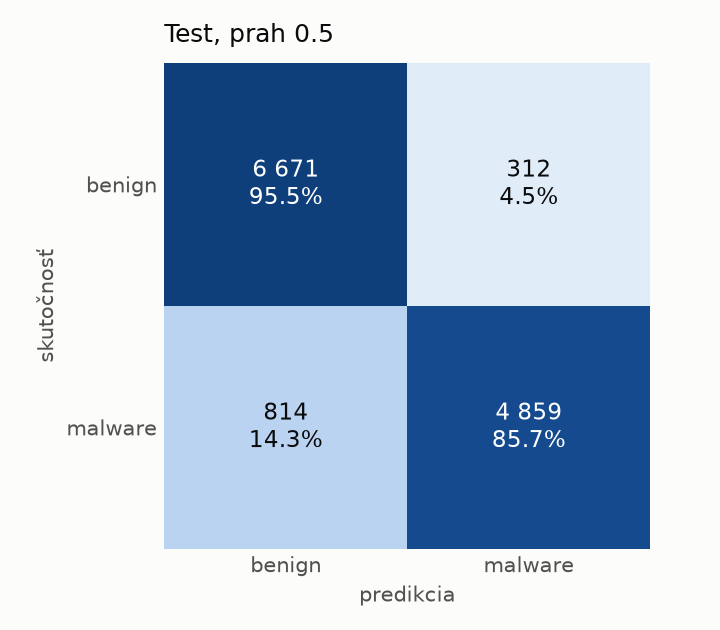
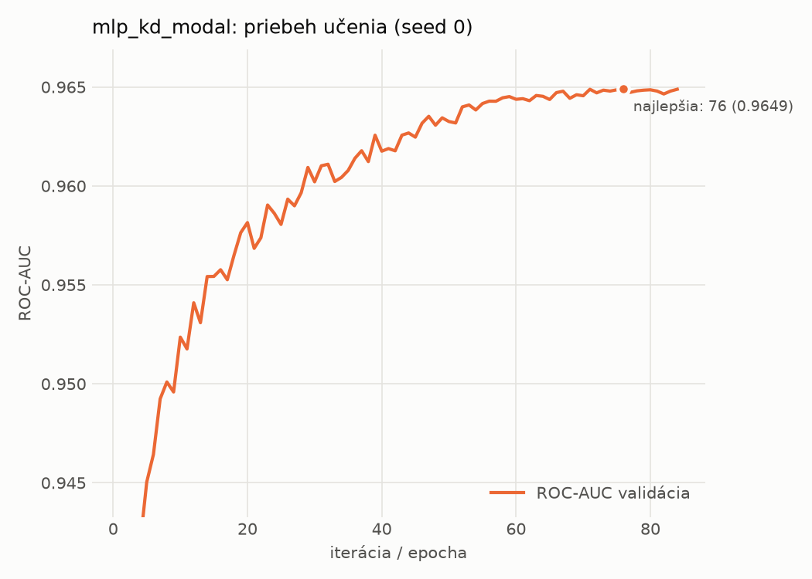

# dynamic/mlp_kd_modal – beh `20261123-185207`

> Automaticky generované (`src/training/run_tabular.py`). Konfigurácia: `config.yaml`, protokol: `protocol.yaml`.

- **Model:** `mlp` – študent – malé MLP učené destiláciou z učiteľa rovnakej modality (variant A)
- **Ladenie:** bez ladenia – hyperparametre prevzaté z `runs_v4/real_p/full/students_dynamic/mlp_kd_modal/20261123-004749`
- **Finálne modely:** seedy [0, 1, 2]; hodnoty sú priemer ± smerodajná odchýlka cez seedy
- **Najlepšie hyperparametre:** `{"hidden_layers": 1, "max_epochs": 100, "patience": 8, "hidden_width": 64, "dropout": 0.23306226533454044, "lr": 0.0029211055962699408, "weight_decay": 1.2442051354380418e-06, "batch_size": 512, "kd_alpha": 0.38098578248234166, "kd_temperature": 1.6615545083860346}`

## Detekčná kvalita (bez prahu)
| metrika | train (podvzorka) | validácia | test |
|---|---|---|---|
| ROC-AUC | 0.9718 ± 0.0011 | 0.9646 ± 0.0010 | 0.9637 ± 0.0013 |
| PR-AUC | 0.9709 ± 0.0010 | 0.9629 ± 0.0009 | 0.9650 ± 0.0012 |
| TPR pri FPR 1 % | 0.7877 ± 0.0022 | 0.7284 ± 0.0071 | 0.7282 ± 0.0099 |
| TPR pri FPR 0,1 % | 0.5898 ± 0.0066 | 0.4984 ± 0.0185 | 0.5170 ± 0.0147 |
| log loss | 0.1959 ± 0.0034 | 0.2287 ± 0.0025 | 0.2332 ± 0.0039 |
| Brier skóre | 0.0564 ± 0.0010 | 0.0671 ± 0.0008 | 0.0679 ± 0.0011 |

Rozdiel ROC-AUC train − validácia: **0.0072** (veľký rozdiel = preučenie).

## Pri prahu z validácie (FPR ≤ 1% na validácii)
| metrika | train (podvzorka) | validácia | test |
|---|---|---|---|
| accuracy | 0.8959 ± 0.0015 | 0.8779 ± 0.0030 | 0.8674 ± 0.0022 |
| balanced accuracy | 0.8778 ± 0.0018 | 0.8593 ± 0.0035 | 0.8530 ± 0.0025 |
| precision | 0.9867 ± 0.0009 | 0.9825 ± 0.0002 | 0.9863 ± 0.0005 |
| recall (TPR) | 0.7630 ± 0.0042 | 0.7284 ± 0.0071 | 0.7141 ± 0.0053 |
| FPR | 0.0075 ± 0.0005 | 0.0097 ± 0.0000 | 0.0081 ± 0.0003 |
| F1 | 0.8606 ± 0.0023 | 0.8366 ± 0.0047 | 0.8284 ± 0.0034 |
| MCC | 0.7961 ± 0.0025 | 0.7637 ± 0.0056 | 0.7500 ± 0.0038 |

## Pri pevnom prahu 0.5
| metrika | train (podvzorka) | validácia | test |
|---|---|---|---|
| accuracy | 0.9245 ± 0.0009 | 0.9080 ± 0.0004 | 0.9098 ± 0.0019 |
| balanced accuracy | 0.9181 ± 0.0015 | 0.9017 ± 0.0007 | 0.9043 ± 0.0024 |
| precision | 0.9390 ± 0.0036 | 0.9228 ± 0.0062 | 0.9423 ± 0.0027 |
| recall (TPR) | 0.8776 ± 0.0059 | 0.8574 ± 0.0063 | 0.8509 ± 0.0071 |
| FPR | 0.0414 ± 0.0029 | 0.0540 ± 0.0050 | 0.0423 ± 0.0024 |
| F1 | 0.9072 ± 0.0015 | 0.8889 ± 0.0007 | 0.8942 ± 0.0028 |
| MCC | 0.8451 ± 0.0016 | 0.8122 ± 0.0010 | 0.8192 ± 0.0033 |

## Výpočtové nároky (seed 0, testovacia množina)
| meranie | hodnota |
|---|---|
| tréning finálneho modelu | 10.4 s (priemer cez seedy) |
| ladenie spolu | 0 s |
| počet parametrov / uzlov | 8 129 |
| veľkosť modelu na disku | 0.04 MB |
| transformácia vstupu – latencia (1 vlákno) | 0.015 ms |
| transformácia vstupu – priepustnosť | 780 661 vzoriek/s |
| CPU latencia modelu (batch 1, 1 vlákno) | 0.156 ms (p95 0.168) |
| CPU priepustnosť (24 vlákien) | 5 235 160 vzoriek/s |
| GPU latencia (batch 1) | 0.479 ms (p95 0.504) |
| GPU priepustnosť | 3 924 706 vzoriek/s |
| GPU špičková pamäť | 53 MB |

## Grafy
| | |
|---|---|
|  |  |
|  |  |
|  |  |
|  |  |

## Súbory
`metrics.json` (všetky metriky po seedoch vrátane rodín), `timing.json`, `hpo_trials.csv`,
`predictions/<časť>_seed<N>.parquet` (sha256, family, label, score), `model/seed_<N>/`, `log.txt`.
