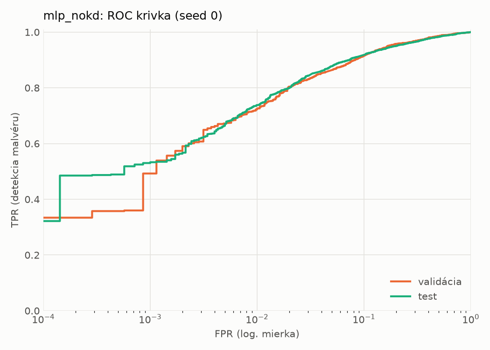
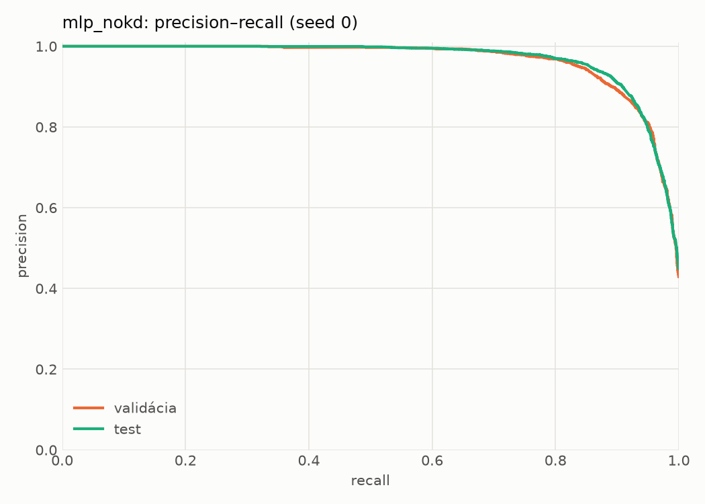
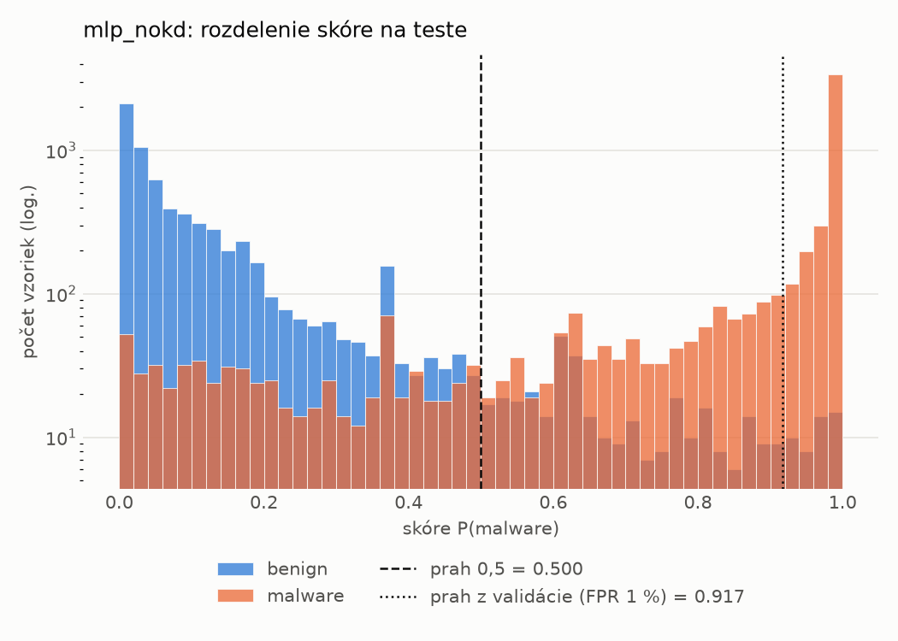
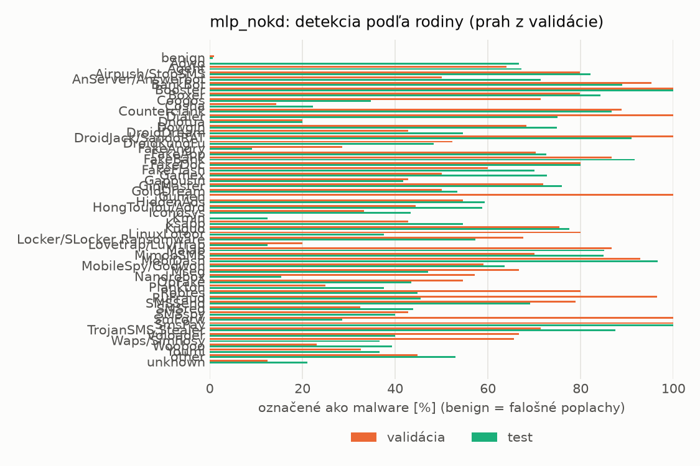
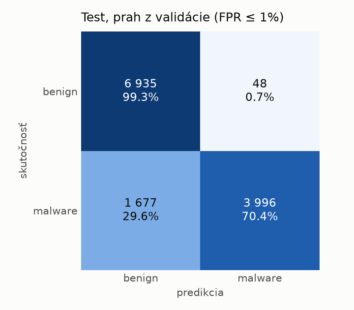
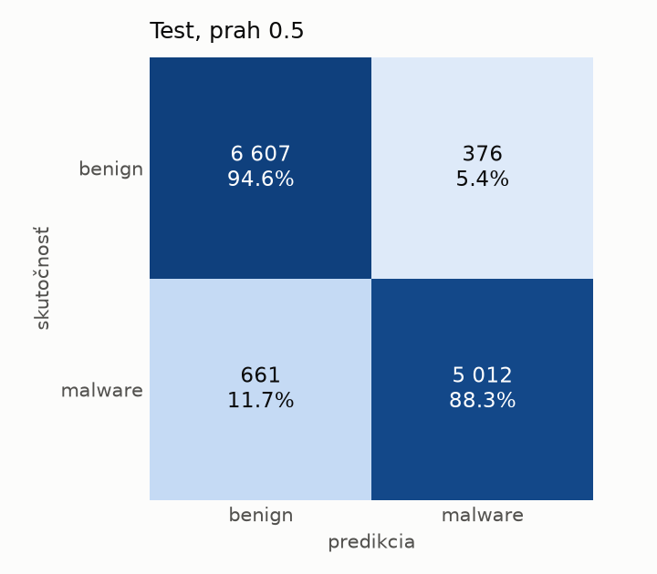
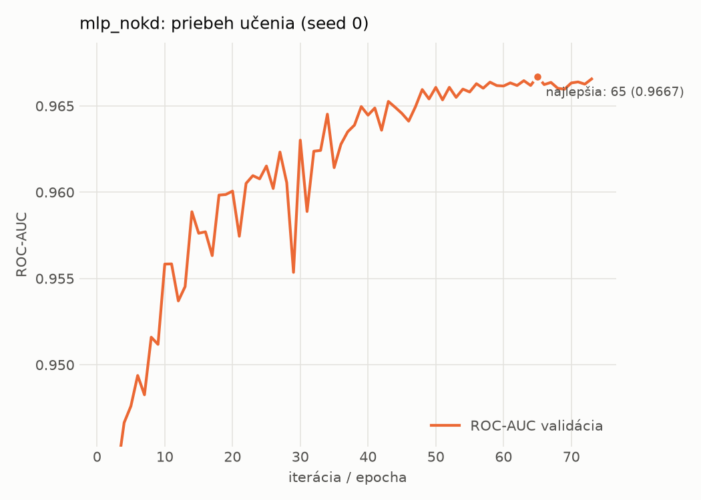

# dynamic/mlp_nokd – beh `20261123-185126`

> Automaticky generované (`src/training/run_tabular.py`). Konfigurácia: `config.yaml`, protokol: `protocol.yaml`.

- **Model:** `mlp` – kontrola – rovnaké malé MLP bez destilácie (iba skutočné označenia)
- **Ladenie:** bez ladenia – hyperparametre prevzaté z `runs_v4/real_p/full/students_dynamic/mlp_nokd/20261123-004046`
- **Finálne modely:** seedy [0, 1, 2]; hodnoty sú priemer ± smerodajná odchýlka cez seedy
- **Najlepšie hyperparametre:** `{"hidden_layers": 1, "max_epochs": 100, "patience": 8, "hidden_width": 64, "dropout": 0.01960392869507369, "lr": 0.0014251751351833603, "weight_decay": 1.336267730425129e-05, "batch_size": 256}`

## Detekčná kvalita (bez prahu)
| metrika | train (podvzorka) | validácia | test |
|---|---|---|---|
| ROC-AUC | 0.9789 ± 0.0008 | 0.9671 ± 0.0004 | 0.9657 ± 0.0010 |
| PR-AUC | 0.9777 ± 0.0006 | 0.9656 ± 0.0004 | 0.9669 ± 0.0011 |
| TPR pri FPR 1 % | 0.8232 ± 0.0042 | 0.7286 ± 0.0070 | 0.7345 ± 0.0029 |
| TPR pri FPR 0,1 % | 0.6522 ± 0.0130 | 0.4882 ± 0.0051 | 0.4956 ± 0.0645 |
| log loss | 0.1743 ± 0.0010 | 0.2228 ± 0.0011 | 0.2256 ± 0.0035 |
| Brier skóre | 0.0497 ± 0.0003 | 0.0641 ± 0.0005 | 0.0641 ± 0.0004 |

Rozdiel ROC-AUC train − validácia: **0.0117** (veľký rozdiel = preučenie).

## Pri prahu z validácie (FPR ≤ 1% na validácii)
| metrika | train (podvzorka) | validácia | test |
|---|---|---|---|
| accuracy | 0.8976 ± 0.0021 | 0.8779 ± 0.0030 | 0.8656 ± 0.0023 |
| balanced accuracy | 0.8792 ± 0.0026 | 0.8594 ± 0.0035 | 0.8510 ± 0.0026 |
| precision | 0.9919 ± 0.0006 | 0.9825 ± 0.0002 | 0.9869 ± 0.0012 |
| recall (TPR) | 0.7629 ± 0.0054 | 0.7286 ± 0.0070 | 0.7096 ± 0.0060 |
| FPR | 0.0045 ± 0.0004 | 0.0097 ± 0.0000 | 0.0076 ± 0.0008 |
| F1 | 0.8624 ± 0.0033 | 0.8367 ± 0.0047 | 0.8256 ± 0.0037 |
| MCC | 0.8002 ± 0.0038 | 0.7638 ± 0.0055 | 0.7469 ± 0.0037 |

## Pri pevnom prahu 0.5
| metrika | train (podvzorka) | validácia | test |
|---|---|---|---|
| accuracy | 0.9353 ± 0.0002 | 0.9122 ± 0.0011 | 0.9168 ± 0.0012 |
| balanced accuracy | 0.9321 ± 0.0005 | 0.9085 ± 0.0010 | 0.9134 ± 0.0014 |
| precision | 0.9331 ± 0.0018 | 0.9101 ± 0.0042 | 0.9308 ± 0.0006 |
| recall (TPR) | 0.9117 ± 0.0024 | 0.8826 ± 0.0034 | 0.8798 ± 0.0035 |
| FPR | 0.0475 ± 0.0015 | 0.0655 ± 0.0036 | 0.0531 ± 0.0007 |
| F1 | 0.9223 ± 0.0004 | 0.8961 ± 0.0012 | 0.9046 ± 0.0015 |
| MCC | 0.8670 ± 0.0004 | 0.8204 ± 0.0023 | 0.8320 ± 0.0023 |

## Výpočtové nároky (seed 0, testovacia množina)
| meranie | hodnota |
|---|---|
| tréning finálneho modelu | 13.0 s (priemer cez seedy) |
| ladenie spolu | 0 s |
| počet parametrov / uzlov | 8 129 |
| veľkosť modelu na disku | 0.04 MB |
| transformácia vstupu – latencia (1 vlákno) | 0.015 ms |
| transformácia vstupu – priepustnosť | 773 750 vzoriek/s |
| CPU latencia modelu (batch 1, 1 vlákno) | 0.154 ms (p95 0.164) |
| CPU priepustnosť (24 vlákien) | 4 933 536 vzoriek/s |
| GPU latencia (batch 1) | 0.459 ms (p95 0.498) |
| GPU priepustnosť | 2 768 093 vzoriek/s |
| GPU špičková pamäť | 77 MB |

## Grafy
| | |
|---|---|
|  |  |
|  |  |
|  |  |
|  |  |

## Súbory
`metrics.json` (všetky metriky po seedoch vrátane rodín), `timing.json`, `hpo_trials.csv`,
`predictions/<časť>_seed<N>.parquet` (sha256, family, label, score), `model/seed_<N>/`, `log.txt`.
