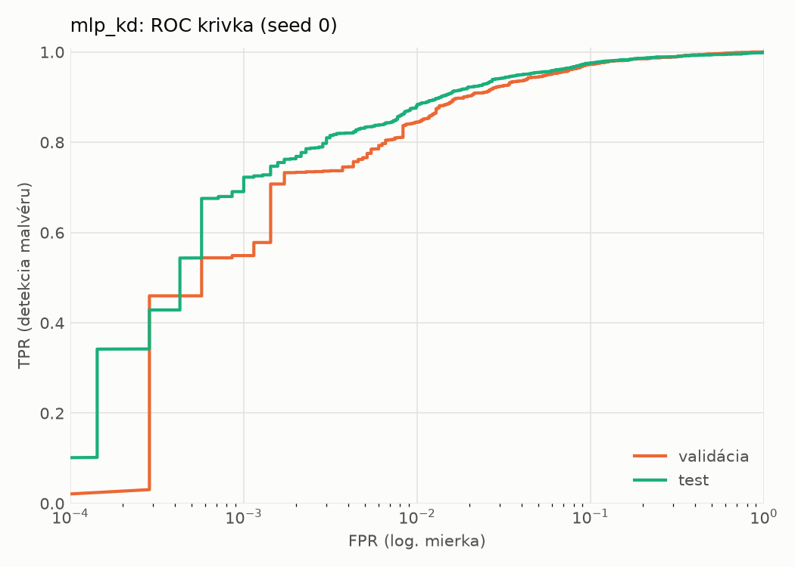
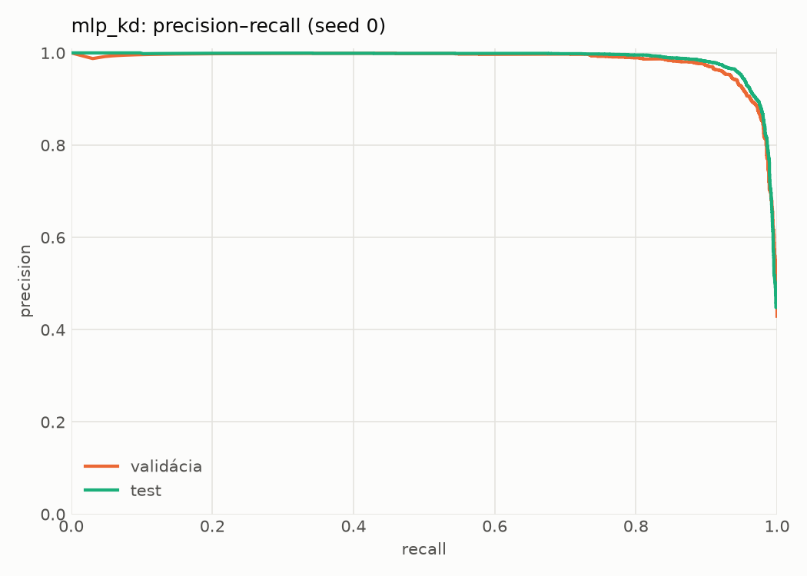
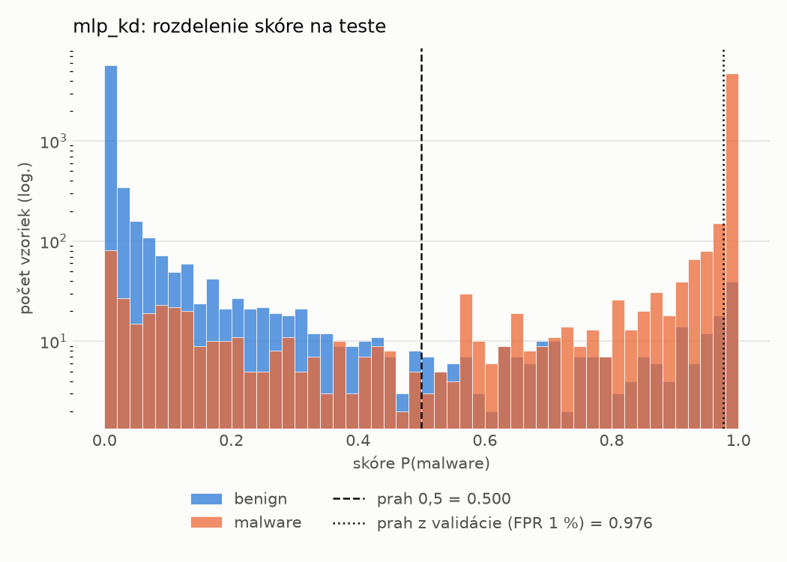
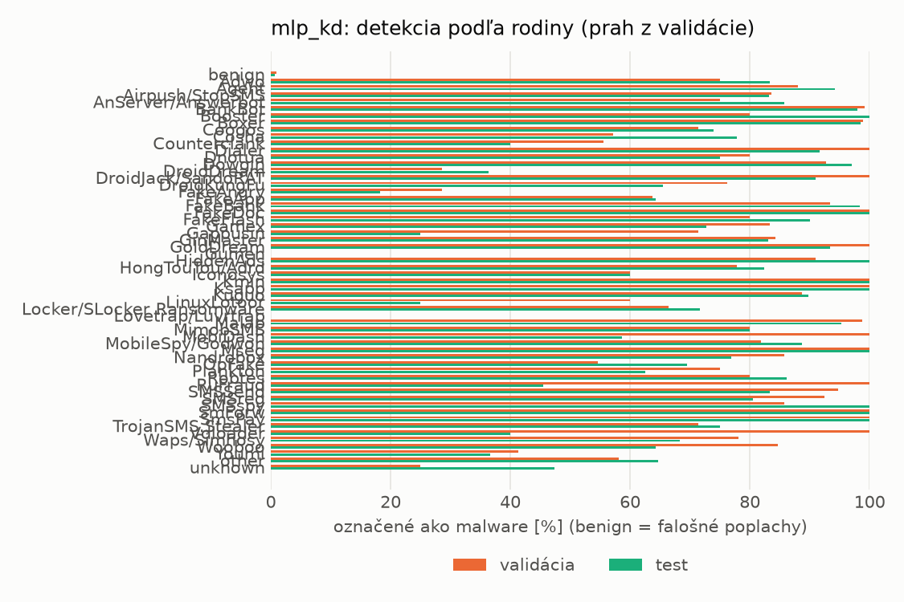
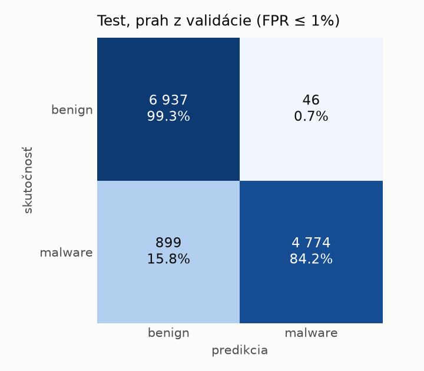
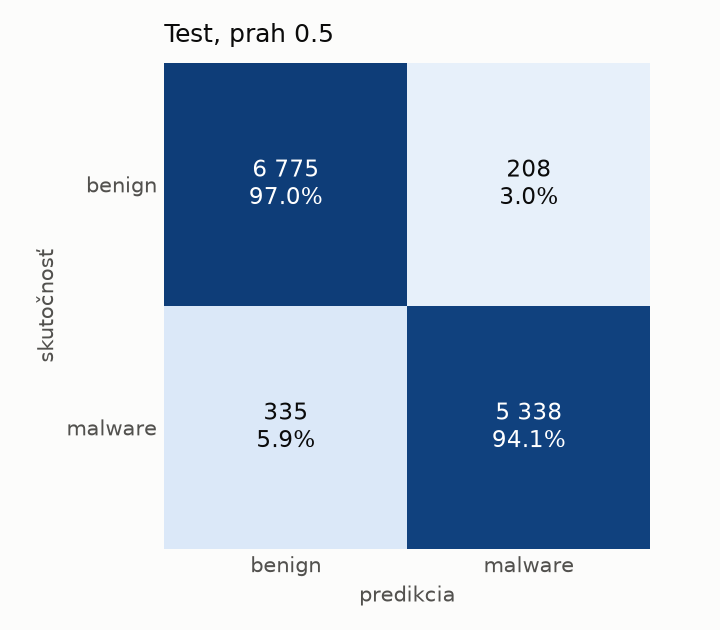
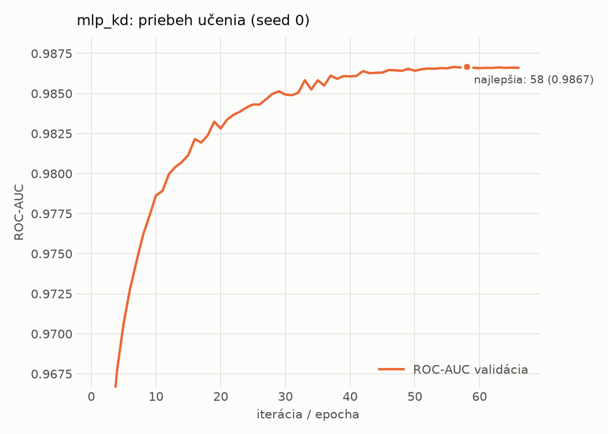

# static/mlp_kd – beh `20261123-184951`

> Automaticky generované (`src/training/run_tabular.py`). Konfigurácia: `config.yaml`, protokol: `protocol.yaml`.

- **Model:** `mlp` – študent – malé MLP učené destiláciou z hybridného učiteľa
- **Ladenie:** bez ladenia – hyperparametre prevzaté z `runs_v4/real_p/full/students_static/mlp_kd/20261123-002115`
- **Finálne modely:** seedy [0, 1, 2]; hodnoty sú priemer ± smerodajná odchýlka cez seedy
- **Najlepšie hyperparametre:** `{"hidden_layers": 1, "max_epochs": 100, "patience": 8, "hidden_width": 64, "dropout": 0.0632721567978865, "lr": 0.0009421311632910299, "weight_decay": 0.0003612082656275497, "batch_size": 1024, "kd_alpha": 0.17546922159086176, "kd_temperature": 1.684481613505065}`

## Detekčná kvalita (bez prahu)
| metrika | train (podvzorka) | validácia | test |
|---|---|---|---|
| ROC-AUC | 0.9903 ± 0.0002 | 0.9866 ± 0.0002 | 0.9879 ± 0.0006 |
| PR-AUC | 0.9899 ± 0.0002 | 0.9840 ± 0.0003 | 0.9880 ± 0.0003 |
| TPR pri FPR 1 % | 0.9158 ± 0.0008 | 0.8483 ± 0.0036 | 0.8777 ± 0.0022 |
| TPR pri FPR 0,1 % | 0.7469 ± 0.0122 | 0.5085 ± 0.0395 | 0.6678 ± 0.0397 |
| log loss | 0.1195 ± 0.0020 | 0.1645 ± 0.0040 | 0.1463 ± 0.0033 |
| Brier skóre | 0.0300 ± 0.0004 | 0.0405 ± 0.0006 | 0.0352 ± 0.0003 |

Rozdiel ROC-AUC train − validácia: **0.0037** (veľký rozdiel = preučenie).

## Pri prahu z validácie (FPR ≤ 1% na validácii)
| metrika | train (podvzorka) | validácia | test |
|---|---|---|---|
| accuracy | 0.9374 ± 0.0011 | 0.9293 ± 0.0016 | 0.9267 ± 0.0012 |
| balanced accuracy | 0.9263 ± 0.0013 | 0.9193 ± 0.0018 | 0.9191 ± 0.0014 |
| precision | 0.9943 ± 0.0006 | 0.9849 ± 0.0001 | 0.9898 ± 0.0008 |
| recall (TPR) | 0.8563 ± 0.0023 | 0.8483 ± 0.0036 | 0.8452 ± 0.0033 |
| FPR | 0.0036 ± 0.0004 | 0.0097 ± 0.0000 | 0.0071 ± 0.0006 |
| F1 | 0.9201 ± 0.0015 | 0.9115 ± 0.0021 | 0.9118 ± 0.0016 |
| MCC | 0.8757 ± 0.0022 | 0.8598 ± 0.0030 | 0.8575 ± 0.0021 |

## Pri pevnom prahu 0.5
| metrika | train (podvzorka) | validácia | test |
|---|---|---|---|
| accuracy | 0.9624 ± 0.0009 | 0.9492 ± 0.0008 | 0.9566 ± 0.0006 |
| balanced accuracy | 0.9593 ± 0.0010 | 0.9473 ± 0.0010 | 0.9549 ± 0.0006 |
| precision | 0.9700 ± 0.0010 | 0.9469 ± 0.0016 | 0.9631 ± 0.0014 |
| recall (TPR) | 0.9397 ± 0.0015 | 0.9340 ± 0.0023 | 0.9391 ± 0.0017 |
| FPR | 0.0211 ± 0.0007 | 0.0394 ± 0.0013 | 0.0293 ± 0.0012 |
| F1 | 0.9546 ± 0.0011 | 0.9404 ± 0.0010 | 0.9509 ± 0.0006 |
| MCC | 0.9228 ± 0.0019 | 0.8963 ± 0.0017 | 0.9122 ± 0.0011 |

## Výpočtové nároky (seed 0, testovacia množina)
| meranie | hodnota |
|---|---|
| tréning finálneho modelu | 4.8 s (priemer cez seedy) |
| ladenie spolu | 0 s |
| počet parametrov / uzlov | 10 689 |
| veľkosť modelu na disku | 0.05 MB |
| transformácia vstupu – latencia (1 vlákno) | 0.006 ms |
| transformácia vstupu – priepustnosť | 1 107 514 vzoriek/s |
| CPU latencia modelu (batch 1, 1 vlákno) | 0.054 ms (p95 0.062) |
| CPU priepustnosť (24 vlákien) | 4 139 871 vzoriek/s |
| GPU latencia (batch 1) | 0.263 ms (p95 0.304) |
| GPU priepustnosť | 2 024 895 vzoriek/s |
| GPU špičková pamäť | 62 MB |

## Grafy
| | |
|---|---|
|  |  |
|  |  |
|  |  |
|  |  |

## Súbory
`metrics.json` (všetky metriky po seedoch vrátane rodín), `timing.json`, `hpo_trials.csv`,
`predictions/<časť>_seed<N>.parquet` (sha256, family, label, score), `model/seed_<N>/`, `log.txt`.
