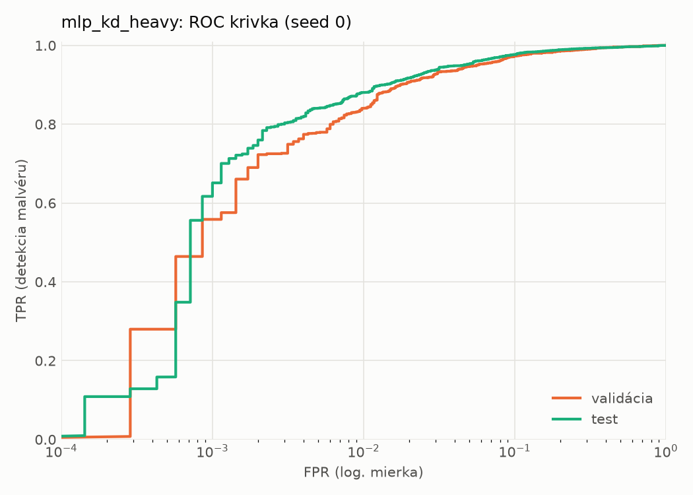
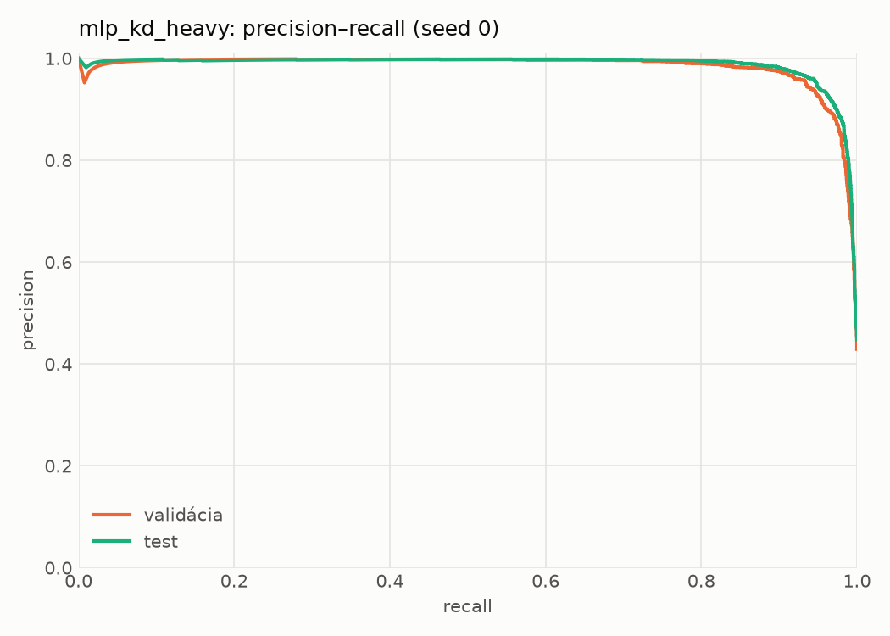
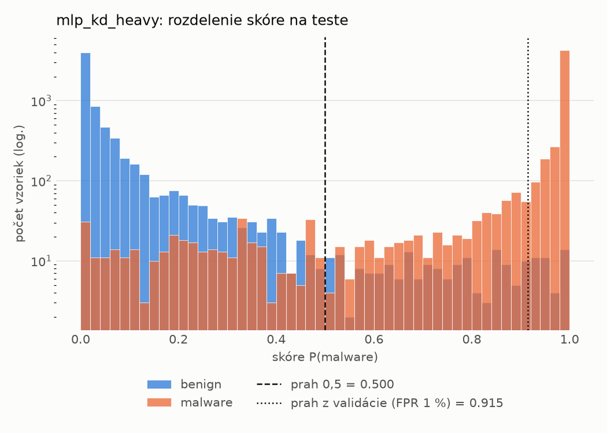
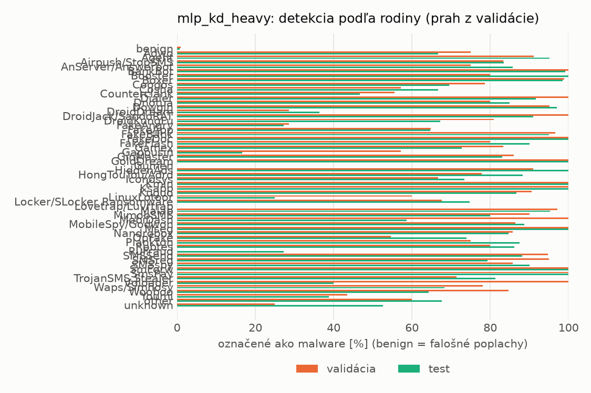
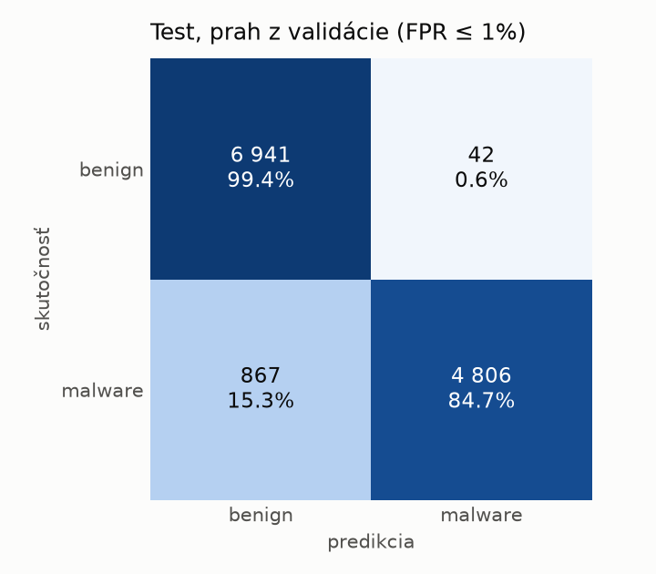
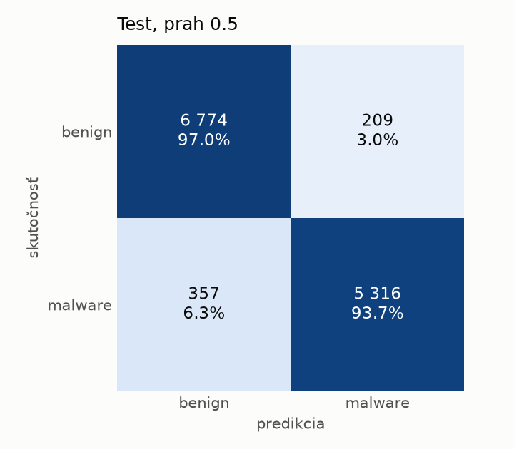
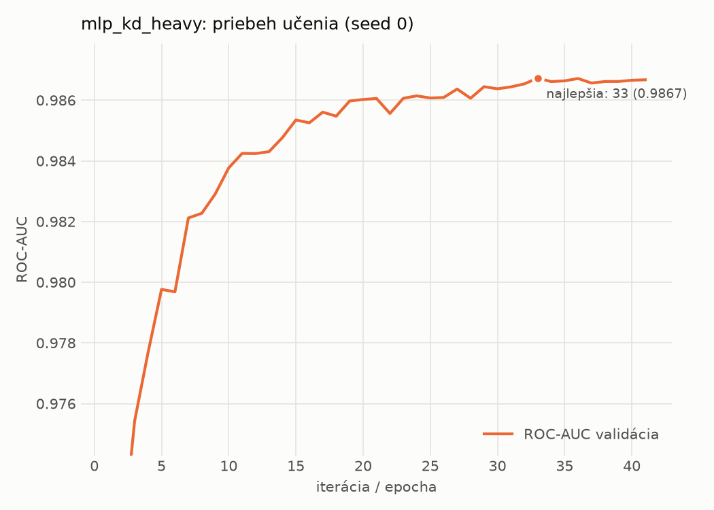

# static/mlp_kd_heavy – beh `20261123-185053`

> Automaticky generované (`src/training/run_tabular.py`). Konfigurácia: `config.yaml`, protokol: `protocol.yaml`.

- **Model:** `mlp` – študent – malé MLP učené destiláciou z mlp_large hybridu (V4)
- **Ladenie:** bez ladenia – hyperparametre prevzaté z `runs_v4/real_p/full/students_static/mlp_kd_heavy/20261123-003302`
- **Finálne modely:** seedy [0, 1, 2]; hodnoty sú priemer ± smerodajná odchýlka cez seedy
- **Najlepšie hyperparametre:** `{"hidden_layers": 1, "max_epochs": 100, "patience": 8, "hidden_width": 64, "dropout": 0.09027280410892091, "lr": 0.002542283406985367, "weight_decay": 5.0021287493134016e-05, "batch_size": 1024, "kd_alpha": 0.49398181049265616, "kd_temperature": 1.0496155846554518}`

## Detekčná kvalita (bez prahu)
| metrika | train (podvzorka) | validácia | test |
|---|---|---|---|
| ROC-AUC | 0.9920 ± 0.0002 | 0.9867 ± 0.0006 | 0.9884 ± 0.0003 |
| PR-AUC | 0.9913 ± 0.0005 | 0.9836 ± 0.0004 | 0.9879 ± 0.0003 |
| TPR pri FPR 1 % | 0.9205 ± 0.0004 | 0.8419 ± 0.0025 | 0.8820 ± 0.0032 |
| TPR pri FPR 0,1 % | 0.7874 ± 0.0227 | 0.5142 ± 0.0399 | 0.6029 ± 0.0457 |
| log loss | 0.1026 ± 0.0015 | 0.1390 ± 0.0026 | 0.1263 ± 0.0007 |
| Brier skóre | 0.0278 ± 0.0002 | 0.0378 ± 0.0006 | 0.0341 ± 0.0001 |

Rozdiel ROC-AUC train − validácia: **0.0053** (veľký rozdiel = preučenie).

## Pri prahu z validácie (FPR ≤ 1% na validácii)
| metrika | train (podvzorka) | validácia | test |
|---|---|---|---|
| accuracy | 0.9371 ± 0.0018 | 0.9266 ± 0.0011 | 0.9288 ± 0.0010 |
| balanced accuracy | 0.9260 ± 0.0023 | 0.9161 ± 0.0013 | 0.9213 ± 0.0012 |
| precision | 0.9940 ± 0.0010 | 0.9848 ± 0.0000 | 0.9909 ± 0.0010 |
| recall (TPR) | 0.8558 ± 0.0052 | 0.8419 ± 0.0025 | 0.8489 ± 0.0032 |
| FPR | 0.0037 ± 0.0007 | 0.0097 ± 0.0000 | 0.0063 ± 0.0008 |
| F1 | 0.9197 ± 0.0026 | 0.9078 ± 0.0015 | 0.9145 ± 0.0014 |
| MCC | 0.8751 ± 0.0033 | 0.8546 ± 0.0021 | 0.8616 ± 0.0017 |

## Pri pevnom prahu 0.5
| metrika | train (podvzorka) | validácia | test |
|---|---|---|---|
| accuracy | 0.9648 ± 0.0006 | 0.9505 ± 0.0019 | 0.9562 ± 0.0014 |
| balanced accuracy | 0.9623 ± 0.0007 | 0.9491 ± 0.0020 | 0.9547 ± 0.0016 |
| precision | 0.9690 ± 0.0004 | 0.9451 ± 0.0014 | 0.9609 ± 0.0012 |
| recall (TPR) | 0.9465 ± 0.0013 | 0.9391 ± 0.0032 | 0.9406 ± 0.0037 |
| FPR | 0.0220 ± 0.0003 | 0.0410 ± 0.0010 | 0.0311 ± 0.0011 |
| F1 | 0.9577 ± 0.0007 | 0.9421 ± 0.0022 | 0.9506 ± 0.0017 |
| MCC | 0.9277 ± 0.0011 | 0.8989 ± 0.0038 | 0.9114 ± 0.0028 |

## Výpočtové nároky (seed 0, testovacia množina)
| meranie | hodnota |
|---|---|
| tréning finálneho modelu | 3.1 s (priemer cez seedy) |
| ladenie spolu | 0 s |
| počet parametrov / uzlov | 10 689 |
| veľkosť modelu na disku | 0.05 MB |
| transformácia vstupu – latencia (1 vlákno) | 0.015 ms |
| transformácia vstupu – priepustnosť | 705 408 vzoriek/s |
| CPU latencia modelu (batch 1, 1 vlákno) | 0.154 ms (p95 0.167) |
| CPU priepustnosť (24 vlákien) | 4 271 491 vzoriek/s |
| GPU latencia (batch 1) | 0.473 ms (p95 0.497) |
| GPU priepustnosť | 3 893 435 vzoriek/s |
| GPU špičková pamäť | 93 MB |

## Grafy
| | |
|---|---|
|  |  |
|  |  |
|  |  |
|  |  |

## Súbory
`metrics.json` (všetky metriky po seedoch vrátane rodín), `timing.json`, `hpo_trials.csv`,
`predictions/<časť>_seed<N>.parquet` (sha256, family, label, score), `model/seed_<N>/`, `log.txt`.
