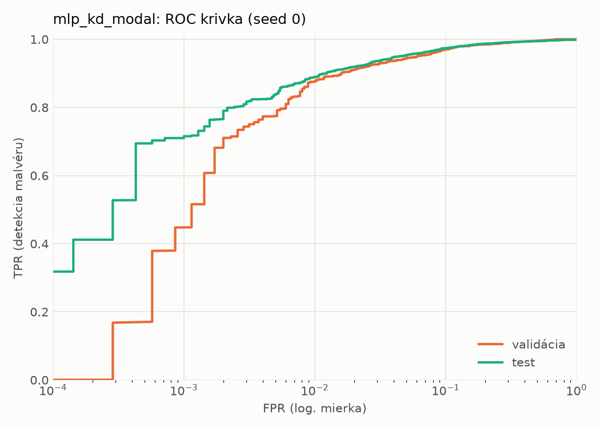
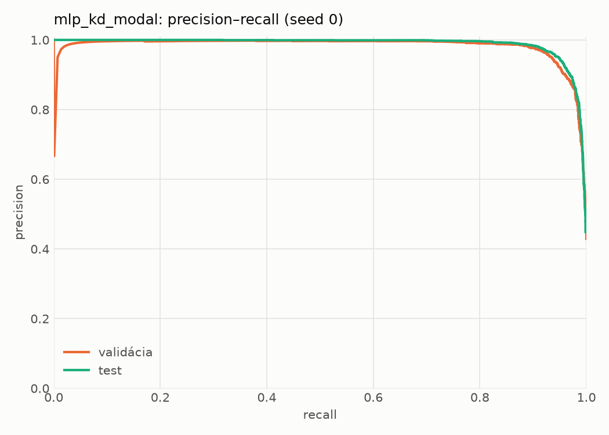
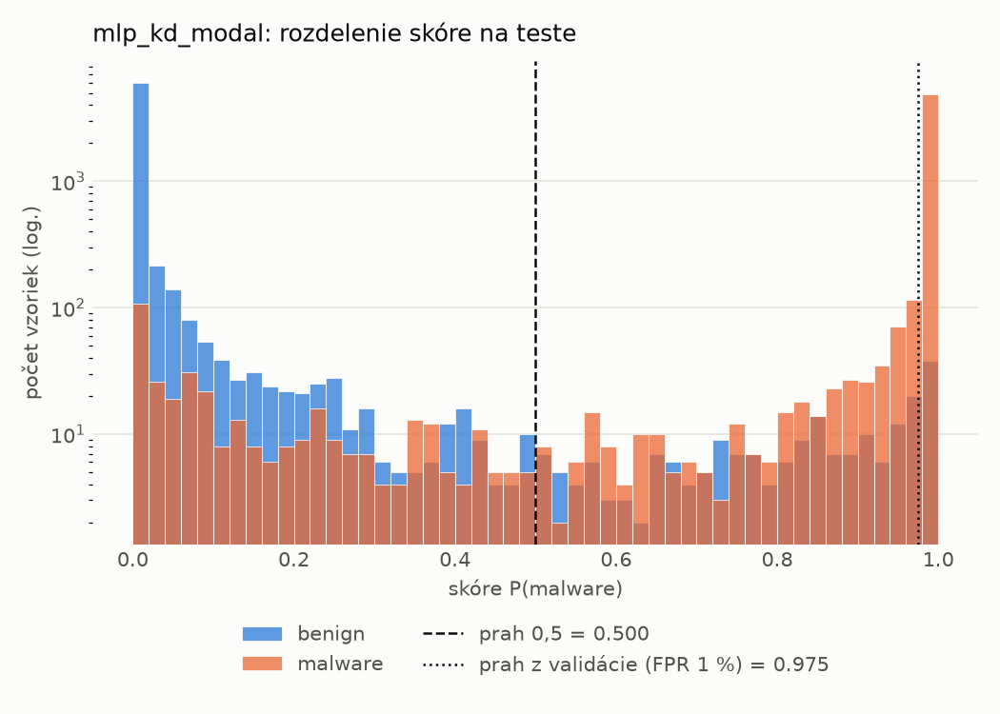
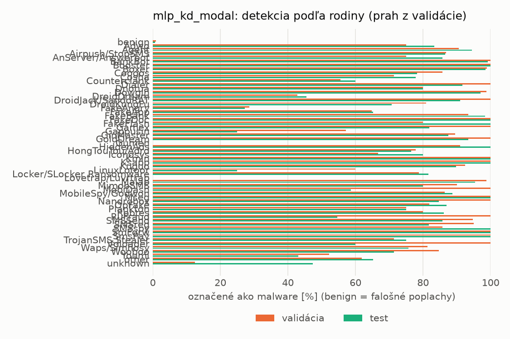
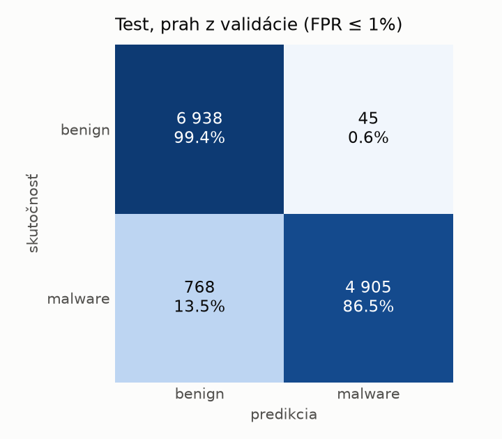
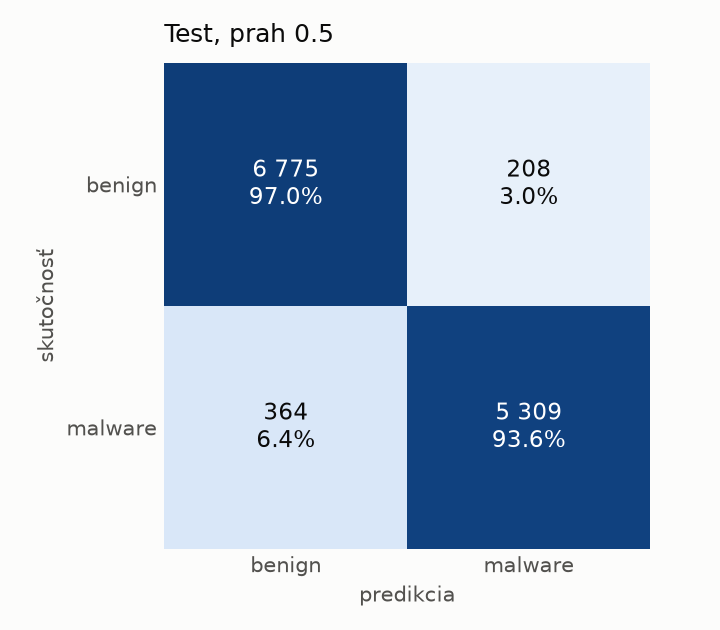
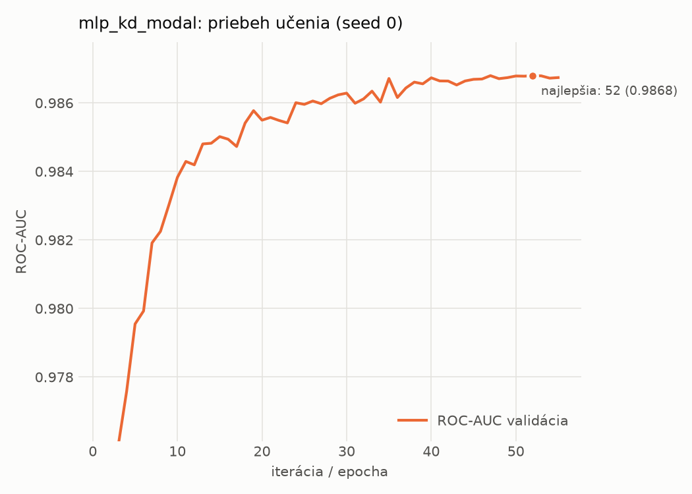

# static/mlp_kd_modal – beh `20261123-185031`

> Automaticky generované (`src/training/run_tabular.py`). Konfigurácia: `config.yaml`, protokol: `protocol.yaml`.

- **Model:** `mlp` – študent – malé MLP učené destiláciou z učiteľa rovnakej modality (variant A)
- **Ladenie:** bez ladenia – hyperparametre prevzaté z `runs_v4/real_p/full/students_static/mlp_kd_modal/20261123-002851`
- **Finálne modely:** seedy [0, 1, 2]; hodnoty sú priemer ± smerodajná odchýlka cez seedy
- **Najlepšie hyperparametre:** `{"hidden_layers": 1, "max_epochs": 100, "patience": 8, "hidden_width": 64, "dropout": 0.037581027791643296, "lr": 0.0019348891318937097, "weight_decay": 9.225533739654786e-05, "batch_size": 512, "kd_alpha": 0.37781550385889523, "kd_temperature": 3.209412682485264}`

## Detekčná kvalita (bez prahu)
| metrika | train (podvzorka) | validácia | test |
|---|---|---|---|
| ROC-AUC | 0.9913 ± 0.0002 | 0.9870 ± 0.0002 | 0.9887 ± 0.0007 |
| PR-AUC | 0.9898 ± 0.0007 | 0.9837 ± 0.0003 | 0.9888 ± 0.0004 |
| TPR pri FPR 1 % | 0.9145 ± 0.0023 | 0.8633 ± 0.0105 | 0.8885 ± 0.0014 |
| TPR pri FPR 0,1 % | 0.7693 ± 0.0176 | 0.5397 ± 0.0854 | 0.6875 ± 0.0259 |
| log loss | 0.1221 ± 0.0007 | 0.1726 ± 0.0011 | 0.1508 ± 0.0052 |
| Brier skóre | 0.0306 ± 0.0006 | 0.0407 ± 0.0002 | 0.0363 ± 0.0004 |

Rozdiel ROC-AUC train − validácia: **0.0043** (veľký rozdiel = preučenie).

## Pri prahu z validácie (FPR ≤ 1% na validácii)
| metrika | train (podvzorka) | validácia | test |
|---|---|---|---|
| accuracy | 0.9428 ± 0.0028 | 0.9358 ± 0.0046 | 0.9325 ± 0.0029 |
| balanced accuracy | 0.9327 ± 0.0034 | 0.9268 ± 0.0053 | 0.9255 ± 0.0032 |
| precision | 0.9941 ± 0.0007 | 0.9853 ± 0.0004 | 0.9904 ± 0.0005 |
| recall (TPR) | 0.8692 ± 0.0070 | 0.8633 ± 0.0105 | 0.8577 ± 0.0061 |
| FPR | 0.0037 ± 0.0004 | 0.0096 ± 0.0002 | 0.0067 ± 0.0003 |
| F1 | 0.9274 ± 0.0038 | 0.9203 ± 0.0061 | 0.9193 ± 0.0037 |
| MCC | 0.8860 ± 0.0053 | 0.8723 ± 0.0088 | 0.8684 ± 0.0054 |

## Pri pevnom prahu 0.5
| metrika | train (podvzorka) | validácia | test |
|---|---|---|---|
| accuracy | 0.9609 ± 0.0012 | 0.9503 ± 0.0003 | 0.9548 ± 0.0001 |
| balanced accuracy | 0.9580 ± 0.0010 | 0.9485 ± 0.0002 | 0.9531 ± 0.0001 |
| precision | 0.9666 ± 0.0026 | 0.9476 ± 0.0008 | 0.9606 ± 0.0015 |
| recall (TPR) | 0.9396 ± 0.0004 | 0.9358 ± 0.0002 | 0.9375 ± 0.0015 |
| FPR | 0.0236 ± 0.0019 | 0.0389 ± 0.0007 | 0.0312 ± 0.0012 |
| F1 | 0.9529 ± 0.0013 | 0.9417 ± 0.0003 | 0.9489 ± 0.0001 |
| MCC | 0.9198 ± 0.0024 | 0.8984 ± 0.0006 | 0.9085 ± 0.0002 |

## Výpočtové nároky (seed 0, testovacia množina)
| meranie | hodnota |
|---|---|
| tréning finálneho modelu | 6.8 s (priemer cez seedy) |
| ladenie spolu | 0 s |
| počet parametrov / uzlov | 10 689 |
| veľkosť modelu na disku | 0.05 MB |
| transformácia vstupu – latencia (1 vlákno) | 0.015 ms |
| transformácia vstupu – priepustnosť | 725 098 vzoriek/s |
| CPU latencia modelu (batch 1, 1 vlákno) | 0.155 ms (p95 0.166) |
| CPU priepustnosť (24 vlákien) | 4 193 923 vzoriek/s |
| GPU latencia (batch 1) | 0.461 ms (p95 0.525) |
| GPU priepustnosť | 3 950 926 vzoriek/s |
| GPU špičková pamäť | 62 MB |

## Grafy
| | |
|---|---|
|  |  |
|  |  |
|  |  |
|  |  |

## Súbory
`metrics.json` (všetky metriky po seedoch vrátane rodín), `timing.json`, `hpo_trials.csv`,
`predictions/<časť>_seed<N>.parquet` (sha256, family, label, score), `model/seed_<N>/`, `log.txt`.
