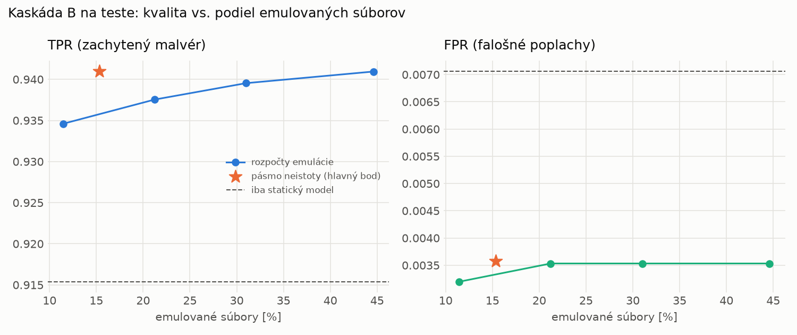

# Kaskáda B `b_baselines` – beh `20261123-190513`

> Generované `src/cascade/evaluate_b.py` (2026-11-23T19:05:13+01:00). Seedy: [0, 1, 2]; hodnoty = priemer ± sm. odchýlka.
> Všetky prahy a pásmo neistoty sú z validácie; test sa na nič nenastavuje. Postup: `docs/09_plan_v2.md`.

| rola | beh |
|---|---|
| static | `runs_v4/real_p/lofo/Locker_SLocker_Ransomware/static/lightgbm/20261123-185406` |
| dynamic | `runs_v4/real_p/lofo/Locker_SLocker_Ransomware/dynamic/lightgbm/20261123-185604` |
| hybrid | `runs_v4/real_p/lofo/Locker_SLocker_Ransomware/hybrid/lightgbm/20261123-185825` |

Druhý stupeň: **dynamic**. Pásmo neistoty statického modelu: FPR ≤ 0.1% nad `hi`,
najviac 1% malvéru validácie pod `lo` (seed 0: lo = 0.0110, hi = 0.9951, seed 1: lo = 0.0110, hi = 0.9933, seed 2: lo = 0.0006, hi = 0.9998).

## Test
| prístup | accuracy | balanced_accuracy | precision | recall_tpr | fpr | f1 | mcc |
|---|---|---|---|---|---|---|---|
| kaskáda B | 0.9716 ± 0.0007 | 0.9687 ± 0.0007 | 0.9953 ± 0.0002 | 0.9410 ± 0.0013 | 0.0036 ± 0.0001 | 0.9674 ± 0.0008 | 0.9434 ± 0.0013 |
| statický | 0.9582 ± 0.0014 | 0.9542 ± 0.0015 | 0.9906 ± 0.0003 | 0.9154 ± 0.0028 | 0.0071 ± 0.0002 | 0.9515 ± 0.0017 | 0.9170 ± 0.0027 |
| dynamický | 0.9201 ± 0.0024 | 0.9118 ± 0.0028 | 0.9879 ± 0.0013 | 0.8318 ± 0.0065 | 0.0083 ± 0.0009 | 0.9032 ± 0.0033 | 0.8449 ± 0.0042 |
| hybrid (každá vzorka) | 0.9743 ± 0.0006 | 0.9722 ± 0.0006 | 0.9911 ± 0.0006 | 0.9513 ± 0.0009 | 0.0070 ± 0.0004 | 0.9708 ± 0.0007 | 0.9485 ± 0.0011 |

- **emulované súbory: 15.34%** (ostatné rozhodne iba statický model); na hybrid ide 3.58% súborov
- chyby pri istom rozhodnutí statického modelu (seed 0): 128
- validácia: emulované 13.63%, na hybrid 2.95%

## Validácia
| prístup | accuracy | balanced_accuracy | precision | recall_tpr | fpr | f1 | mcc |
|---|---|---|---|---|---|---|---|
| kaskáda B | 0.9821 ± 0.0004 | 0.9802 ± 0.0004 | 0.9925 ± 0.0002 | 0.9659 ± 0.0006 | 0.0055 ± 0.0002 | 0.9790 ± 0.0004 | 0.9636 ± 0.0008 |
| statický | 0.9707 ± 0.0014 | 0.9677 ± 0.0016 | 0.9867 ± 0.0000 | 0.9451 ± 0.0031 | 0.0097 ± 0.0000 | 0.9654 ± 0.0017 | 0.9407 ± 0.0027 |
| dynamický | 0.9300 ± 0.0023 | 0.9206 ± 0.0027 | 0.9854 ± 0.0002 | 0.8509 ± 0.0056 | 0.0096 ± 0.0002 | 0.9132 ± 0.0032 | 0.8615 ± 0.0044 |
| hybrid (každá vzorka) | 0.9823 ± 0.0006 | 0.9810 ± 0.0006 | 0.9874 ± 0.0004 | 0.9715 ± 0.0010 | 0.0095 ± 0.0003 | 0.9794 ± 0.0007 | 0.9640 ± 0.0012 |

## Januárové vzorky vynechanej rodiny (iba malvér → TPR)
| prístup | TPR |
|---|---|
| kaskáda B | 0.3627 ± 0.0011 |
| statický | 0.3239 ± 0.0049 |
| dynamický | 0.5204 ± 0.0140 |
| hybrid (každá vzorka) | 0.5070 ± 0.0749 |

Podiel emulovaných: 37.17%

## Krivka rozpočtu emulácie (test, priemer cez seedy)
| budget_val | emulation_rate | hybrid_rate | recall_tpr | fpr | f1 |
|---|---|---|---|---|---|
| 0.1000 | 0.1146 | 0.0381 | 0.9346 | 0.0032 | 0.9642 |
| 0.2000 | 0.2123 | 0.0529 | 0.9375 | 0.0035 | 0.9656 |
| 0.3000 | 0.3101 | 0.0615 | 0.9395 | 0.0035 | 0.9667 |
| 0.4000 | 0.4460 | 0.0724 | 0.9409 | 0.0035 | 0.9674 |

## Výpočtové nároky
Čas dynamickej analýzy (beh v emulátore alebo na zariadení) dataset neuvádza, preto sa neodhaduje. Úspora kaskády B = podiel súborov s dynamickou analýzou: **15.34%** (ostatné prístupy 100 %).

_Chýba benchmark niektorého komponentu (v zero-day behoch sa nemeria)._

