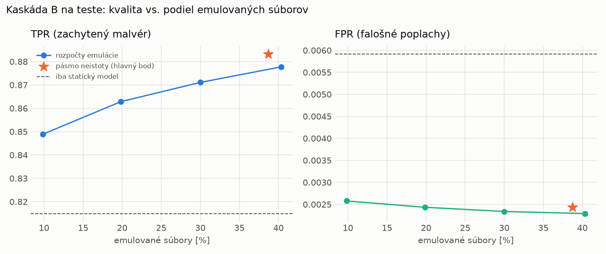

# Kaskáda B `b_heavy` – beh `20261123-190511`

> Generované `src/cascade/evaluate_b.py` (2026-11-23T19:05:11+01:00). Seedy: [0, 1, 2]; hodnoty = priemer ± sm. odchýlka.
> Všetky prahy a pásmo neistoty sú z validácie; test sa na nič nenastavuje. Postup: `docs/09_plan_v2.md`.

| rola | beh |
|---|---|
| static | `runs_v4/real_p/lofo/Locker_SLocker_Ransomware/students_static/mlp_kd/20261123-190146` |
| dynamic | `runs_v4/real_p/lofo/Locker_SLocker_Ransomware/students_dynamic/mlp_kd/20261123-190303` |
| hybrid | `runs_v4/real_p/lofo/Locker_SLocker_Ransomware/hybrid/mlp_large/20261123-185848` |

Druhý stupeň: **dynamic**. Pásmo neistoty statického modelu: FPR ≤ 0.1% nad `hi`,
najviac 1% malvéru validácie pod `lo` (seed 0: lo = 0.0054, hi = 0.9999, seed 1: lo = 0.0043, hi = 1.0000, seed 2: lo = 0.0039, hi = 1.0000).

## Test
| prístup | accuracy | balanced_accuracy | precision | recall_tpr | fpr | f1 | mcc |
|---|---|---|---|---|---|---|---|
| kaskáda B | 0.9463 ± 0.0053 | 0.9404 ± 0.0060 | 0.9966 ± 0.0007 | 0.8833 ± 0.0124 | 0.0024 ± 0.0005 | 0.9365 ± 0.0067 | 0.8953 ± 0.0100 |
| statický | 0.9138 ± 0.0061 | 0.9045 ± 0.0069 | 0.9912 ± 0.0024 | 0.8149 ± 0.0155 | 0.0059 ± 0.0017 | 0.8944 ± 0.0085 | 0.8340 ± 0.0106 |
| dynamický | 0.8628 ± 0.0033 | 0.8479 ± 0.0038 | 0.9855 ± 0.0017 | 0.7043 ± 0.0086 | 0.0084 ± 0.0011 | 0.8215 ± 0.0053 | 0.7417 ± 0.0053 |
| hybrid (každá vzorka) | 0.9626 ± 0.0044 | 0.9592 ± 0.0051 | 0.9902 ± 0.0025 | 0.9258 ± 0.0119 | 0.0075 ± 0.0020 | 0.9569 ± 0.0054 | 0.9256 ± 0.0084 |

- **emulované súbory: 38.71%** (ostatné rozhodne iba statický model); na hybrid ide 8.60% súborov
- chyby pri istom rozhodnutí statického modelu (seed 0): 157
- validácia: emulované 38.02%, na hybrid 9.59%

## Validácia
| prístup | accuracy | balanced_accuracy | precision | recall_tpr | fpr | f1 | mcc |
|---|---|---|---|---|---|---|---|
| kaskáda B | 0.9583 ± 0.0040 | 0.9526 ± 0.0046 | 0.9937 ± 0.0002 | 0.9096 ± 0.0094 | 0.0044 ± 0.0002 | 0.9498 ± 0.0051 | 0.9169 ± 0.0077 |
| statický | 0.9196 ± 0.0057 | 0.9087 ± 0.0066 | 0.9848 ± 0.0002 | 0.8271 ± 0.0131 | 0.0097 ± 0.0000 | 0.8991 ± 0.0079 | 0.8419 ± 0.0107 |
| dynamický | 0.8730 ± 0.0041 | 0.8548 ± 0.0047 | 0.9827 ± 0.0005 | 0.7193 ± 0.0092 | 0.0096 ± 0.0002 | 0.8306 ± 0.0063 | 0.7557 ± 0.0075 |
| hybrid (každá vzorka) | 0.9704 ± 0.0053 | 0.9673 ± 0.0061 | 0.9868 ± 0.0001 | 0.9443 ± 0.0124 | 0.0096 ± 0.0002 | 0.9651 ± 0.0065 | 0.9402 ± 0.0105 |

## Januárové vzorky vynechanej rodiny (iba malvér → TPR)
| prístup | TPR |
|---|---|
| kaskáda B | 0.3652 ± 0.1367 |
| statický | 0.2495 ± 0.0049 |
| dynamický | 0.4845 ± 0.0108 |
| hybrid (každá vzorka) | 0.6511 ± 0.0419 |

Podiel emulovaných: 42.13%

## Krivka rozpočtu emulácie (test, priemer cez seedy)
| budget_val | emulation_rate | hybrid_rate | recall_tpr | fpr | f1 |
|---|---|---|---|---|---|
| 0.1000 | 0.0984 | 0.0408 | 0.8489 | 0.0026 | 0.9166 |
| 0.2000 | 0.1984 | 0.0712 | 0.8629 | 0.0024 | 0.9249 |
| 0.3000 | 0.3000 | 0.0877 | 0.8711 | 0.0023 | 0.9296 |
| 0.4000 | 0.4033 | 0.1025 | 0.8777 | 0.0023 | 0.9334 |

## Výpočtové nároky
Čas dynamickej analýzy (beh v emulátore alebo na zariadení) dataset neuvádza, preto sa neodhaduje. Úspora kaskády B = podiel súborov s dynamickou analýzou: **38.71%** (ostatné prístupy 100 %).

_Chýba benchmark niektorého komponentu (v zero-day behoch sa nemeria)._

