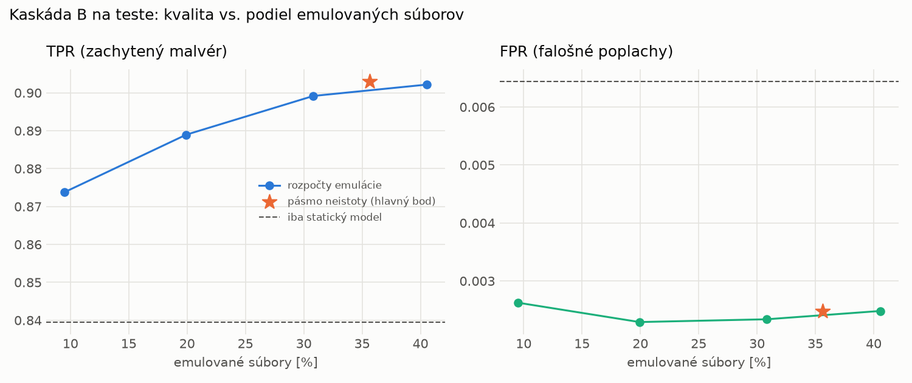

# Kaskáda B `b_heavyteacher` – beh `20261123-190517`

> Generované `src/cascade/evaluate_b.py` (2026-11-23T19:05:17+01:00). Seedy: [0, 1, 2]; hodnoty = priemer ± sm. odchýlka.
> Všetky prahy a pásmo neistoty sú z validácie; test sa na nič nenastavuje. Postup: `docs/09_plan_v2.md`.

| rola | beh |
|---|---|
| static | `runs_v4/real_p/lofo/Locker_SLocker_Ransomware/students_static/mlp_kd_heavy/20261123-190246` |
| dynamic | `runs_v4/real_p/lofo/Locker_SLocker_Ransomware/students_dynamic/mlp_kd_heavy/20261123-190434` |
| hybrid | `runs_v4/real_p/lofo/Locker_SLocker_Ransomware/hybrid/lightgbm/20261123-185825` |

Druhý stupeň: **dynamic**. Pásmo neistoty statického modelu: FPR ≤ 0.1% nad `hi`,
najviac 1% malvéru validácie pod `lo` (seed 0: lo = 0.0397, hi = 0.9992, seed 1: lo = 0.0275, hi = 0.9986, seed 2: lo = 0.0345, hi = 0.9989).

## Test
| prístup | accuracy | balanced_accuracy | precision | recall_tpr | fpr | f1 | mcc |
|---|---|---|---|---|---|---|---|
| kaskáda B | 0.9552 ± 0.0028 | 0.9503 ± 0.0031 | 0.9966 ± 0.0001 | 0.9030 ± 0.0063 | 0.0025 ± 0.0001 | 0.9475 ± 0.0034 | 0.9119 ± 0.0053 |
| statický | 0.9245 ± 0.0024 | 0.9165 ± 0.0027 | 0.9906 ± 0.0007 | 0.8395 ± 0.0056 | 0.0064 ± 0.0005 | 0.9088 ± 0.0032 | 0.8536 ± 0.0044 |
| dynamický | 0.8627 ± 0.0064 | 0.8477 ± 0.0073 | 0.9868 ± 0.0021 | 0.7031 ± 0.0160 | 0.0077 ± 0.0014 | 0.8210 ± 0.0102 | 0.7418 ± 0.0107 |
| hybrid (každá vzorka) | 0.9743 ± 0.0006 | 0.9722 ± 0.0006 | 0.9911 ± 0.0006 | 0.9513 ± 0.0009 | 0.0070 ± 0.0004 | 0.9708 ± 0.0007 | 0.9485 ± 0.0011 |

- **emulované súbory: 35.64%** (ostatné rozhodne iba statický model); na hybrid ide 8.18% súborov
- chyby pri istom rozhodnutí statického modelu (seed 0): 148
- validácia: emulované 34.97%, na hybrid 8.95%

## Validácia
| prístup | accuracy | balanced_accuracy | precision | recall_tpr | fpr | f1 | mcc |
|---|---|---|---|---|---|---|---|
| kaskáda B | 0.9691 ± 0.0022 | 0.9650 ± 0.0025 | 0.9943 ± 0.0008 | 0.9341 ± 0.0050 | 0.0041 ± 0.0006 | 0.9632 ± 0.0027 | 0.9380 ± 0.0043 |
| statický | 0.9352 ± 0.0056 | 0.9266 ± 0.0065 | 0.9856 ± 0.0001 | 0.8629 ± 0.0131 | 0.0096 ± 0.0002 | 0.9201 ± 0.0075 | 0.8714 ± 0.0106 |
| dynamický | 0.8731 ± 0.0060 | 0.8550 ± 0.0070 | 0.9826 ± 0.0003 | 0.7197 ± 0.0139 | 0.0097 ± 0.0000 | 0.8308 ± 0.0094 | 0.7559 ± 0.0110 |
| hybrid (každá vzorka) | 0.9823 ± 0.0006 | 0.9810 ± 0.0006 | 0.9874 ± 0.0004 | 0.9715 ± 0.0010 | 0.0095 ± 0.0003 | 0.9794 ± 0.0007 | 0.9640 ± 0.0012 |

## Januárové vzorky vynechanej rodiny (iba malvér → TPR)
| prístup | TPR |
|---|---|
| kaskáda B | 0.3440 ± 0.0036 |
| statický | 0.3122 ± 0.0248 |
| dynamický | 0.4859 ± 0.0228 |
| hybrid (každá vzorka) | 0.5070 ± 0.0749 |

Podiel emulovaných: 33.97%

## Krivka rozpočtu emulácie (test, priemer cez seedy)
| budget_val | emulation_rate | hybrid_rate | recall_tpr | fpr | f1 |
|---|---|---|---|---|---|
| 0.1000 | 0.0949 | 0.0407 | 0.8738 | 0.0026 | 0.9310 |
| 0.2000 | 0.1992 | 0.0690 | 0.8889 | 0.0023 | 0.9398 |
| 0.3000 | 0.3082 | 0.0845 | 0.8992 | 0.0023 | 0.9455 |
| 0.4000 | 0.4056 | 0.0937 | 0.9022 | 0.0025 | 0.9470 |

## Výpočtové nároky
Čas dynamickej analýzy (beh v emulátore alebo na zariadení) dataset neuvádza, preto sa neodhaduje. Úspora kaskády B = podiel súborov s dynamickou analýzou: **35.64%** (ostatné prístupy 100 %).

_Chýba benchmark niektorého komponentu (v zero-day behoch sa nemeria)._

