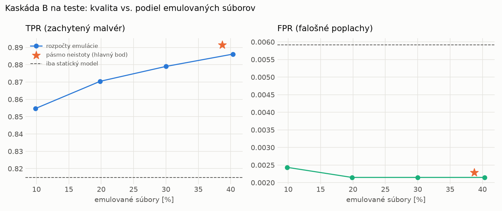

# Kaskáda B `b_main` – beh `20261123-190508`

> Generované `src/cascade/evaluate_b.py` (2026-11-23T19:05:08+01:00). Seedy: [0, 1, 2]; hodnoty = priemer ± sm. odchýlka.
> Všetky prahy a pásmo neistoty sú z validácie; test sa na nič nenastavuje. Postup: `docs/09_plan_v2.md`.

| rola | beh |
|---|---|
| static | `runs_v4/real_p/lofo/Locker_SLocker_Ransomware/students_static/mlp_kd/20261123-190146` |
| dynamic | `runs_v4/real_p/lofo/Locker_SLocker_Ransomware/students_dynamic/mlp_kd/20261123-190303` |
| hybrid | `runs_v4/real_p/lofo/Locker_SLocker_Ransomware/hybrid/lightgbm/20261123-185825` |

Druhý stupeň: **dynamic**. Pásmo neistoty statického modelu: FPR ≤ 0.1% nad `hi`,
najviac 1% malvéru validácie pod `lo` (seed 0: lo = 0.0054, hi = 0.9999, seed 1: lo = 0.0043, hi = 1.0000, seed 2: lo = 0.0039, hi = 1.0000).

## Test
| prístup | accuracy | balanced_accuracy | precision | recall_tpr | fpr | f1 | mcc |
|---|---|---|---|---|---|---|---|
| kaskáda B | 0.9501 ± 0.0042 | 0.9446 ± 0.0047 | 0.9969 ± 0.0009 | 0.8915 ± 0.0101 | 0.0023 ± 0.0007 | 0.9412 ± 0.0052 | 0.9024 ± 0.0077 |
| statický | 0.9138 ± 0.0061 | 0.9045 ± 0.0069 | 0.9912 ± 0.0024 | 0.8149 ± 0.0155 | 0.0059 ± 0.0017 | 0.8944 ± 0.0085 | 0.8340 ± 0.0106 |
| dynamický | 0.8628 ± 0.0033 | 0.8479 ± 0.0038 | 0.9855 ± 0.0017 | 0.7043 ± 0.0086 | 0.0084 ± 0.0011 | 0.8215 ± 0.0053 | 0.7417 ± 0.0053 |
| hybrid (každá vzorka) | 0.9743 ± 0.0006 | 0.9722 ± 0.0006 | 0.9911 ± 0.0006 | 0.9513 ± 0.0009 | 0.0070 ± 0.0004 | 0.9708 ± 0.0007 | 0.9485 ± 0.0011 |

- **emulované súbory: 38.71%** (ostatné rozhodne iba statický model); na hybrid ide 8.60% súborov
- chyby pri istom rozhodnutí statického modelu (seed 0): 157
- validácia: emulované 38.02%, na hybrid 9.59%

## Validácia
| prístup | accuracy | balanced_accuracy | precision | recall_tpr | fpr | f1 | mcc |
|---|---|---|---|---|---|---|---|
| kaskáda B | 0.9628 ± 0.0030 | 0.9576 ± 0.0036 | 0.9951 ± 0.0014 | 0.9186 ± 0.0080 | 0.0034 ± 0.0010 | 0.9553 ± 0.0038 | 0.9257 ± 0.0057 |
| statický | 0.9196 ± 0.0057 | 0.9087 ± 0.0066 | 0.9848 ± 0.0002 | 0.8271 ± 0.0131 | 0.0097 ± 0.0000 | 0.8991 ± 0.0079 | 0.8419 ± 0.0107 |
| dynamický | 0.8730 ± 0.0041 | 0.8548 ± 0.0047 | 0.9827 ± 0.0005 | 0.7193 ± 0.0092 | 0.0096 ± 0.0002 | 0.8306 ± 0.0063 | 0.7557 ± 0.0075 |
| hybrid (každá vzorka) | 0.9823 ± 0.0006 | 0.9810 ± 0.0006 | 0.9874 ± 0.0004 | 0.9715 ± 0.0010 | 0.0095 ± 0.0003 | 0.9794 ± 0.0007 | 0.9640 ± 0.0012 |

## Januárové vzorky vynechanej rodiny (iba malvér → TPR)
| prístup | TPR |
|---|---|
| kaskáda B | 0.3034 ± 0.0302 |
| statický | 0.2495 ± 0.0049 |
| dynamický | 0.4845 ± 0.0108 |
| hybrid (každá vzorka) | 0.5070 ± 0.0749 |

Podiel emulovaných: 42.13%

## Krivka rozpočtu emulácie (test, priemer cez seedy)
| budget_val | emulation_rate | hybrid_rate | recall_tpr | fpr | f1 |
|---|---|---|---|---|---|
| 0.1000 | 0.0984 | 0.0408 | 0.8547 | 0.0024 | 0.9201 |
| 0.2000 | 0.1984 | 0.0712 | 0.8704 | 0.0021 | 0.9294 |
| 0.3000 | 0.3000 | 0.0877 | 0.8790 | 0.0021 | 0.9343 |
| 0.4000 | 0.4033 | 0.1025 | 0.8861 | 0.0021 | 0.9383 |

## Výpočtové nároky
Čas dynamickej analýzy (beh v emulátore alebo na zariadení) dataset neuvádza, preto sa neodhaduje. Úspora kaskády B = podiel súborov s dynamickou analýzou: **38.71%** (ostatné prístupy 100 %).

_Chýba benchmark niektorého komponentu (v zero-day behoch sa nemeria)._

