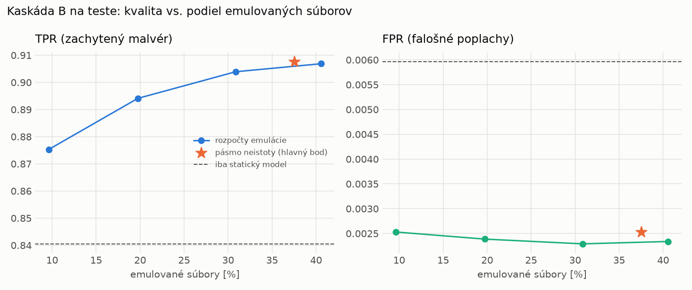

# Kaskáda B `b_nokd` – beh `20261123-190515`

> Generované `src/cascade/evaluate_b.py` (2026-11-23T19:05:15+01:00). Seedy: [0, 1, 2]; hodnoty = priemer ± sm. odchýlka.
> Všetky prahy a pásmo neistoty sú z validácie; test sa na nič nenastavuje. Postup: `docs/09_plan_v2.md`.

| rola | beh |
|---|---|
| static | `runs_v4/real_p/lofo/Locker_SLocker_Ransomware/students_static/mlp_nokd/20261123-190201` |
| dynamic | `runs_v4/real_p/lofo/Locker_SLocker_Ransomware/students_dynamic/mlp_nokd/20261123-190320` |
| hybrid | `runs_v4/real_p/lofo/Locker_SLocker_Ransomware/hybrid/lightgbm/20261123-185825` |

Druhý stupeň: **dynamic**. Pásmo neistoty statického modelu: FPR ≤ 0.1% nad `hi`,
najviac 1% malvéru validácie pod `lo` (seed 0: lo = 0.0306, hi = 0.9988, seed 1: lo = 0.0322, hi = 0.9998, seed 2: lo = 0.0322, hi = 0.9994).

## Test
| prístup | accuracy | balanced_accuracy | precision | recall_tpr | fpr | f1 | mcc |
|---|---|---|---|---|---|---|---|
| kaskáda B | 0.9572 ± 0.0011 | 0.9526 ± 0.0013 | 0.9966 ± 0.0004 | 0.9077 ± 0.0028 | 0.0025 ± 0.0003 | 0.9501 ± 0.0014 | 0.9158 ± 0.0020 |
| statický | 0.9252 ± 0.0028 | 0.9173 ± 0.0032 | 0.9913 ± 0.0007 | 0.8405 ± 0.0070 | 0.0060 ± 0.0005 | 0.9097 ± 0.0038 | 0.8551 ± 0.0051 |
| dynamický | 0.8650 ± 0.0023 | 0.8503 ± 0.0025 | 0.9875 ± 0.0010 | 0.7079 ± 0.0045 | 0.0073 ± 0.0006 | 0.8246 ± 0.0034 | 0.7461 ± 0.0043 |
| hybrid (každá vzorka) | 0.9743 ± 0.0006 | 0.9722 ± 0.0006 | 0.9911 ± 0.0006 | 0.9513 ± 0.0009 | 0.0070 ± 0.0004 | 0.9708 ± 0.0007 | 0.9485 ± 0.0011 |

- **emulované súbory: 37.52%** (ostatné rozhodne iba statický model); na hybrid ide 8.26% súborov
- chyby pri istom rozhodnutí statického modelu (seed 0): 156
- validácia: emulované 37.15%, na hybrid 8.83%

## Validácia
| prístup | accuracy | balanced_accuracy | precision | recall_tpr | fpr | f1 | mcc |
|---|---|---|---|---|---|---|---|
| kaskáda B | 0.9691 ± 0.0009 | 0.9650 ± 0.0010 | 0.9932 ± 0.0007 | 0.9350 ± 0.0017 | 0.0049 ± 0.0005 | 0.9632 ± 0.0011 | 0.9378 ± 0.0019 |
| statický | 0.9338 ± 0.0061 | 0.9250 ± 0.0070 | 0.9855 ± 0.0005 | 0.8597 ± 0.0139 | 0.0096 ± 0.0002 | 0.9183 ± 0.0082 | 0.8687 ± 0.0117 |
| dynamický | 0.8767 ± 0.0033 | 0.8592 ± 0.0038 | 0.9828 ± 0.0002 | 0.7281 ± 0.0075 | 0.0097 ± 0.0000 | 0.8365 ± 0.0050 | 0.7625 ± 0.0059 |
| hybrid (každá vzorka) | 0.9823 ± 0.0006 | 0.9810 ± 0.0006 | 0.9874 ± 0.0004 | 0.9715 ± 0.0010 | 0.0095 ± 0.0003 | 0.9794 ± 0.0007 | 0.9640 ± 0.0012 |

## Januárové vzorky vynechanej rodiny (iba malvér → TPR)
| prístup | TPR |
|---|---|
| kaskáda B | 0.3401 ± 0.0085 |
| statický | 0.3197 ± 0.0089 |
| dynamický | 0.4767 ± 0.0066 |
| hybrid (každá vzorka) | 0.5070 ± 0.0749 |

Podiel emulovaných: 31.78%

## Krivka rozpočtu emulácie (test, priemer cez seedy)
| budget_val | emulation_rate | hybrid_rate | recall_tpr | fpr | f1 |
|---|---|---|---|---|---|
| 0.1000 | 0.0962 | 0.0415 | 0.8753 | 0.0025 | 0.9320 |
| 0.2000 | 0.1974 | 0.0686 | 0.8941 | 0.0024 | 0.9426 |
| 0.3000 | 0.3087 | 0.0830 | 0.9039 | 0.0023 | 0.9481 |
| 0.4000 | 0.4055 | 0.0912 | 0.9069 | 0.0023 | 0.9497 |

## Výpočtové nároky
Čas dynamickej analýzy (beh v emulátore alebo na zariadení) dataset neuvádza, preto sa neodhaduje. Úspora kaskády B = podiel súborov s dynamickou analýzou: **37.52%** (ostatné prístupy 100 %).

_Chýba benchmark niektorého komponentu (v zero-day behoch sa nemeria)._

