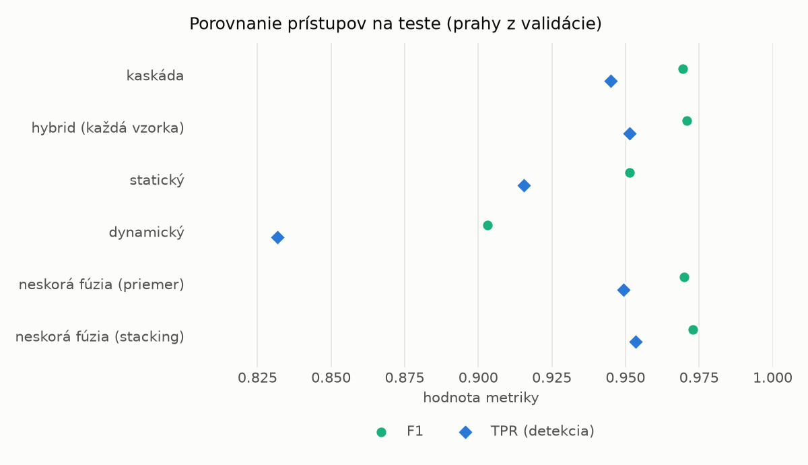
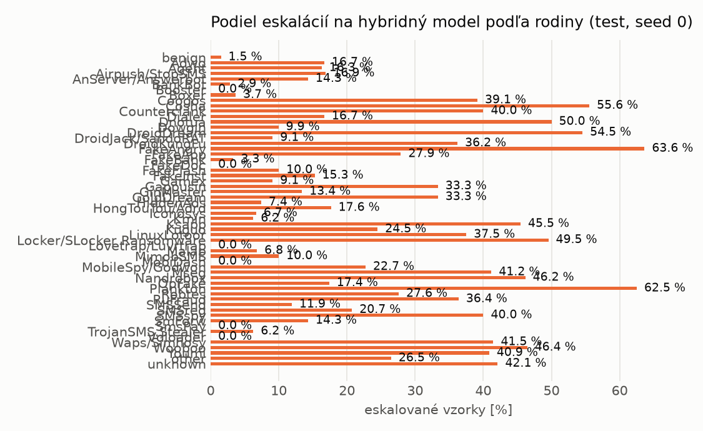

# Kaskáda `baselines` – beh `20261123-190503`

> Generované `src/cascade/evaluate.py` (2026-11-23T19:05:04+01:00). Seedy: [0, 1, 2]; hodnoty = priemer ± sm. odchýlka.
> Všetky prahy sú určené na validácii (FPR ≤ 1 %); test sa na nič nenastavuje.

| rola | beh |
|---|---|
| static | `runs_v4/real_p/lofo/Locker_SLocker_Ransomware/static/lightgbm/20261123-185406` |
| dynamic | `runs_v4/real_p/lofo/Locker_SLocker_Ransomware/dynamic/lightgbm/20261123-185604` |
| hybrid | `runs_v4/real_p/lofo/Locker_SLocker_Ransomware/hybrid/lightgbm/20261123-185825` |

## Test
| prístup | accuracy | balanced_accuracy | precision | recall_tpr | fpr | f1 | mcc |
|---|---|---|---|---|---|---|---|
| kaskáda | 0.9734 ± 0.0006 | 0.9707 ± 0.0006 | 0.9954 ± 0.0001 | 0.9449 ± 0.0012 | 0.0035 ± 0.0001 | 0.9695 ± 0.0007 | 0.9469 ± 0.0011 |
| hybrid (každá vzorka) | 0.9743 ± 0.0006 | 0.9722 ± 0.0006 | 0.9911 ± 0.0006 | 0.9513 ± 0.0009 | 0.0070 ± 0.0004 | 0.9708 ± 0.0007 | 0.9485 ± 0.0011 |
| statický | 0.9582 ± 0.0014 | 0.9542 ± 0.0015 | 0.9906 ± 0.0003 | 0.9154 ± 0.0028 | 0.0071 ± 0.0002 | 0.9515 ± 0.0017 | 0.9170 ± 0.0027 |
| dynamický | 0.9201 ± 0.0024 | 0.9118 ± 0.0028 | 0.9879 ± 0.0013 | 0.8318 ± 0.0065 | 0.0083 ± 0.0009 | 0.9032 ± 0.0033 | 0.8449 ± 0.0042 |
| neskorá fúzia (priemer) | 0.9737 ± 0.0014 | 0.9714 ± 0.0013 | 0.9915 ± 0.0028 | 0.9494 ± 0.0006 | 0.0066 ± 0.0022 | 0.9700 ± 0.0016 | 0.9472 ± 0.0029 |
| neskorá fúzia (stacking) | 0.9762 ± 0.0002 | 0.9741 ± 0.0003 | 0.9931 ± 0.0005 | 0.9535 ± 0.0010 | 0.0054 ± 0.0004 | 0.9729 ± 0.0003 | 0.9523 ± 0.0005 |

## Validácia
| prístup | accuracy | balanced_accuracy | precision | recall_tpr | fpr | f1 | mcc |
|---|---|---|---|---|---|---|---|
| kaskáda | 0.9827 ± 0.0008 | 0.9808 ± 0.0008 | 0.9928 ± 0.0005 | 0.9670 ± 0.0013 | 0.0054 ± 0.0003 | 0.9797 ± 0.0009 | 0.9648 ± 0.0015 |
| hybrid (každá vzorka) | 0.9823 ± 0.0006 | 0.9810 ± 0.0006 | 0.9874 ± 0.0004 | 0.9715 ± 0.0010 | 0.0095 ± 0.0003 | 0.9794 ± 0.0007 | 0.9640 ± 0.0012 |
| statický | 0.9707 ± 0.0014 | 0.9677 ± 0.0016 | 0.9867 ± 0.0000 | 0.9451 ± 0.0031 | 0.0097 ± 0.0000 | 0.9654 ± 0.0017 | 0.9407 ± 0.0027 |
| dynamický | 0.9300 ± 0.0023 | 0.9206 ± 0.0027 | 0.9854 ± 0.0002 | 0.8509 ± 0.0056 | 0.0096 ± 0.0002 | 0.9132 ± 0.0032 | 0.8615 ± 0.0044 |
| neskorá fúzia (priemer) | 0.9833 ± 0.0011 | 0.9822 ± 0.0012 | 0.9872 ± 0.0002 | 0.9741 ± 0.0025 | 0.0096 ± 0.0002 | 0.9806 ± 0.0013 | 0.9660 ± 0.0022 |
| neskorá fúzia (stacking) | 0.9846 ± 0.0002 | 0.9837 ± 0.0002 | 0.9871 ± 0.0000 | 0.9772 ± 0.0004 | 0.0097 ± 0.0000 | 0.9821 ± 0.0002 | 0.9687 ± 0.0004 |

## Správanie kaskády (test, seed 0)
- podiel eskalácií na hybrid: **8.64%** (1094 vzoriek)
- chyby pri zhode študentov (kaskáda ich nemôže opraviť): **210**
  (1.816% zo zhôd; FP 4, FN 206)
- úspešnosť na eskalovaných vzorkách: hybrid 0.8912248628884827, statický 0.7084095063985375,
  dynamický 0.2915904936014625  → prínos hybridu pri nezhode

## Výpočtové nároky (odhad z benchmarkov komponentov)
_Chýba benchmark niektorého komponentu (`python -m src.evaluation.benchmark`)._

