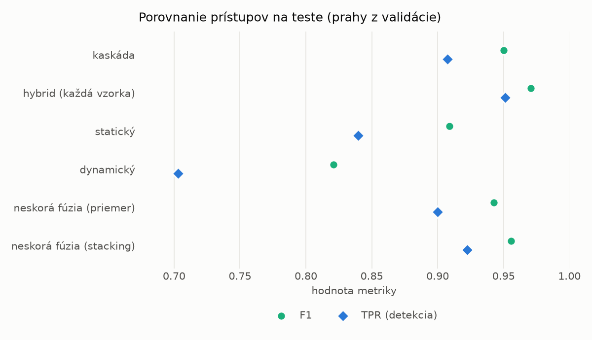
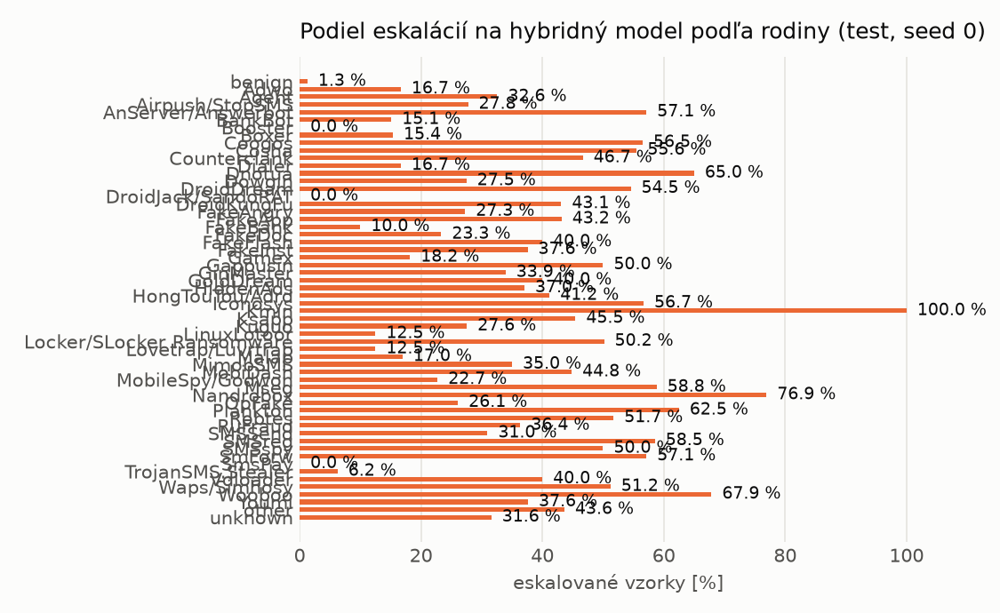

# Kaskáda `heavyteacher` – beh `20261123-190505`

> Generované `src/cascade/evaluate.py` (2026-11-23T19:05:06+01:00). Seedy: [0, 1, 2]; hodnoty = priemer ± sm. odchýlka.
> Všetky prahy sú určené na validácii (FPR ≤ 1 %); test sa na nič nenastavuje.

| rola | beh |
|---|---|
| static | `runs_v4/real_p/lofo/Locker_SLocker_Ransomware/students_static/mlp_kd_heavy/20261123-190246` |
| dynamic | `runs_v4/real_p/lofo/Locker_SLocker_Ransomware/students_dynamic/mlp_kd_heavy/20261123-190434` |
| hybrid | `runs_v4/real_p/lofo/Locker_SLocker_Ransomware/hybrid/lightgbm/20261123-185825` |

## Test
| prístup | accuracy | balanced_accuracy | precision | recall_tpr | fpr | f1 | mcc |
|---|---|---|---|---|---|---|---|
| kaskáda | 0.9572 ± 0.0025 | 0.9526 ± 0.0028 | 0.9967 ± 0.0002 | 0.9076 ± 0.0057 | 0.0024 ± 0.0001 | 0.9500 ± 0.0031 | 0.9159 ± 0.0048 |
| hybrid (každá vzorka) | 0.9743 ± 0.0006 | 0.9722 ± 0.0006 | 0.9911 ± 0.0006 | 0.9513 ± 0.0009 | 0.0070 ± 0.0004 | 0.9708 ± 0.0007 | 0.9485 ± 0.0011 |
| statický | 0.9245 ± 0.0024 | 0.9165 ± 0.0027 | 0.9906 ± 0.0007 | 0.8395 ± 0.0056 | 0.0064 ± 0.0005 | 0.9088 ± 0.0032 | 0.8536 ± 0.0044 |
| dynamický | 0.8627 ± 0.0064 | 0.8477 ± 0.0073 | 0.9868 ± 0.0021 | 0.7031 ± 0.0160 | 0.0077 ± 0.0014 | 0.8210 ± 0.0102 | 0.7418 ± 0.0107 |
| neskorá fúzia (priemer) | 0.9510 ± 0.0045 | 0.9462 ± 0.0053 | 0.9898 ± 0.0021 | 0.8999 ± 0.0122 | 0.0075 ± 0.0017 | 0.9427 ± 0.0057 | 0.9032 ± 0.0085 |
| neskorá fúzia (stacking) | 0.9617 ± 0.0022 | 0.9580 ± 0.0025 | 0.9916 ± 0.0012 | 0.9224 ± 0.0057 | 0.0063 ± 0.0009 | 0.9558 ± 0.0026 | 0.9240 ± 0.0041 |

## Validácia
| prístup | accuracy | balanced_accuracy | precision | recall_tpr | fpr | f1 | mcc |
|---|---|---|---|---|---|---|---|
| kaskáda | 0.9698 ± 0.0022 | 0.9658 ± 0.0025 | 0.9944 ± 0.0008 | 0.9356 ± 0.0048 | 0.0040 ± 0.0006 | 0.9641 ± 0.0027 | 0.9394 ± 0.0043 |
| hybrid (každá vzorka) | 0.9823 ± 0.0006 | 0.9810 ± 0.0006 | 0.9874 ± 0.0004 | 0.9715 ± 0.0010 | 0.0095 ± 0.0003 | 0.9794 ± 0.0007 | 0.9640 ± 0.0012 |
| statický | 0.9352 ± 0.0056 | 0.9266 ± 0.0065 | 0.9856 ± 0.0001 | 0.8629 ± 0.0131 | 0.0096 ± 0.0002 | 0.9201 ± 0.0075 | 0.8714 ± 0.0106 |
| dynamický | 0.8731 ± 0.0060 | 0.8550 ± 0.0070 | 0.9826 ± 0.0003 | 0.7197 ± 0.0139 | 0.0097 ± 0.0000 | 0.8308 ± 0.0094 | 0.7559 ± 0.0110 |
| neskorá fúzia (priemer) | 0.9602 ± 0.0056 | 0.9555 ± 0.0065 | 0.9863 ± 0.0002 | 0.9208 ± 0.0129 | 0.0097 ± 0.0000 | 0.9524 ± 0.0070 | 0.9199 ± 0.0110 |
| neskorá fúzia (stacking) | 0.9698 ± 0.0018 | 0.9665 ± 0.0022 | 0.9873 ± 0.0005 | 0.9423 ± 0.0047 | 0.0093 ± 0.0004 | 0.9643 ± 0.0023 | 0.9389 ± 0.0036 |

## Správanie kaskády (test, seed 0)
- podiel eskalácií na hybrid: **14.37%** (1819 vzoriek)
- chyby pri zhode študentov (kaskáda ich nemôže opraviť): **477**
  (4.402% zo zhôd; FP 1, FN 476)
- úspešnosť na eskalovaných vzorkách: hybrid 0.9642660802638813, statický 0.7361187465640462,
  dynamický 0.2638812534359538  → prínos hybridu pri nezhode

## Výpočtové nároky (odhad z benchmarkov komponentov)
_Chýba benchmark niektorého komponentu (`python -m src.evaluation.benchmark`)._

