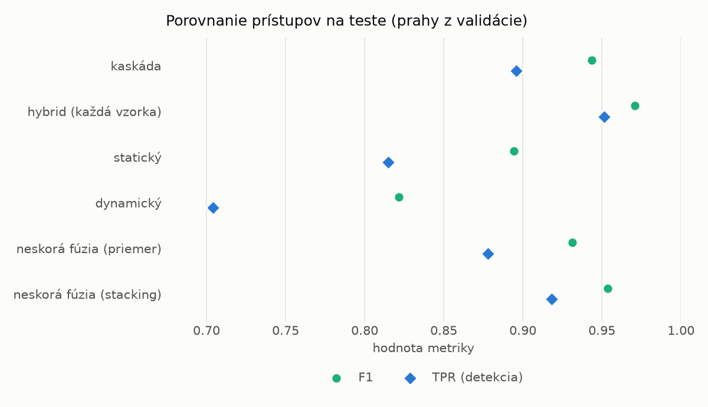
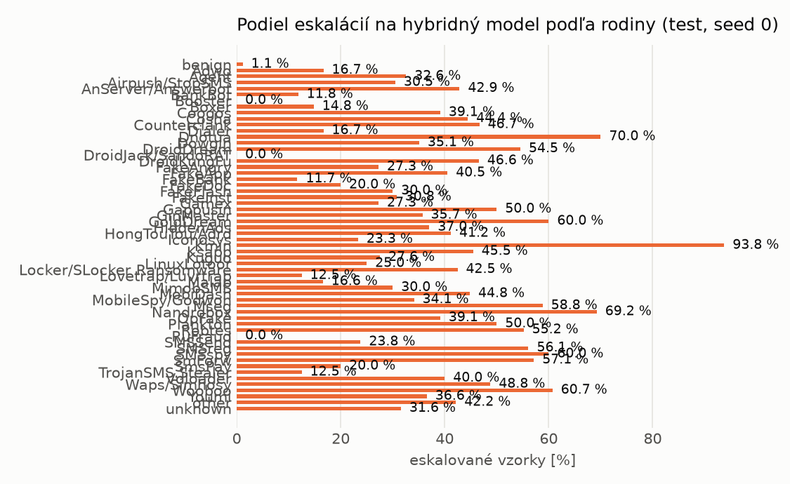

# Kaskáda `main` – beh `20261123-190454`

> Generované `src/cascade/evaluate.py` (2026-11-23T19:04:55+01:00). Seedy: [0, 1, 2]; hodnoty = priemer ± sm. odchýlka.
> Všetky prahy sú určené na validácii (FPR ≤ 1 %); test sa na nič nenastavuje.

| rola | beh |
|---|---|
| static | `runs_v4/real_p/lofo/Locker_SLocker_Ransomware/students_static/mlp_kd/20261123-190146` |
| dynamic | `runs_v4/real_p/lofo/Locker_SLocker_Ransomware/students_dynamic/mlp_kd/20261123-190303` |
| hybrid | `runs_v4/real_p/lofo/Locker_SLocker_Ransomware/hybrid/lightgbm/20261123-185825` |

## Test
| prístup | accuracy | balanced_accuracy | precision | recall_tpr | fpr | f1 | mcc |
|---|---|---|---|---|---|---|---|
| kaskáda | 0.9521 ± 0.0035 | 0.9469 ± 0.0040 | 0.9969 ± 0.0010 | 0.8960 ± 0.0086 | 0.0022 ± 0.0007 | 0.9438 ± 0.0044 | 0.9062 ± 0.0064 |
| hybrid (každá vzorka) | 0.9743 ± 0.0006 | 0.9722 ± 0.0006 | 0.9911 ± 0.0006 | 0.9513 ± 0.0009 | 0.0070 ± 0.0004 | 0.9708 ± 0.0007 | 0.9485 ± 0.0011 |
| statický | 0.9138 ± 0.0061 | 0.9045 ± 0.0069 | 0.9912 ± 0.0024 | 0.8149 ± 0.0155 | 0.0059 ± 0.0017 | 0.8944 ± 0.0085 | 0.8340 ± 0.0106 |
| dynamický | 0.8628 ± 0.0033 | 0.8479 ± 0.0038 | 0.9855 ± 0.0017 | 0.7043 ± 0.0086 | 0.0084 ± 0.0011 | 0.8215 ± 0.0053 | 0.7417 ± 0.0053 |
| neskorá fúzia (priemer) | 0.9418 ± 0.0036 | 0.9359 ± 0.0041 | 0.9912 ± 0.0012 | 0.8781 ± 0.0089 | 0.0063 ± 0.0010 | 0.9312 ± 0.0046 | 0.8860 ± 0.0066 |
| neskorá fúzia (stacking) | 0.9599 ± 0.0011 | 0.9560 ± 0.0012 | 0.9919 ± 0.0009 | 0.9180 ± 0.0027 | 0.0061 ± 0.0007 | 0.9535 ± 0.0013 | 0.9205 ± 0.0021 |

## Validácia
| prístup | accuracy | balanced_accuracy | precision | recall_tpr | fpr | f1 | mcc |
|---|---|---|---|---|---|---|---|
| kaskáda | 0.9639 ± 0.0029 | 0.9588 ± 0.0035 | 0.9954 ± 0.0014 | 0.9208 ± 0.0079 | 0.0032 ± 0.0010 | 0.9567 ± 0.0037 | 0.9278 ± 0.0056 |
| hybrid (každá vzorka) | 0.9823 ± 0.0006 | 0.9810 ± 0.0006 | 0.9874 ± 0.0004 | 0.9715 ± 0.0010 | 0.0095 ± 0.0003 | 0.9794 ± 0.0007 | 0.9640 ± 0.0012 |
| statický | 0.9196 ± 0.0057 | 0.9087 ± 0.0066 | 0.9848 ± 0.0002 | 0.8271 ± 0.0131 | 0.0097 ± 0.0000 | 0.8991 ± 0.0079 | 0.8419 ± 0.0107 |
| dynamický | 0.8730 ± 0.0041 | 0.8548 ± 0.0047 | 0.9827 ± 0.0005 | 0.7193 ± 0.0092 | 0.0096 ± 0.0002 | 0.8306 ± 0.0063 | 0.7557 ± 0.0075 |
| neskorá fúzia (priemer) | 0.9490 ± 0.0058 | 0.9426 ± 0.0066 | 0.9861 ± 0.0004 | 0.8949 ± 0.0131 | 0.0096 ± 0.0002 | 0.9383 ± 0.0074 | 0.8981 ± 0.0112 |
| neskorá fúzia (stacking) | 0.9671 ± 0.0016 | 0.9635 ± 0.0018 | 0.9867 ± 0.0003 | 0.9367 ± 0.0035 | 0.0096 ± 0.0002 | 0.9611 ± 0.0019 | 0.9336 ± 0.0031 |

## Správanie kaskády (test, seed 0)
- podiel eskalácií na hybrid: **13.99%** (1770 vzoriek)
- chyby pri zhode študentov (kaskáda ich nemôže opraviť): **595**
  (5.466% zo zhôd; FP 0, FN 595)
- úspešnosť na eskalovaných vzorkách: hybrid 0.9655367231638418, statický 0.6700564971751413,
  dynamický 0.32994350282485874  → prínos hybridu pri nezhode

## Výpočtové nároky (odhad z benchmarkov komponentov)
_Chýba benchmark niektorého komponentu (`python -m src.evaluation.benchmark`)._

