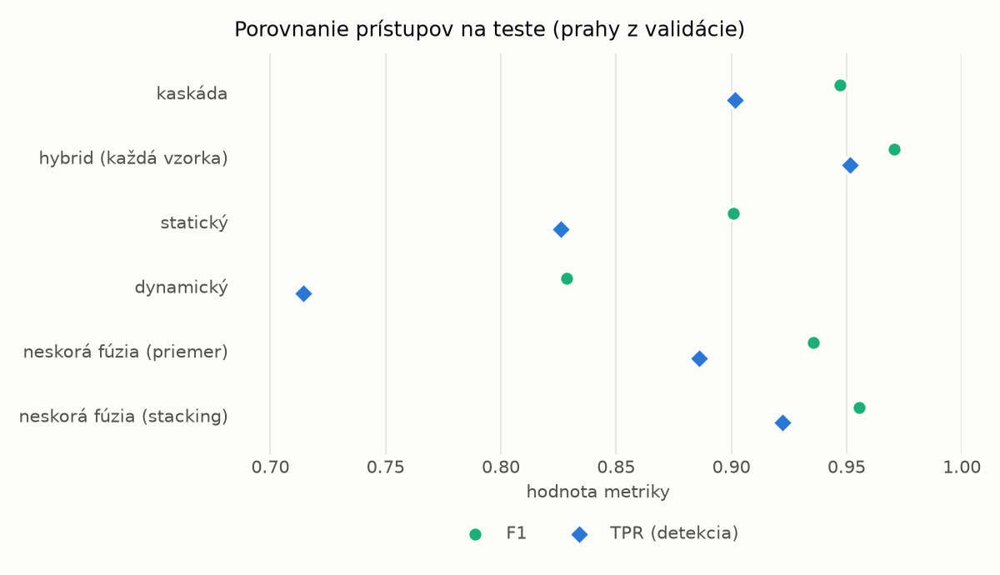
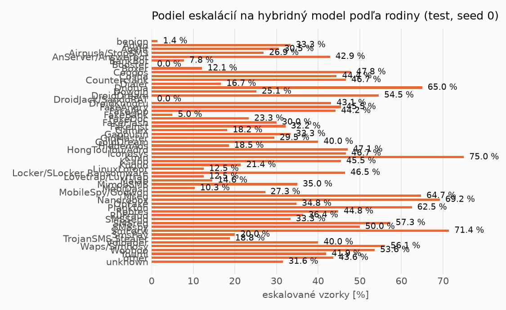

# Kaskáda `modal` – beh `20261123-190459`

> Generované `src/cascade/evaluate.py` (2026-11-23T19:04:59+01:00). Seedy: [0, 1, 2]; hodnoty = priemer ± sm. odchýlka.
> Všetky prahy sú určené na validácii (FPR ≤ 1 %); test sa na nič nenastavuje.

| rola | beh |
|---|---|
| static | `runs_v4/real_p/lofo/Locker_SLocker_Ransomware/students_static/mlp_kd_modal/20261123-190224` |
| dynamic | `runs_v4/real_p/lofo/Locker_SLocker_Ransomware/students_dynamic/mlp_kd_modal/20261123-190359` |
| hybrid | `runs_v4/real_p/lofo/Locker_SLocker_Ransomware/hybrid/lightgbm/20261123-185825` |

## Test
| prístup | accuracy | balanced_accuracy | precision | recall_tpr | fpr | f1 | mcc |
|---|---|---|---|---|---|---|---|
| kaskáda | 0.9549 ± 0.0013 | 0.9498 ± 0.0015 | 0.9976 ± 0.0001 | 0.9015 ± 0.0029 | 0.0018 ± 0.0001 | 0.9471 ± 0.0016 | 0.9115 ± 0.0025 |
| hybrid (každá vzorka) | 0.9743 ± 0.0006 | 0.9722 ± 0.0006 | 0.9911 ± 0.0006 | 0.9513 ± 0.0009 | 0.0070 ± 0.0004 | 0.9708 ± 0.0007 | 0.9485 ± 0.0011 |
| statický | 0.9184 ± 0.0008 | 0.9097 ± 0.0009 | 0.9903 ± 0.0002 | 0.8260 ± 0.0019 | 0.0065 ± 0.0002 | 0.9007 ± 0.0011 | 0.8423 ± 0.0016 |
| dynamický | 0.8674 ± 0.0026 | 0.8531 ± 0.0029 | 0.9861 ± 0.0014 | 0.7143 ± 0.0064 | 0.0082 ± 0.0009 | 0.8285 ± 0.0040 | 0.7499 ± 0.0044 |
| neskorá fúzia (priemer) | 0.9454 ± 0.0016 | 0.9399 ± 0.0018 | 0.9913 ± 0.0006 | 0.8861 ± 0.0037 | 0.0063 ± 0.0005 | 0.9357 ± 0.0021 | 0.8928 ± 0.0031 |
| neskorá fúzia (stacking) | 0.9615 ± 0.0020 | 0.9578 ± 0.0023 | 0.9915 ± 0.0006 | 0.9221 ± 0.0051 | 0.0064 ± 0.0005 | 0.9555 ± 0.0025 | 0.9236 ± 0.0038 |

## Validácia
| prístup | accuracy | balanced_accuracy | precision | recall_tpr | fpr | f1 | mcc |
|---|---|---|---|---|---|---|---|
| kaskáda | 0.9686 ± 0.0027 | 0.9644 ± 0.0030 | 0.9943 ± 0.0006 | 0.9330 ± 0.0057 | 0.0041 ± 0.0004 | 0.9626 ± 0.0033 | 0.9371 ± 0.0053 |
| hybrid (každá vzorka) | 0.9823 ± 0.0006 | 0.9810 ± 0.0006 | 0.9874 ± 0.0004 | 0.9715 ± 0.0010 | 0.0095 ± 0.0003 | 0.9794 ± 0.0007 | 0.9640 ± 0.0012 |
| statický | 0.9317 ± 0.0043 | 0.9226 ± 0.0049 | 0.9853 ± 0.0002 | 0.8550 ± 0.0099 | 0.0097 ± 0.0000 | 0.9155 ± 0.0057 | 0.8648 ± 0.0081 |
| dynamický | 0.8768 ± 0.0032 | 0.8592 ± 0.0037 | 0.9829 ± 0.0001 | 0.7281 ± 0.0075 | 0.0096 ± 0.0002 | 0.8365 ± 0.0050 | 0.7626 ± 0.0057 |
| neskorá fúzia (priemer) | 0.9542 ± 0.0025 | 0.9486 ± 0.0028 | 0.9861 ± 0.0001 | 0.9069 ± 0.0057 | 0.0097 ± 0.0000 | 0.9449 ± 0.0031 | 0.9081 ± 0.0048 |
| neskorá fúzia (stacking) | 0.9701 ± 0.0016 | 0.9670 ± 0.0019 | 0.9868 ± 0.0003 | 0.9436 ± 0.0036 | 0.0096 ± 0.0002 | 0.9647 ± 0.0020 | 0.9395 ± 0.0032 |

## Správanie kaskády (test, seed 0)
- podiel eskalácií na hybrid: **13.35%** (1690 vzoriek)
- chyby pri zhode študentov (kaskáda ich nemôže opraviť): **488**
  (4.450% zo zhôd; FP 1, FN 487)
- úspešnosť na eskalovaných vzorkách: hybrid 0.9597633136094674, statický 0.6846153846153846,
  dynamický 0.3153846153846154  → prínos hybridu pri nezhode

## Výpočtové nároky (odhad z benchmarkov komponentov)
_Chýba benchmark niektorého komponentu (`python -m src.evaluation.benchmark`)._

