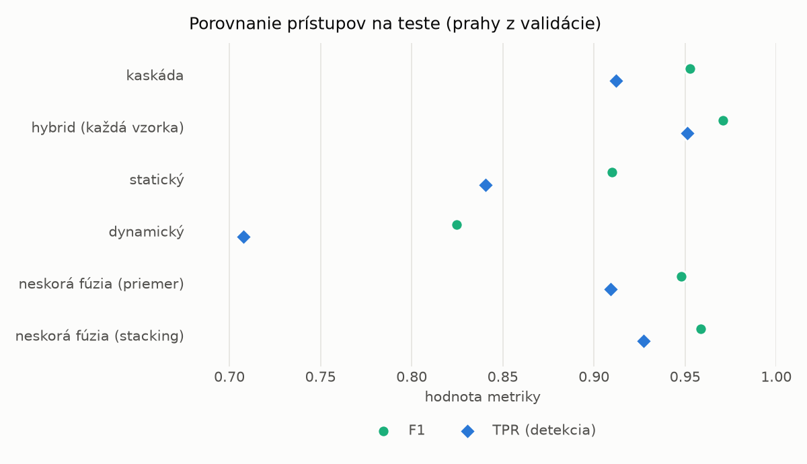
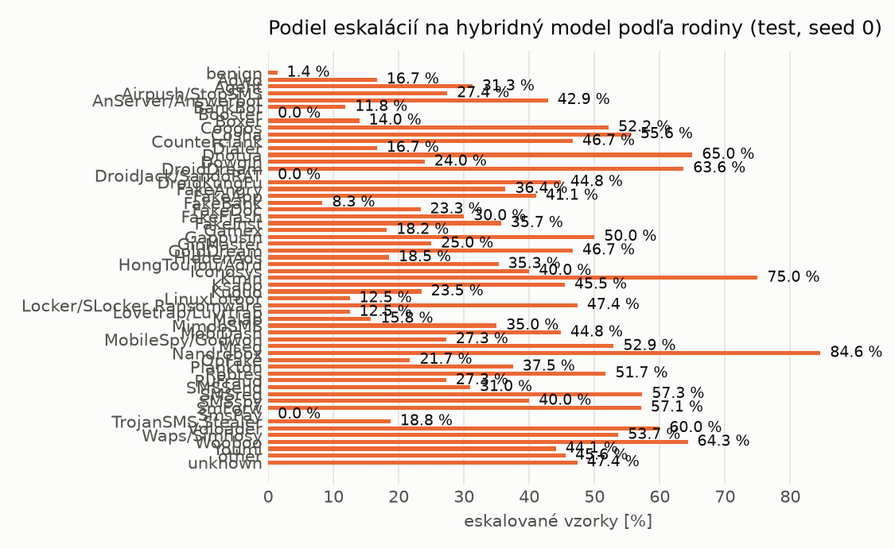

# Kaskáda `nokd` – beh `20261123-190457`

> Generované `src/cascade/evaluate.py` (2026-11-23T19:04:57+01:00). Seedy: [0, 1, 2]; hodnoty = priemer ± sm. odchýlka.
> Všetky prahy sú určené na validácii (FPR ≤ 1 %); test sa na nič nenastavuje.

| rola | beh |
|---|---|
| static | `runs_v4/real_p/lofo/Locker_SLocker_Ransomware/students_static/mlp_nokd/20261123-190201` |
| dynamic | `runs_v4/real_p/lofo/Locker_SLocker_Ransomware/students_dynamic/mlp_nokd/20261123-190320` |
| hybrid | `runs_v4/real_p/lofo/Locker_SLocker_Ransomware/hybrid/lightgbm/20261123-185825` |

## Test
| prístup | accuracy | balanced_accuracy | precision | recall_tpr | fpr | f1 | mcc |
|---|---|---|---|---|---|---|---|
| kaskáda | 0.9593 ± 0.0011 | 0.9549 ± 0.0012 | 0.9969 ± 0.0002 | 0.9122 ± 0.0026 | 0.0023 ± 0.0002 | 0.9526 ± 0.0013 | 0.9199 ± 0.0020 |
| hybrid (každá vzorka) | 0.9743 ± 0.0006 | 0.9722 ± 0.0006 | 0.9911 ± 0.0006 | 0.9513 ± 0.0009 | 0.0070 ± 0.0004 | 0.9708 ± 0.0007 | 0.9485 ± 0.0011 |
| statický | 0.9252 ± 0.0028 | 0.9173 ± 0.0032 | 0.9913 ± 0.0007 | 0.8405 ± 0.0070 | 0.0060 ± 0.0005 | 0.9097 ± 0.0038 | 0.8551 ± 0.0051 |
| dynamický | 0.8650 ± 0.0023 | 0.8503 ± 0.0025 | 0.9875 ± 0.0010 | 0.7079 ± 0.0045 | 0.0073 ± 0.0006 | 0.8246 ± 0.0034 | 0.7461 ± 0.0043 |
| neskorá fúzia (priemer) | 0.9551 ± 0.0026 | 0.9508 ± 0.0029 | 0.9898 ± 0.0004 | 0.9092 ± 0.0062 | 0.0076 ± 0.0004 | 0.9478 ± 0.0032 | 0.9111 ± 0.0049 |
| neskorá fúzia (stacking) | 0.9642 ± 0.0007 | 0.9607 ± 0.0008 | 0.9922 ± 0.0004 | 0.9273 ± 0.0013 | 0.0059 ± 0.0003 | 0.9587 ± 0.0008 | 0.9287 ± 0.0014 |

## Validácia
| prístup | accuracy | balanced_accuracy | precision | recall_tpr | fpr | f1 | mcc |
|---|---|---|---|---|---|---|---|
| kaskáda | 0.9704 ± 0.0010 | 0.9665 ± 0.0011 | 0.9938 ± 0.0008 | 0.9375 ± 0.0019 | 0.0045 ± 0.0006 | 0.9648 ± 0.0013 | 0.9404 ± 0.0021 |
| hybrid (každá vzorka) | 0.9823 ± 0.0006 | 0.9810 ± 0.0006 | 0.9874 ± 0.0004 | 0.9715 ± 0.0010 | 0.0095 ± 0.0003 | 0.9794 ± 0.0007 | 0.9640 ± 0.0012 |
| statický | 0.9338 ± 0.0061 | 0.9250 ± 0.0070 | 0.9855 ± 0.0005 | 0.8597 ± 0.0139 | 0.0096 ± 0.0002 | 0.9183 ± 0.0082 | 0.8687 ± 0.0117 |
| dynamický | 0.8767 ± 0.0033 | 0.8592 ± 0.0038 | 0.9828 ± 0.0002 | 0.7281 ± 0.0075 | 0.0097 ± 0.0000 | 0.8365 ± 0.0050 | 0.7625 ± 0.0059 |
| neskorá fúzia (priemer) | 0.9659 ± 0.0018 | 0.9622 ± 0.0021 | 0.9867 ± 0.0002 | 0.9340 ± 0.0043 | 0.0096 ± 0.0002 | 0.9596 ± 0.0022 | 0.9312 ± 0.0036 |
| neskorá fúzia (stacking) | 0.9710 ± 0.0009 | 0.9680 ± 0.0010 | 0.9869 ± 0.0005 | 0.9455 ± 0.0019 | 0.0096 ± 0.0003 | 0.9658 ± 0.0011 | 0.9412 ± 0.0018 |

## Správanie kaskády (test, seed 0)
- podiel eskalácií na hybrid: **13.82%** (1749 vzoriek)
- chyby pri zhode študentov (kaskáda ich nemôže opraviť): **431**
  (3.952% zo zhôd; FP 0, FN 431)
- úspešnosť na eskalovaných vzorkách: hybrid 0.9594053744997141, statický 0.725557461406518,
  dynamický 0.274442538593482  → prínos hybridu pri nezhode

## Výpočtové nároky (odhad z benchmarkov komponentov)
_Chýba benchmark niektorého komponentu (`python -m src.evaluation.benchmark`)._

