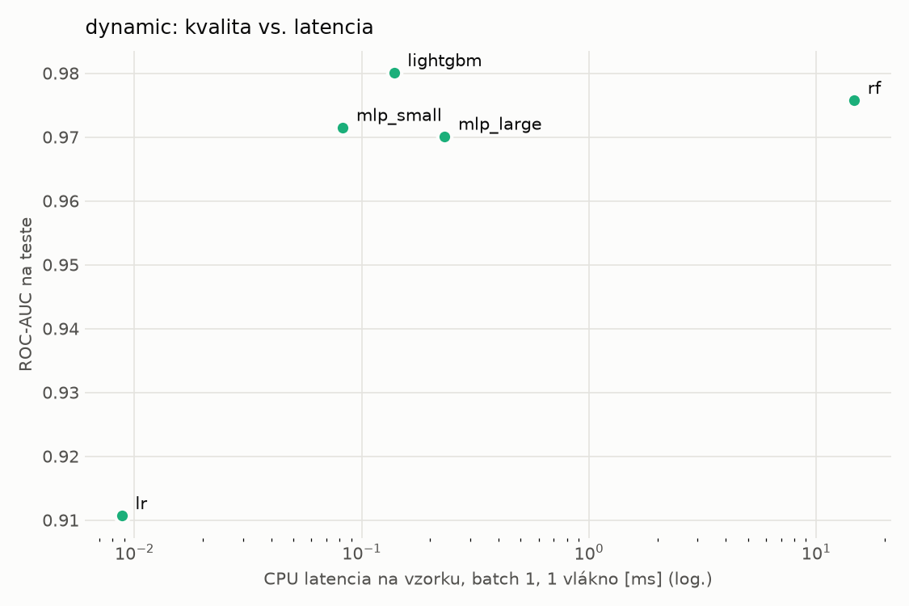
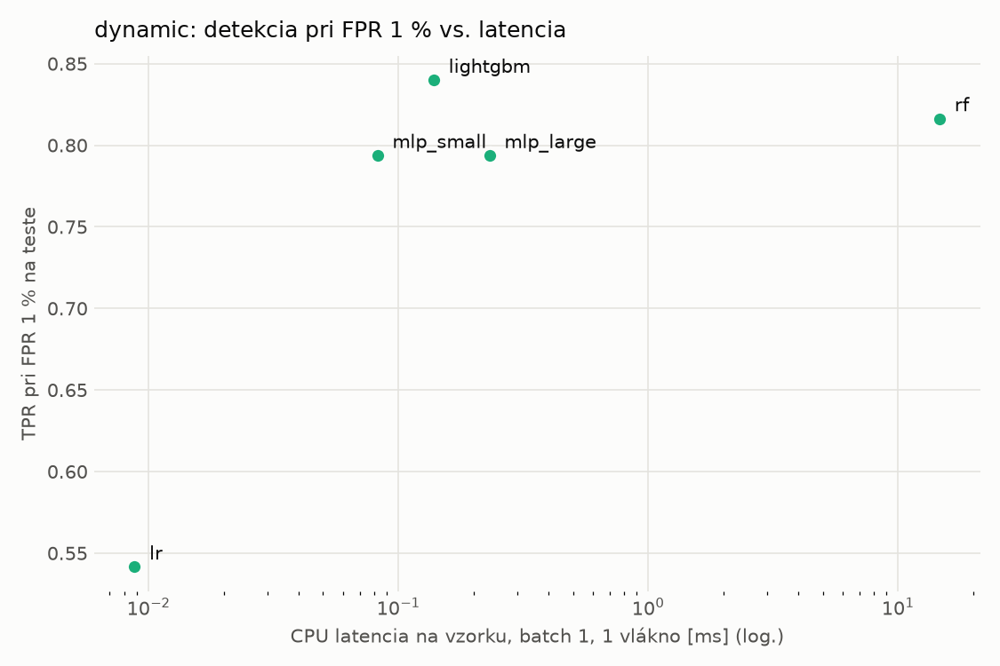
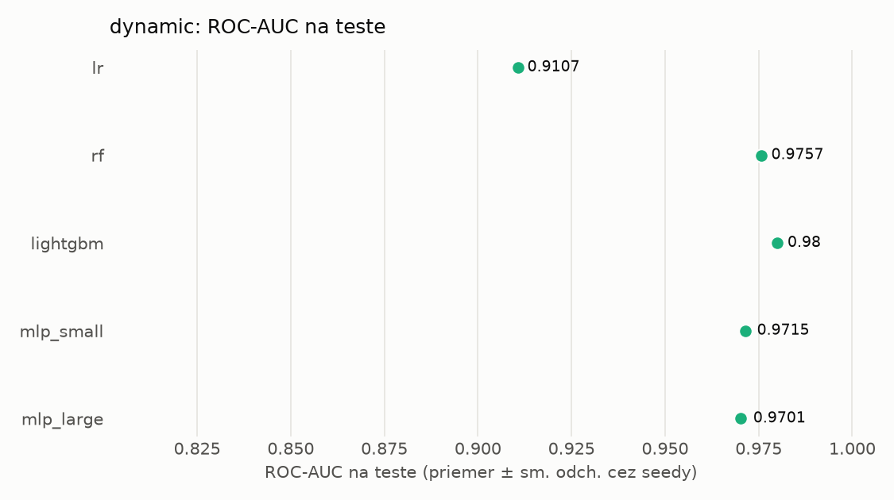
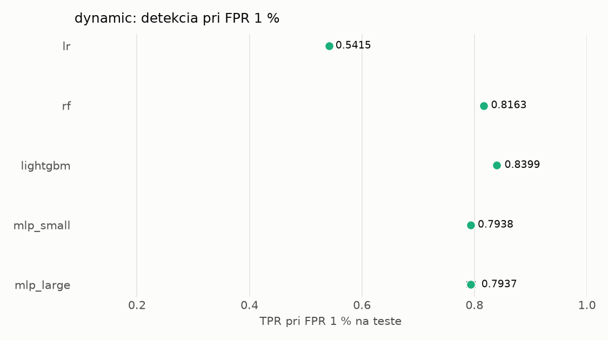

# Porovnanie modelov – dynamic

> Generované `src/evaluation/compare.py` (2026-11-23T18:58:04+01:00); použitý je posledný beh každého modelu.
> Metriky sú priemer cez seedy. \* = pri prahu určenom na validácii (FPR ≤ 1 %).
> CPU ms/vz. = medián latencie jednej vzorky na 1 vlákne vrátane transformácie vstupu (meranie hneď po tréningu,
> orientačné). Oficiálne merania spotreby sú v časti „Spotreba zdrojov pri inferencii“.

## Detekčná kvalita a orientačné časy
| model | ROC-AUC val | ROC-AUC test | TPR@FPR 1 % test | TPR@FPR 0,1 % test | F1 test* | FPR test* | gap train−val | CPU ms/vz. | CPU vz./s | GPU ms/vz. | parametre | MB | tréning s | ladenie min |
|---|---|---|---|---|---|---|---|---|---|---|---|---|---|---|
| [lr](../../dynamic/lr/20261123-185544/README.md) | 0.9116 | 0.9107 ± 0.0000 | 0.5415 | 0.3874 | 0.6704 | 0.0076 | 0.0098 | 0.009 | 3 711 437 | – | 124 | 0.01 | 0.3 | 0.0 |
| [rf](../../dynamic/rf/20261123-185546/README.md) | 0.9752 | 0.9757 ± 0.0001 | 0.8163 | 0.7267 | 0.8906 | 0.0087 | 0.0230 | 14.692 | 111 887 | – | 3 224 024 | 258.30 | 2.4 | 0.0 |
| [lightgbm](../../dynamic/lightgbm/20261123-185604/README.md) | 0.9810 | 0.9800 ± 0.0001 | 0.8399 | 0.7419 | 0.9032 | 0.0083 | 0.0178 | 0.139 | 112 384 | – | 263 610 | 14.48 | 10.1 | 0.0 |
| [mlp_small](../../dynamic/mlp_small/20261123-185642/README.md) | 0.9731 | 0.9715 ± 0.0005 | 0.7938 | 0.6485 | 0.8626 | 0.0070 | 0.0143 | 0.083 | 2 775 378 | 0.662 | 65 537 | 0.27 | 18.1 | 0.0 |
| [mlp_large](../../dynamic/mlp_large/20261123-185738/README.md) | 0.9742 | 0.9701 ± 0.0009 | 0.7937 | 0.6455 | 0.8633 | 0.0063 | 0.0132 | 0.232 | 301 879 | 0.591 | 1 119 745 | 4.51 | 7.8 | 0.0 |

## Nízka prevalencia malvéru (test, prah z validácie)
| model | TPR | FPR | precision @ 1 % | falošné na 1 skutočný poplach @ 1 % | precision @ 0.1 % | falošné na 1 skutočný poplach @ 0.1 % |
|---|---|---|---|---|---|---|
| lr | 0.5089 | 0.0076 | 0.404 | 1.48 | 0.063 | 14.90 |
| rf | 0.8114 | 0.0087 | 0.484 | 1.07 | 0.085 | 10.75 |
| lightgbm | 0.8318 | 0.0083 | 0.504 | 0.98 | 0.092 | 9.92 |
| mlp_small | 0.7650 | 0.0070 | 0.524 | 0.91 | 0.098 | 9.16 |
| mlp_large | 0.7654 | 0.0063 | 0.551 | 0.81 | 0.108 | 8.22 |

Prepočet: TPR a FPR nezávisia od podielu malvéru, preto sa dajú preniesť na nízku prevalenciu (v reálnej prevádzke je malvéru ~1 % alebo menej; v teste 54 %). „Falošné na 1 skutočný poplach“ = koľko neškodných súborov je označených na každý zachytený malvér.

## Spotreba zdrojov pri inferencii (benchmark, testovacia množina)
_Benchmark zatiaľ nebol spustený (`python -m src.evaluation.benchmark --approach dynamic`)._

## Grafy

