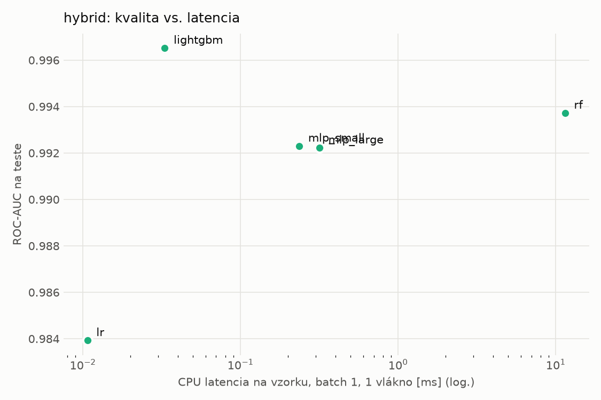
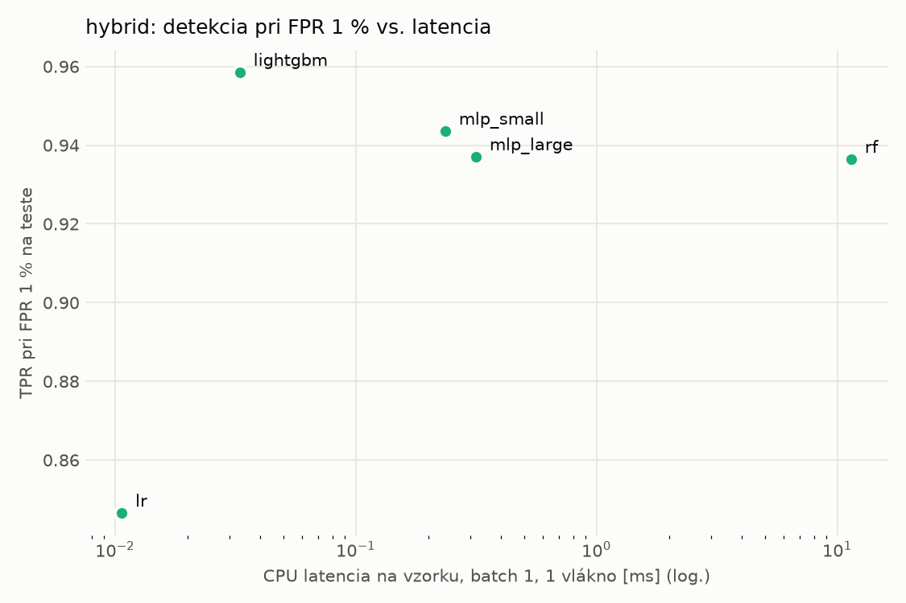
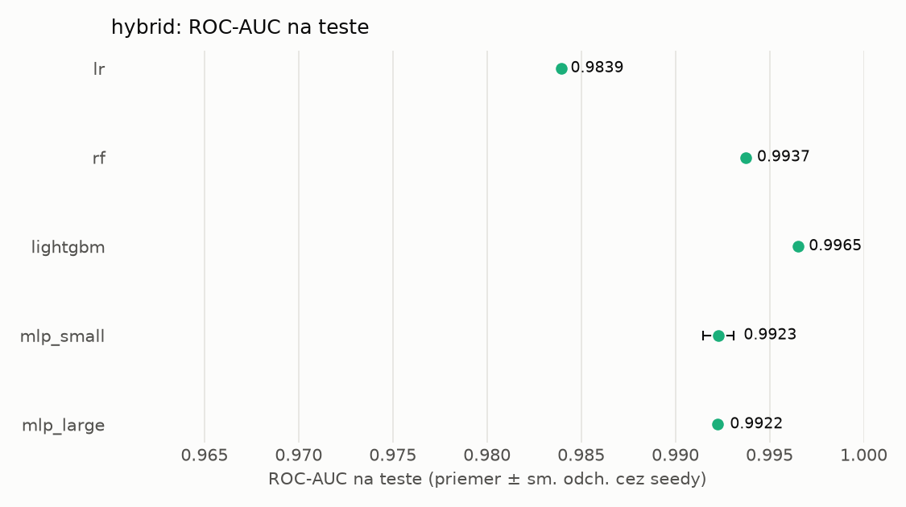
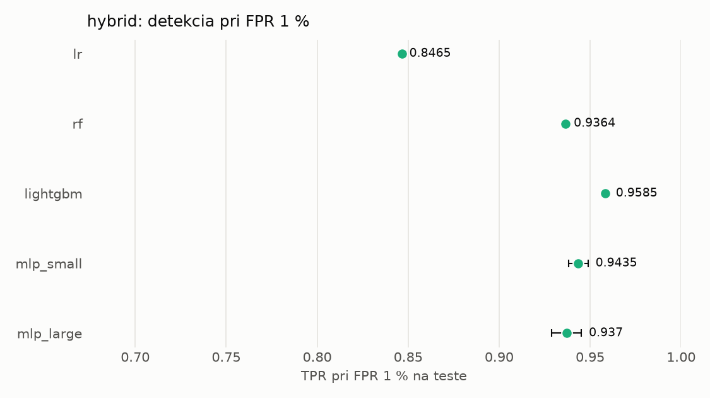

# Porovnanie modelov – hybrid

> Generované `src/evaluation/compare.py` (2026-11-23T18:59:12+01:00); použitý je posledný beh každého modelu.
> Metriky sú priemer cez seedy. \* = pri prahu určenom na validácii (FPR ≤ 1 %).
> CPU ms/vz. = medián latencie jednej vzorky na 1 vlákne vrátane transformácie vstupu (meranie hneď po tréningu,
> orientačné). Oficiálne merania spotreby sú v časti „Spotreba zdrojov pri inferencii“.

## Detekčná kvalita a orientačné časy
| model | ROC-AUC val | ROC-AUC test | TPR@FPR 1 % test | TPR@FPR 0,1 % test | F1 test* | FPR test* | gap train−val | CPU ms/vz. | CPU vz./s | GPU ms/vz. | parametre | MB | tréning s | ladenie min |
|---|---|---|---|---|---|---|---|---|---|---|---|---|---|---|
| [lr](../../hybrid/lr/20261123-185807/README.md) | 0.9855 | 0.9839 ± 0.0000 | 0.8465 | 0.6002 | 0.8973 | 0.0072 | 0.0035 | 0.011 | 2 435 954 | – | 287 | 0.01 | 0.2 | 0.0 |
| [rf](../../hybrid/rf/20261123-185810/README.md) | 0.9955 | 0.9937 ± 0.0001 | 0.9364 | 0.8658 | 0.9546 | 0.0058 | 0.0045 | 11.460 | 121 367 | – | 1 822 302 | 146.12 | 2.5 | 0.0 |
| [lightgbm](../../hybrid/lightgbm/20261123-185825/README.md) | 0.9969 | 0.9965 ± 0.0001 | 0.9585 | 0.8966 | 0.9708 | 0.0070 | 0.0031 | 0.033 | 620 660 | – | 35 026 | 1.95 | 4.1 | 0.0 |
| [mlp_small](../../hybrid/mlp_small/20261123-185840/README.md) | 0.9939 | 0.9923 ± 0.0008 | 0.9435 | 0.8358 | 0.9618 | 0.0079 | 0.0054 | 0.236 | 1 167 829 | 0.415 | 107 265 | 0.45 | 1.8 | 0.0 |
| [mlp_large](../../hybrid/mlp_large/20261123-185848/README.md) | 0.9941 | 0.9922 ± 0.0002 | 0.9370 | 0.8096 | 0.9569 | 0.0075 | 0.0051 | 0.317 | 129 328 | 0.521 | 2 400 257 | 9.64 | 6.8 | 0.0 |

## Nízka prevalencia malvéru (test, prah z validácie)
| model | TPR | FPR | precision @ 1 % | falošné na 1 skutočný poplach @ 1 % | precision @ 0.1 % | falošné na 1 skutočný poplach @ 0.1 % |
|---|---|---|---|---|---|---|
| lr | 0.8209 | 0.0072 | 0.537 | 0.86 | 0.103 | 8.71 |
| rf | 0.9197 | 0.0058 | 0.615 | 0.63 | 0.137 | 6.33 |
| lightgbm | 0.9513 | 0.0070 | 0.580 | 0.73 | 0.120 | 7.32 |
| mlp_small | 0.9355 | 0.0079 | 0.544 | 0.84 | 0.106 | 8.46 |
| mlp_large | 0.9258 | 0.0075 | 0.555 | 0.80 | 0.110 | 8.09 |

Prepočet: TPR a FPR nezávisia od podielu malvéru, preto sa dajú preniesť na nízku prevalenciu (v reálnej prevádzke je malvéru ~1 % alebo menej; v teste 54 %). „Falošné na 1 skutočný poplach“ = koľko neškodných súborov je označených na každý zachytený malvér.

## Spotreba zdrojov pri inferencii (benchmark, testovacia množina)
_Benchmark zatiaľ nebol spustený (`python -m src.evaluation.benchmark --approach hybrid`)._

## Grafy

