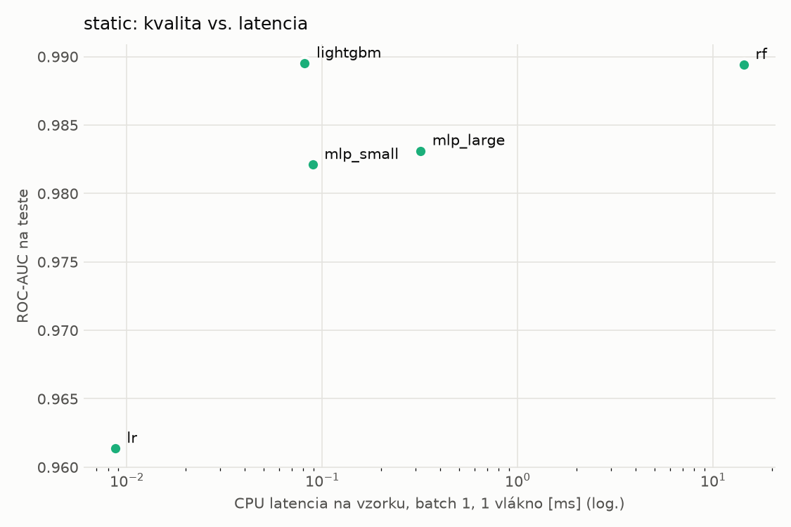
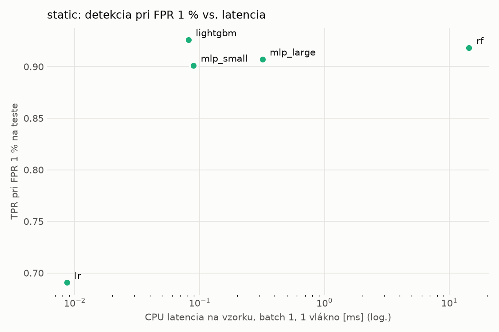
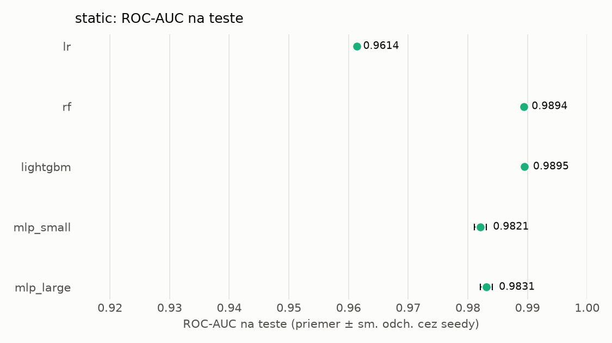
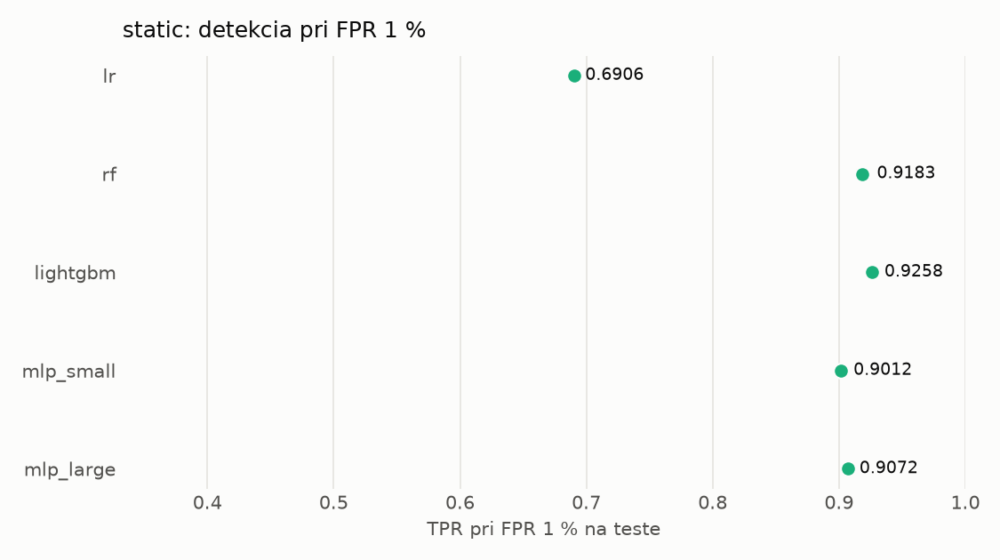

# Porovnanie modelov – static

> Generované `src/evaluation/compare.py` (2026-11-23T18:55:41+01:00); použitý je posledný beh každého modelu.
> Metriky sú priemer cez seedy. \* = pri prahu určenom na validácii (FPR ≤ 1 %).
> CPU ms/vz. = medián latencie jednej vzorky na 1 vlákne vrátane transformácie vstupu (meranie hneď po tréningu,
> orientačné). Oficiálne merania spotreby sú v časti „Spotreba zdrojov pri inferencii“.

## Detekčná kvalita a orientačné časy
| model | ROC-AUC val | ROC-AUC test | TPR@FPR 1 % test | TPR@FPR 0,1 % test | F1 test* | FPR test* | gap train−val | CPU ms/vz. | CPU vz./s | GPU ms/vz. | parametre | MB | tréning s | ladenie min |
|---|---|---|---|---|---|---|---|---|---|---|---|---|---|---|
| [lr](../../static/lr/20261123-185349/README.md) | 0.9681 | 0.9614 ± 0.0000 | 0.6906 | 0.1421 | 0.7750 | 0.0074 | 0.0025 | 0.009 | 3 485 925 | – | 164 | 0.01 | 0.3 | 0.0 |
| [rf](../../static/rf/20261123-185351/README.md) | 0.9937 | 0.9894 ± 0.0002 | 0.9183 | 0.8304 | 0.9437 | 0.0063 | 0.0063 | 14.346 | 113 464 | – | 2 956 544 | 236.90 | 1.5 | 0.0 |
| [lightgbm](../../static/lightgbm/20261123-185406/README.md) | 0.9942 | 0.9895 ± 0.0003 | 0.9258 | 0.8414 | 0.9515 | 0.0071 | 0.0058 | 0.081 | 163 133 | – | 210 281 | 11.68 | 8.3 | 0.0 |
| [mlp_small](../../static/mlp_small/20261123-185440/README.md) | 0.9904 | 0.9821 ± 0.0010 | 0.9012 | 0.6684 | 0.9329 | 0.0066 | 0.0066 | 0.089 | 1 763 263 | 0.413 | 75 777 | 0.32 | 8.1 | 0.0 |
| [mlp_large](../../static/mlp_large/20261123-185506/README.md) | 0.9909 | 0.9831 ± 0.0010 | 0.9072 | 0.6623 | 0.9333 | 0.0063 | 0.0074 | 0.318 | 96 541 | 0.418 | 2 966 529 | 11.91 | 10.4 | 0.0 |

## Nízka prevalencia malvéru (test, prah z validácie)
| model | TPR | FPR | precision @ 1 % | falošné na 1 skutočný poplach @ 1 % | precision @ 0.1 % | falošné na 1 skutočný poplach @ 0.1 % |
|---|---|---|---|---|---|---|
| lr | 0.6385 | 0.0074 | 0.464 | 1.15 | 0.079 | 11.65 |
| rf | 0.9003 | 0.0063 | 0.593 | 0.69 | 0.126 | 6.94 |
| lightgbm | 0.9154 | 0.0071 | 0.567 | 0.76 | 0.115 | 7.71 |
| mlp_small | 0.8814 | 0.0066 | 0.575 | 0.74 | 0.118 | 7.47 |
| mlp_large | 0.8817 | 0.0063 | 0.587 | 0.70 | 0.124 | 7.09 |

Prepočet: TPR a FPR nezávisia od podielu malvéru, preto sa dajú preniesť na nízku prevalenciu (v reálnej prevádzke je malvéru ~1 % alebo menej; v teste 54 %). „Falošné na 1 skutočný poplach“ = koľko neškodných súborov je označených na každý zachytený malvér.

## Spotreba zdrojov pri inferencii (benchmark, testovacia množina)
_Benchmark zatiaľ nebol spustený (`python -m src.evaluation.benchmark --approach static`)._

## Grafy

