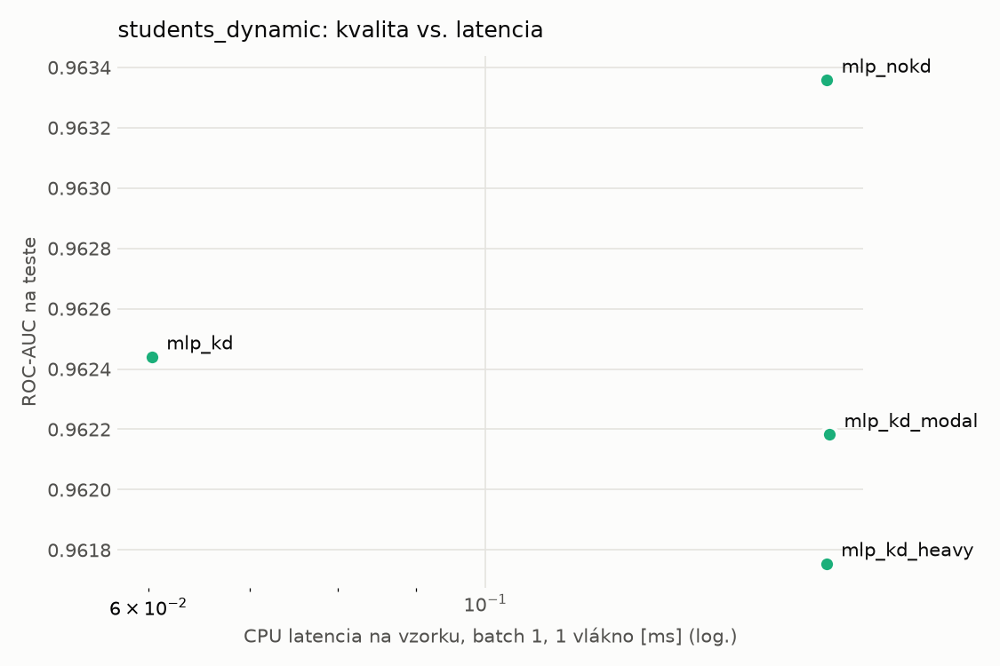
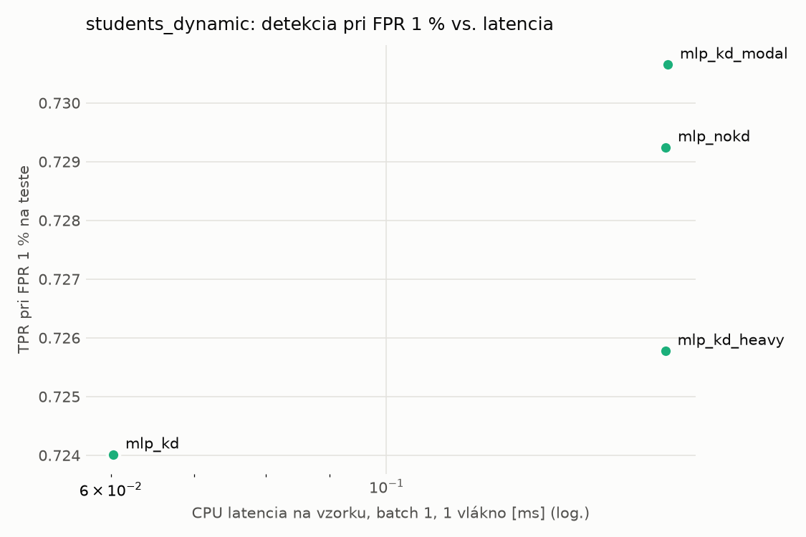
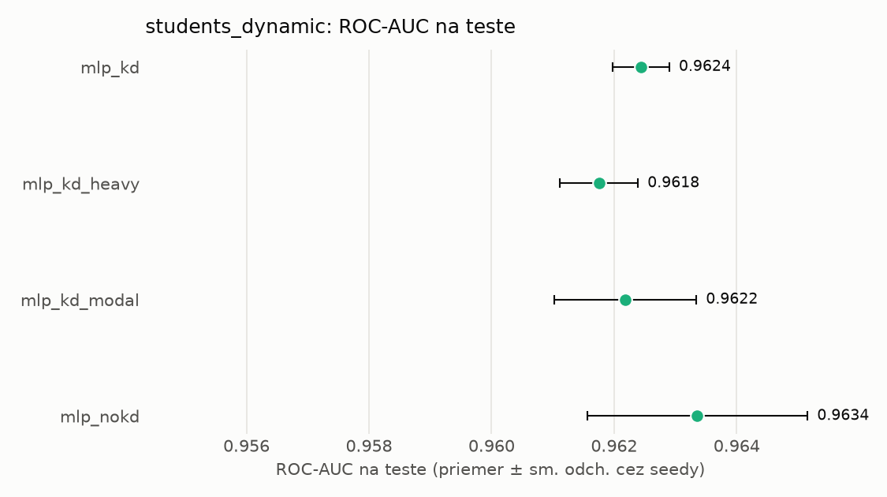
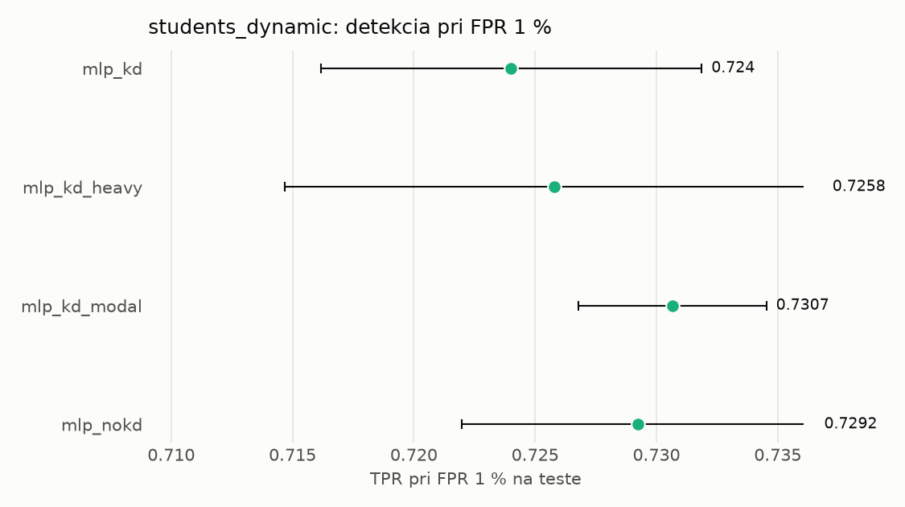

# Porovnanie modelov – students_dynamic

> Generované `src/evaluation/compare.py` (2026-11-23T19:04:52+01:00); použitý je posledný beh každého modelu.
> Metriky sú priemer cez seedy. \* = pri prahu určenom na validácii (FPR ≤ 1 %).
> CPU ms/vz. = medián latencie jednej vzorky na 1 vlákne vrátane transformácie vstupu (meranie hneď po tréningu,
> orientačné). Oficiálne merania spotreby sú v časti „Spotreba zdrojov pri inferencii“.

## Detekčná kvalita a orientačné časy
| model | ROC-AUC val | ROC-AUC test | TPR@FPR 1 % test | TPR@FPR 0,1 % test | F1 test* | FPR test* | gap train−val | CPU ms/vz. | CPU vz./s | GPU ms/vz. | parametre | MB | tréning s | ladenie min |
|---|---|---|---|---|---|---|---|---|---|---|---|---|---|---|
| [mlp_kd](../../students_dynamic/mlp_kd/20261123-190303/README.md) | 0.9637 | 0.9624 ± 0.0005 | 0.7240 | 0.5137 | 0.8215 | 0.0084 | 0.0103 | 0.060 | 6 401 619 | 0.255 | 8 129 | 0.04 | 5.2 | 0.0 |
| [mlp_kd_heavy](../../students_dynamic/mlp_kd_heavy/20261123-190434/README.md) | 0.9633 | 0.9618 ± 0.0006 | 0.7258 | 0.5095 | 0.8210 | 0.0077 | 0.0101 | 0.168 | 5 566 502 | 0.451 | 8 129 | 0.04 | 5.3 | 0.0 |
| [mlp_kd_modal](../../students_dynamic/mlp_kd_modal/20261123-190359/README.md) | 0.9633 | 0.9622 ± 0.0012 | 0.7307 | 0.5304 | 0.8285 | 0.0082 | 0.0083 | 0.168 | 6 326 418 | 0.444 | 8 129 | 0.04 | 11.1 | 0.0 |
| [mlp_nokd](../../students_dynamic/mlp_nokd/20261123-190320/README.md) | 0.9651 | 0.9634 ± 0.0018 | 0.7292 | 0.5114 | 0.8246 | 0.0073 | 0.0116 | 0.168 | 5 964 747 | 0.445 | 8 129 | 0.04 | 12.4 | 0.0 |

## Nízka prevalencia malvéru (test, prah z validácie)
| model | TPR | FPR | precision @ 1 % | falošné na 1 skutočný poplach @ 1 % | precision @ 0.1 % | falošné na 1 skutočný poplach @ 0.1 % |
|---|---|---|---|---|---|---|
| mlp_kd | 0.7043 | 0.0084 | 0.459 | 1.18 | 0.077 | 11.92 |
| mlp_kd_heavy | 0.7031 | 0.0077 | 0.480 | 1.08 | 0.084 | 10.92 |
| mlp_kd_modal | 0.7143 | 0.0082 | 0.468 | 1.14 | 0.080 | 11.48 |
| mlp_nokd | 0.7079 | 0.0073 | 0.495 | 1.02 | 0.088 | 10.31 |

Prepočet: TPR a FPR nezávisia od podielu malvéru, preto sa dajú preniesť na nízku prevalenciu (v reálnej prevádzke je malvéru ~1 % alebo menej; v teste 54 %). „Falošné na 1 skutočný poplach“ = koľko neškodných súborov je označených na každý zachytený malvér.

## Spotreba zdrojov pri inferencii (benchmark, testovacia množina)
_Benchmark zatiaľ nebol spustený (`python -m src.evaluation.benchmark --approach students_dynamic`)._

## Grafy

