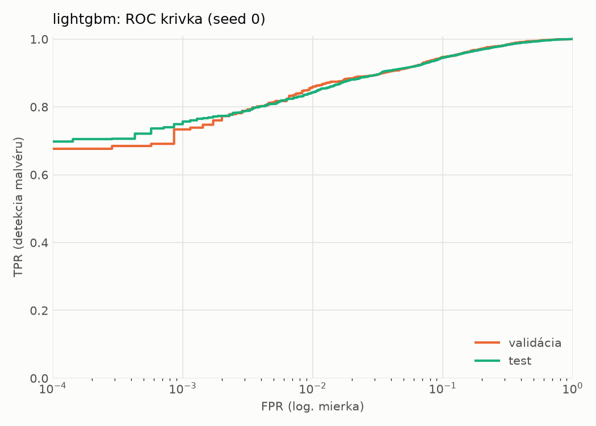
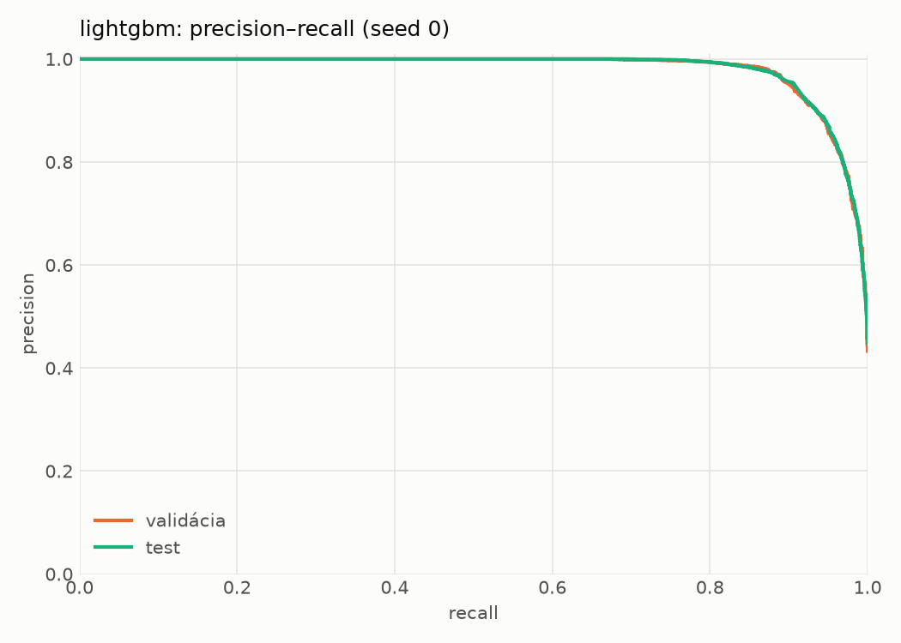
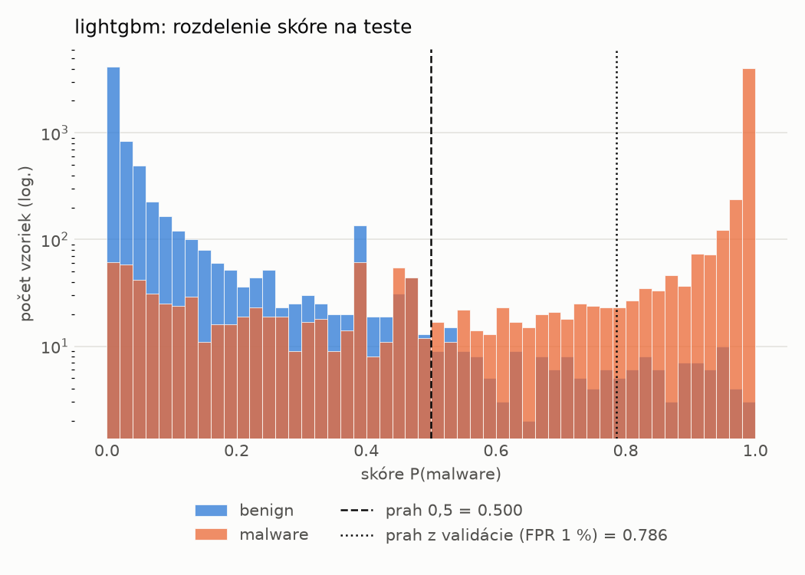
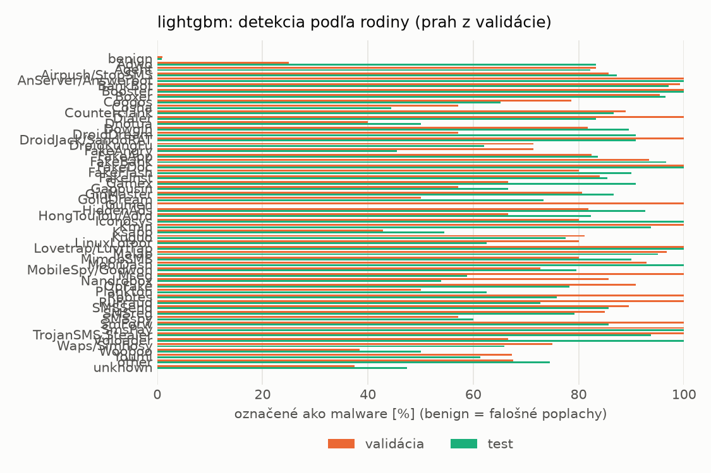
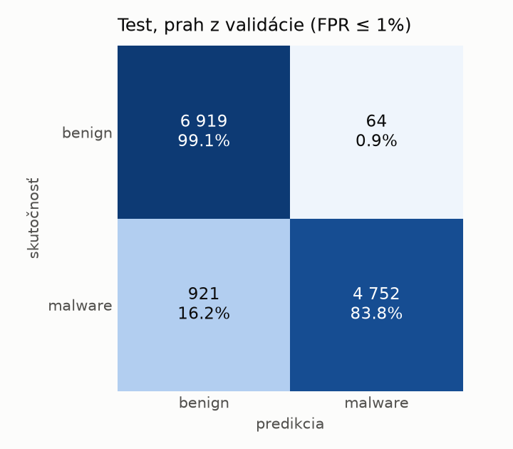
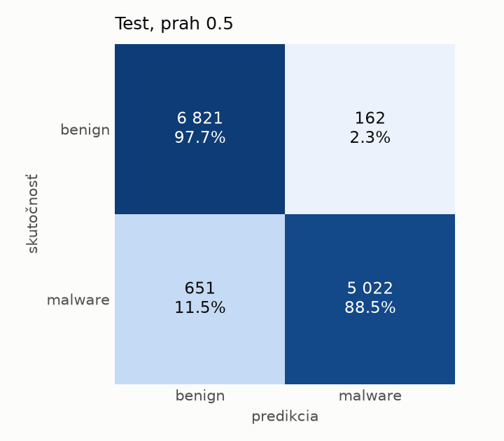
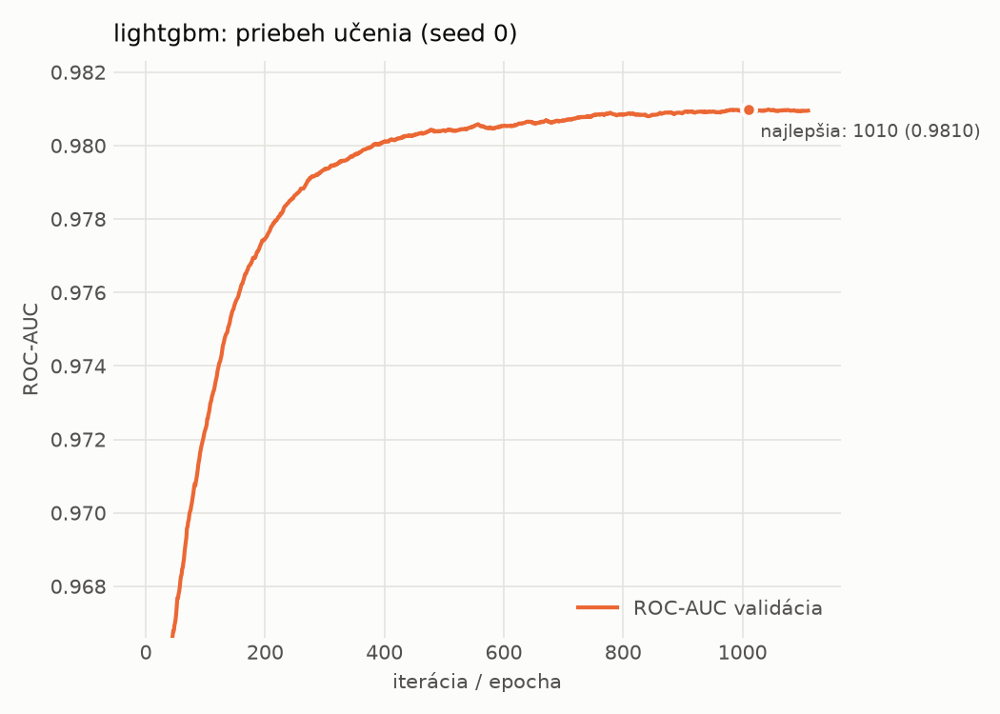

# dynamic/lightgbm – beh `20261123-185604`

> Automaticky generované (`src/training/run_tabular.py`). Konfigurácia: `config.yaml`, protokol: `protocol.yaml`.

- **Model:** `lightgbm` – LightGBM, gradient boosting stromov s early stopping na validácii (pôvodné hodnoty príznakov)
- **Ladenie:** bez ladenia – hyperparametre prevzaté z `runs_v4/real_p/full/dynamic/lightgbm/20261122-233440`
- **Finálne modely:** seedy [0, 1, 2]; hodnoty sú priemer ± smerodajná odchýlka cez seedy
- **Najlepšie hyperparametre:** `{"num_boost_round": 5000, "early_stopping_rounds": 100, "learning_rate": 0.027489744122517933, "num_leaves": 131, "min_child_samples": 30, "feature_fraction": 0.6013521321216351, "bagging_fraction": 0.9615246014341245, "lambda_l1": 3.231327066876444e-06, "lambda_l2": 0.000134433136248308}`

## Detekčná kvalita (bez prahu)
| metrika | train (podvzorka) | validácia | test |
|---|---|---|---|
| ROC-AUC | 0.9988 ± 0.0005 | 0.9810 ± 0.0000 | 0.9800 ± 0.0001 |
| PR-AUC | 0.9984 ± 0.0006 | 0.9805 ± 0.0002 | 0.9807 ± 0.0000 |
| TPR pri FPR 1 % | 0.9727 ± 0.0090 | 0.8509 ± 0.0056 | 0.8399 ± 0.0020 |
| TPR pri FPR 0,1 % | 0.9629 ± 0.0132 | 0.7262 ± 0.0070 | 0.7419 ± 0.0096 |
| log loss | 0.0552 ± 0.0125 | 0.1616 ± 0.0013 | 0.1682 ± 0.0012 |
| Brier skóre | 0.0129 ± 0.0030 | 0.0468 ± 0.0004 | 0.0489 ± 0.0001 |

Rozdiel ROC-AUC train − validácia: **0.0178** (veľký rozdiel = preučenie).

## Pri prahu z validácie (FPR ≤ 1% na validácii)
| metrika | train (podvzorka) | validácia | test |
|---|---|---|---|
| accuracy | 0.9759 ± 0.0050 | 0.9300 ± 0.0023 | 0.9201 ± 0.0024 |
| balanced accuracy | 0.9716 ± 0.0058 | 0.9206 ± 0.0027 | 0.9118 ± 0.0028 |
| precision | 0.9996 ± 0.0001 | 0.9854 ± 0.0002 | 0.9879 ± 0.0013 |
| recall (TPR) | 0.9434 ± 0.0117 | 0.8509 ± 0.0056 | 0.8318 ± 0.0065 |
| FPR | 0.0003 ± 0.0001 | 0.0096 ± 0.0002 | 0.0083 ± 0.0009 |
| F1 | 0.9707 ± 0.0062 | 0.9132 ± 0.0032 | 0.9032 ± 0.0033 |
| MCC | 0.9514 ± 0.0098 | 0.8615 ± 0.0044 | 0.8449 ± 0.0042 |

## Pri pevnom prahu 0.5
| metrika | train (podvzorka) | validácia | test |
|---|---|---|---|
| accuracy | 0.9849 ± 0.0034 | 0.9380 ± 0.0006 | 0.9346 ± 0.0011 |
| balanced accuracy | 0.9825 ± 0.0038 | 0.9328 ± 0.0007 | 0.9298 ± 0.0011 |
| precision | 0.9977 ± 0.0021 | 0.9602 ± 0.0004 | 0.9672 ± 0.0013 |
| recall (TPR) | 0.9667 ± 0.0062 | 0.8938 ± 0.0017 | 0.8840 ± 0.0011 |
| FPR | 0.0016 ± 0.0015 | 0.0283 ± 0.0003 | 0.0243 ± 0.0010 |
| F1 | 0.9819 ± 0.0041 | 0.9258 ± 0.0008 | 0.9237 ± 0.0012 |
| MCC | 0.9694 ± 0.0070 | 0.8743 ± 0.0012 | 0.8693 ± 0.0022 |

## Výpočtové nároky (seed 0, testovacia množina)
| meranie | hodnota |
|---|---|
| tréning finálneho modelu | 10.1 s (priemer cez seedy) |
| ladenie spolu | 0 s |
| počet parametrov / uzlov | 263 610 |
| veľkosť modelu na disku | 14.48 MB |
| CPU latencia modelu (batch 1, 1 vlákno) | 0.139 ms (p95 0.152) |
| CPU priepustnosť (24 vlákien) | 112 384 vzoriek/s |

## Grafy
| | |
|---|---|
|  |  |
|  |  |
|  |  |
|  |  |

## Súbory
`metrics.json` (všetky metriky po seedoch vrátane rodín), `timing.json`, `hpo_trials.csv`,
`predictions/<časť>_seed<N>.parquet` (sha256, family, label, score), `model/seed_<N>/`, `log.txt`.
