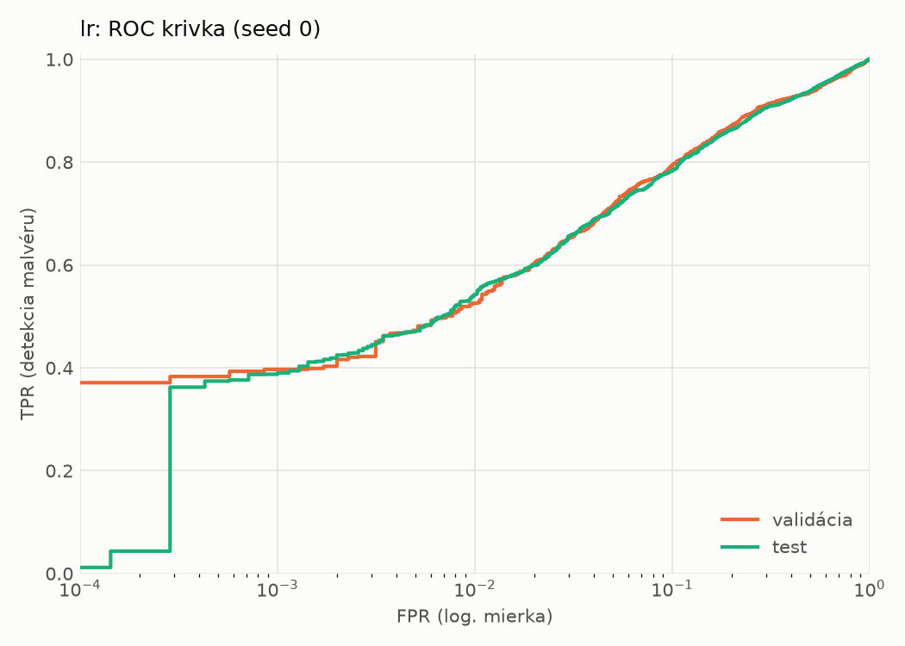
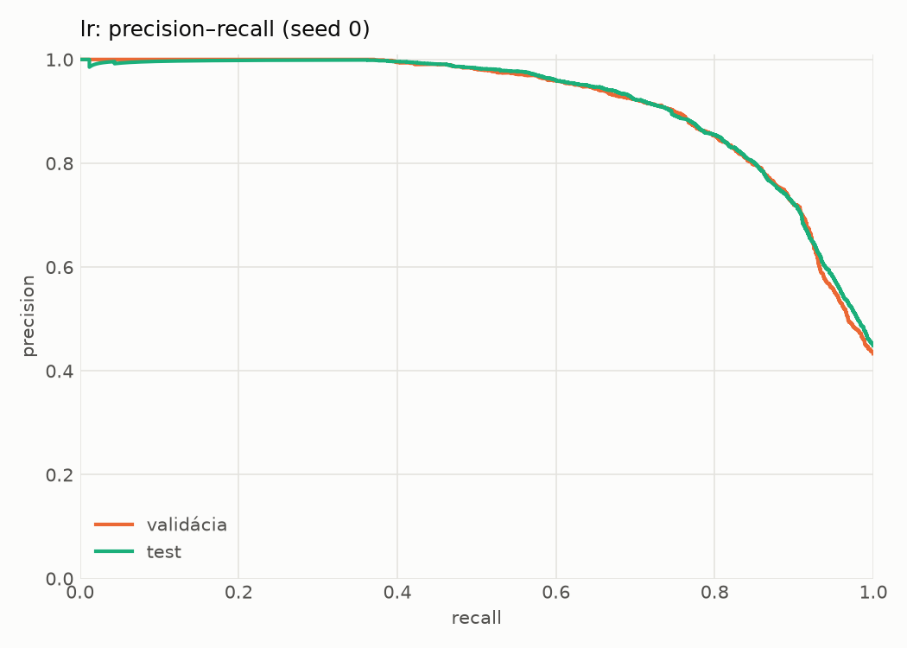
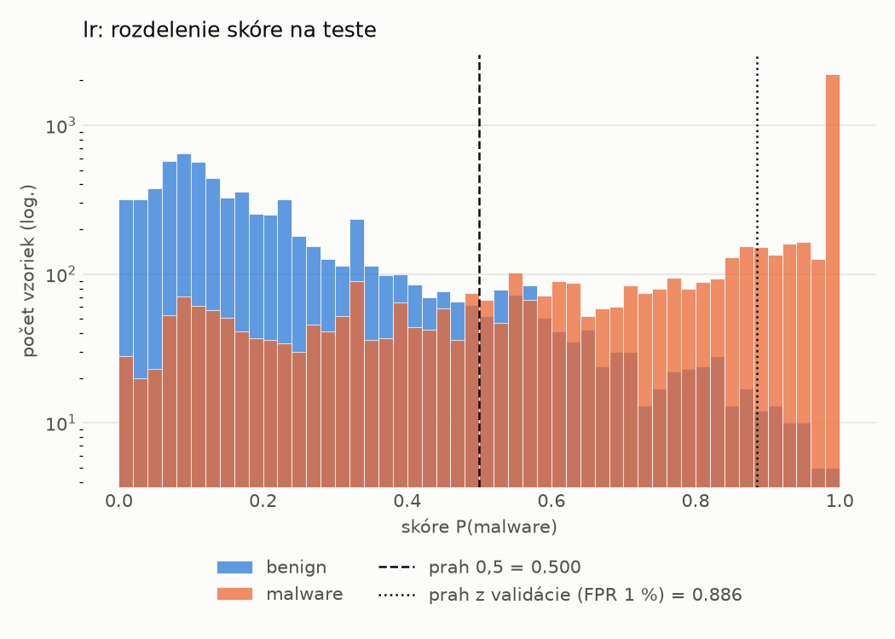
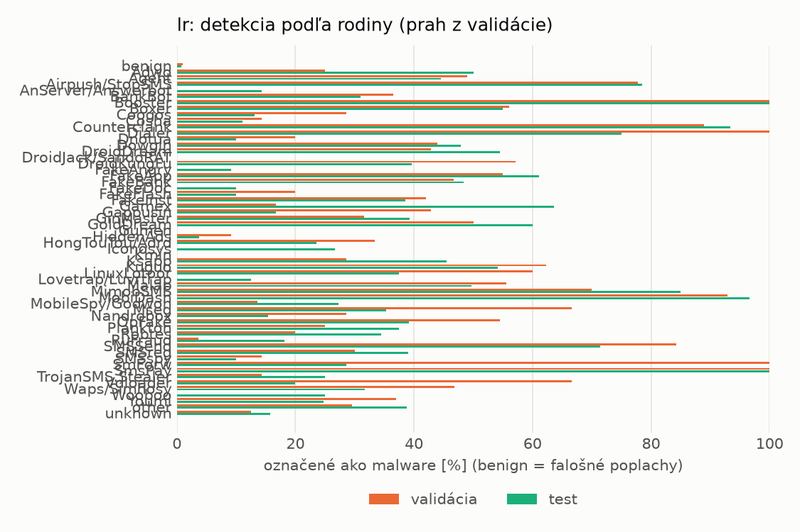
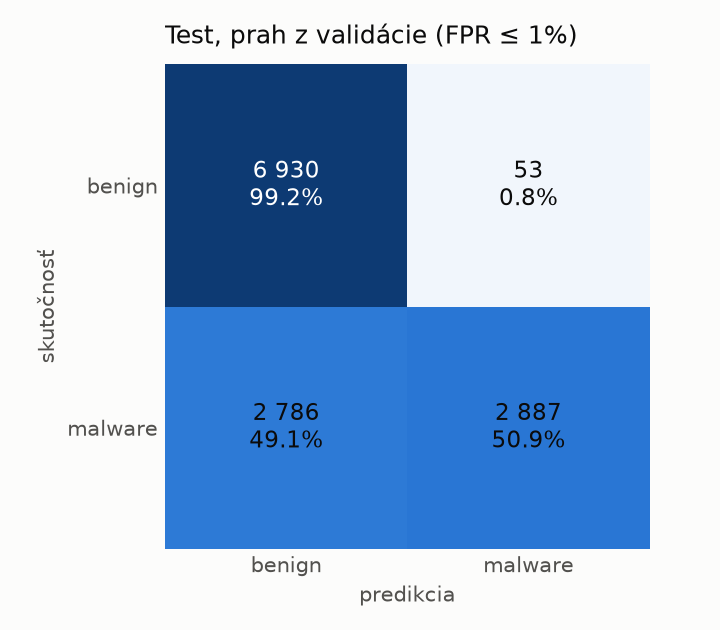
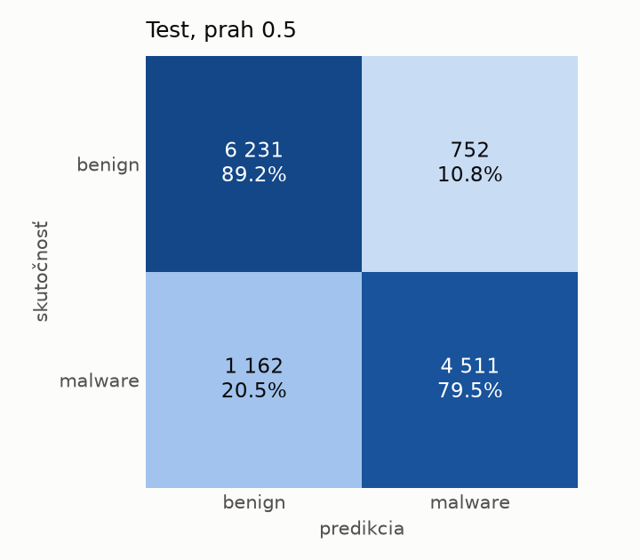

# dynamic/lr – beh `20261123-185544`

> Automaticky generované (`src/training/run_tabular.py`). Konfigurácia: `config.yaml`, protokol: `protocol.yaml`.

- **Model:** `logreg` – logistická regresia s L2 regularizáciou (vstup signed log1p + štandardizácia)
- **Ladenie:** bez ladenia – hyperparametre prevzaté z `runs_v4/real_p/full/dynamic/lr/20261122-233312`
- **Finálne modely:** seedy [0, 1, 2]; hodnoty sú priemer ± smerodajná odchýlka cez seedy
- **Najlepšie hyperparametre:** `{"max_iter": 2000, "C": 9.535095002298556}`

## Detekčná kvalita (bez prahu)
| metrika | train (podvzorka) | validácia | test |
|---|---|---|---|
| ROC-AUC | 0.9214 ± 0.0000 | 0.9116 ± 0.0000 | 0.9107 ± 0.0000 |
| PR-AUC | 0.9202 ± 0.0000 | 0.9154 ± 0.0000 | 0.9167 ± 0.0000 |
| TPR pri FPR 1 % | 0.5373 ± 0.0000 | 0.5257 ± 0.0000 | 0.5415 ± 0.0000 |
| TPR pri FPR 0,1 % | 0.4014 ± 0.0000 | 0.3970 ± 0.0000 | 0.3874 ± 0.0000 |
| log loss | 0.3424 ± 0.0000 | 0.3574 ± 0.0000 | 0.3630 ± 0.0000 |
| Brier skóre | 0.1042 ± 0.0000 | 0.1094 ± 0.0000 | 0.1114 ± 0.0000 |

Rozdiel ROC-AUC train − validácia: **0.0098** (veľký rozdiel = preučenie).

## Pri prahu z validácie (FPR ≤ 1% na validácii)
| metrika | train (podvzorka) | validácia | test |
|---|---|---|---|
| accuracy | 0.7973 ± 0.0000 | 0.7891 ± 0.0000 | 0.7757 ± 0.0000 |
| balanced accuracy | 0.7626 ± 0.0000 | 0.7580 ± 0.0000 | 0.7507 ± 0.0000 |
| precision | 0.9763 ± 0.0000 | 0.9763 ± 0.0000 | 0.9820 ± 0.0000 |
| recall (TPR) | 0.5347 ± 0.0000 | 0.5257 ± 0.0000 | 0.5089 ± 0.0000 |
| FPR | 0.0095 ± 0.0000 | 0.0097 ± 0.0000 | 0.0076 ± 0.0000 |
| F1 | 0.6910 ± 0.0000 | 0.6834 ± 0.0000 | 0.6704 ± 0.0000 |
| MCC | 0.6147 ± 0.0000 | 0.6046 ± 0.0000 | 0.5904 ± 0.0000 |

## Pri pevnom prahu 0.5
| metrika | train (podvzorka) | validácia | test |
|---|---|---|---|
| accuracy | 0.8599 ± 0.0000 | 0.8516 ± 0.0000 | 0.8488 ± 0.0000 |
| balanced accuracy | 0.8544 ± 0.0000 | 0.8463 ± 0.0000 | 0.8437 ± 0.0000 |
| precision | 0.8461 ± 0.0000 | 0.8441 ± 0.0000 | 0.8571 ± 0.0000 |
| recall (TPR) | 0.8183 ± 0.0000 | 0.8064 ± 0.0000 | 0.7952 ± 0.0000 |
| FPR | 0.1095 ± 0.0000 | 0.1138 ± 0.0000 | 0.1077 ± 0.0000 |
| F1 | 0.8320 ± 0.0000 | 0.8248 ± 0.0000 | 0.8250 ± 0.0000 |
| MCC | 0.7122 ± 0.0000 | 0.6968 ± 0.0000 | 0.6937 ± 0.0000 |

## Výpočtové nároky (seed 0, testovacia množina)
| meranie | hodnota |
|---|---|
| tréning finálneho modelu | 0.3 s (priemer cez seedy) |
| ladenie spolu | 0 s |
| počet parametrov / uzlov | 124 |
| veľkosť modelu na disku | 0.01 MB |
| transformácia vstupu – latencia (1 vlákno) | 0.005 ms |
| transformácia vstupu – priepustnosť | 1 380 710 vzoriek/s |
| CPU latencia modelu (batch 1, 1 vlákno) | 0.004 ms (p95 0.004) |
| CPU priepustnosť (24 vlákien) | 3 711 437 vzoriek/s |

## Grafy
| | |
|---|---|
|  |  |
|  |  |
|  |  |
|  |  |

## Súbory
`metrics.json` (všetky metriky po seedoch vrátane rodín), `timing.json`, `hpo_trials.csv`,
`predictions/<časť>_seed<N>.parquet` (sha256, family, label, score), `model/seed_<N>/`, `log.txt`.
