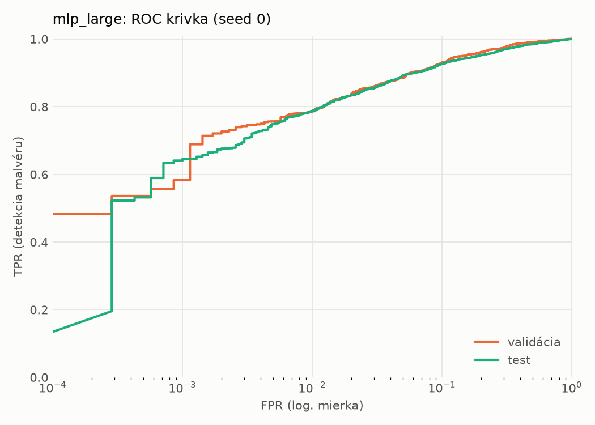
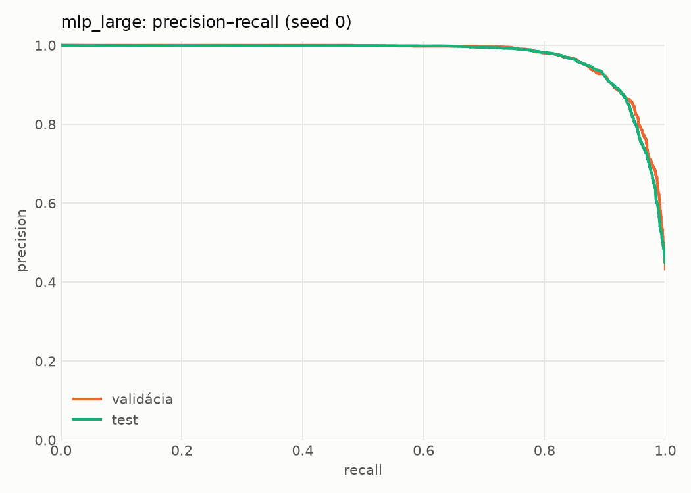
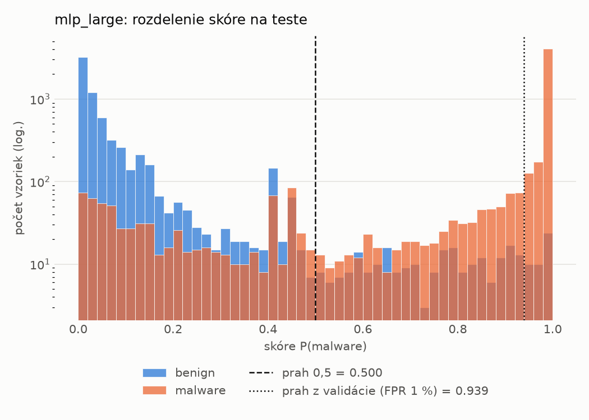
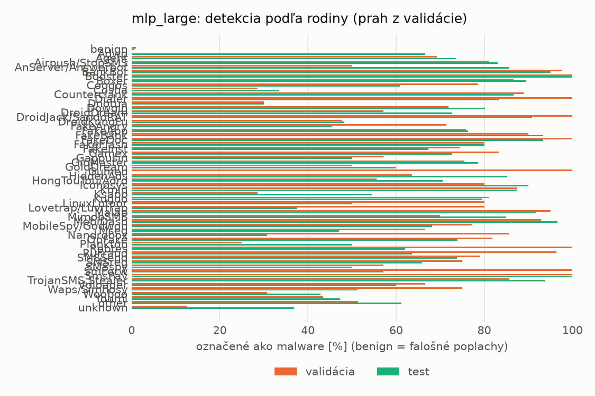
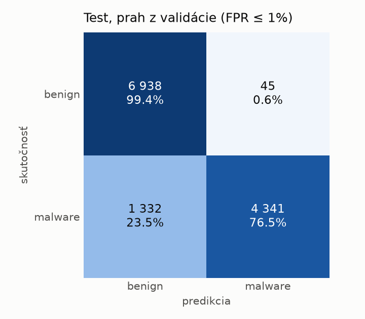
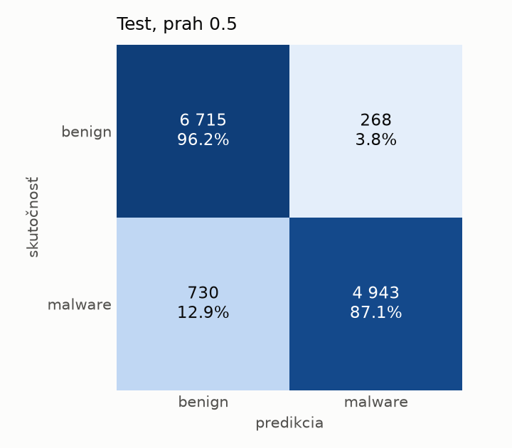
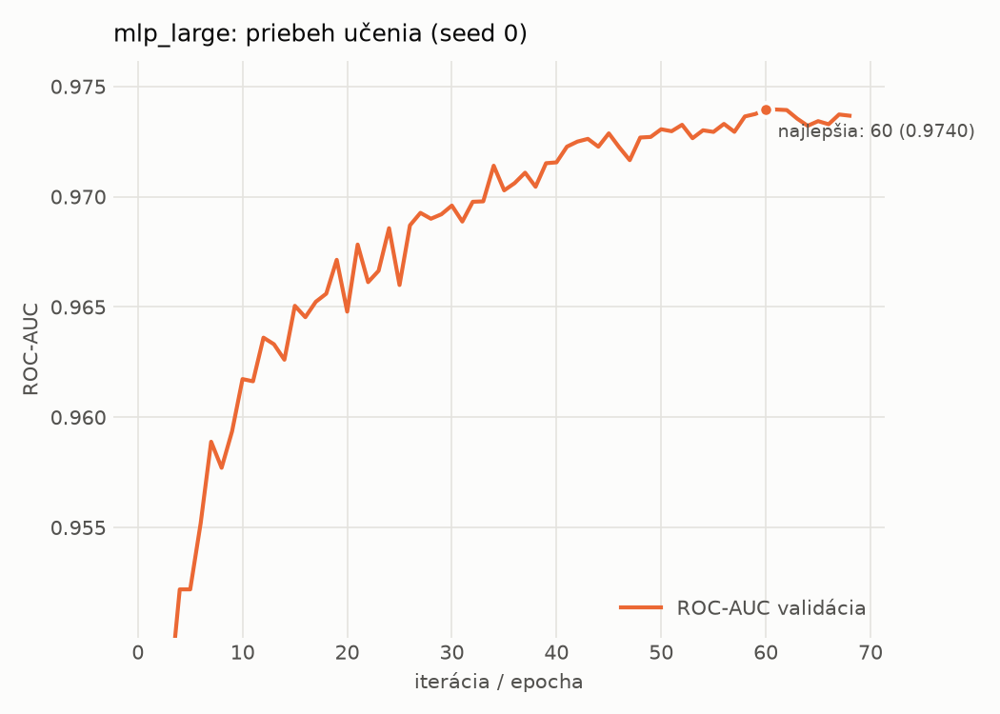

# dynamic/mlp_large – beh `20261123-185738`

> Automaticky generované (`src/training/run_tabular.py`). Konfigurácia: `config.yaml`, protokol: `protocol.yaml`.

- **Model:** `mlp` – veľká neurónová sieť (3–5 skrytých vrstiev, 512–2048 neurónov), kandidát na učiteľa
- **Ladenie:** bez ladenia – hyperparametre prevzaté z `runs_v4/real_p/full/dynamic/mlp_large/20261122-235153`
- **Finálne modely:** seedy [0, 1, 2]; hodnoty sú priemer ± smerodajná odchýlka cez seedy
- **Najlepšie hyperparametre:** `{"max_epochs": 100, "patience": 8, "hidden_layers": 5, "hidden_width": 512, "width_decay": 1.0, "dropout": 0.3998176791356432, "lr": 0.0024125104549951384, "weight_decay": 1.1960883604412328e-06, "batch_size": 1024}`

## Detekčná kvalita (bez prahu)
| metrika | train (podvzorka) | validácia | test |
|---|---|---|---|
| ROC-AUC | 0.9874 ± 0.0009 | 0.9742 ± 0.0005 | 0.9701 ± 0.0009 |
| PR-AUC | 0.9866 ± 0.0009 | 0.9737 ± 0.0005 | 0.9718 ± 0.0008 |
| TPR pri FPR 1 % | 0.8928 ± 0.0064 | 0.7904 ± 0.0062 | 0.7937 ± 0.0072 |
| TPR pri FPR 0,1 % | 0.8069 ± 0.0150 | 0.6103 ± 0.0618 | 0.6455 ± 0.0132 |
| log loss | 0.1287 ± 0.0037 | 0.1987 ± 0.0014 | 0.2091 ± 0.0047 |
| Brier skóre | 0.0370 ± 0.0010 | 0.0573 ± 0.0004 | 0.0589 ± 0.0008 |

Rozdiel ROC-AUC train − validácia: **0.0132** (veľký rozdiel = preučenie).

## Pri prahu z validácie (FPR ≤ 1% na validácii)
| metrika | train (podvzorka) | validácia | test |
|---|---|---|---|
| accuracy | 0.9246 ± 0.0008 | 0.9037 ± 0.0027 | 0.8914 ± 0.0005 |
| balanced accuracy | 0.9113 ± 0.0009 | 0.8903 ± 0.0031 | 0.8796 ± 0.0007 |
| precision | 0.9973 ± 0.0004 | 0.9841 ± 0.0001 | 0.9900 ± 0.0008 |
| recall (TPR) | 0.8242 ± 0.0017 | 0.7904 ± 0.0062 | 0.7654 ± 0.0018 |
| FPR | 0.0016 ± 0.0003 | 0.0097 ± 0.0000 | 0.0063 ± 0.0005 |
| F1 | 0.9025 ± 0.0011 | 0.8767 ± 0.0038 | 0.8633 ± 0.0009 |
| MCC | 0.8521 ± 0.0016 | 0.8121 ± 0.0050 | 0.7933 ± 0.0008 |

## Pri pevnom prahu 0.5
| metrika | train (podvzorka) | validácia | test |
|---|---|---|---|
| accuracy | 0.9512 ± 0.0021 | 0.9218 ± 0.0013 | 0.9217 ± 0.0009 |
| balanced accuracy | 0.9474 ± 0.0022 | 0.9181 ± 0.0020 | 0.9176 ± 0.0015 |
| precision | 0.9612 ± 0.0036 | 0.9262 ± 0.0058 | 0.9434 ± 0.0055 |
| recall (TPR) | 0.9221 ± 0.0041 | 0.8906 ± 0.0087 | 0.8780 ± 0.0078 |
| FPR | 0.0274 ± 0.0026 | 0.0543 ± 0.0051 | 0.0428 ± 0.0048 |
| F1 | 0.9412 ± 0.0026 | 0.9080 ± 0.0021 | 0.9095 ± 0.0017 |
| MCC | 0.9001 ± 0.0043 | 0.8406 ± 0.0027 | 0.8424 ± 0.0014 |

## Výpočtové nároky (seed 0, testovacia množina)
| meranie | hodnota |
|---|---|
| tréning finálneho modelu | 7.8 s (priemer cez seedy) |
| ladenie spolu | 0 s |
| počet parametrov / uzlov | 1 119 745 |
| veľkosť modelu na disku | 4.51 MB |
| transformácia vstupu – latencia (1 vlákno) | 0.015 ms |
| transformácia vstupu – priepustnosť | 766 060 vzoriek/s |
| CPU latencia modelu (batch 1, 1 vlákno) | 0.217 ms (p95 0.571) |
| CPU priepustnosť (24 vlákien) | 301 879 vzoriek/s |
| GPU latencia (batch 1) | 0.591 ms (p95 1.382) |
| GPU priepustnosť | 1 681 548 vzoriek/s |
| GPU špičková pamäť | 115 MB |

## Grafy
| | |
|---|---|
|  |  |
|  |  |
|  |  |
|  |  |

## Súbory
`metrics.json` (všetky metriky po seedoch vrátane rodín), `timing.json`, `hpo_trials.csv`,
`predictions/<časť>_seed<N>.parquet` (sha256, family, label, score), `model/seed_<N>/`, `log.txt`.
