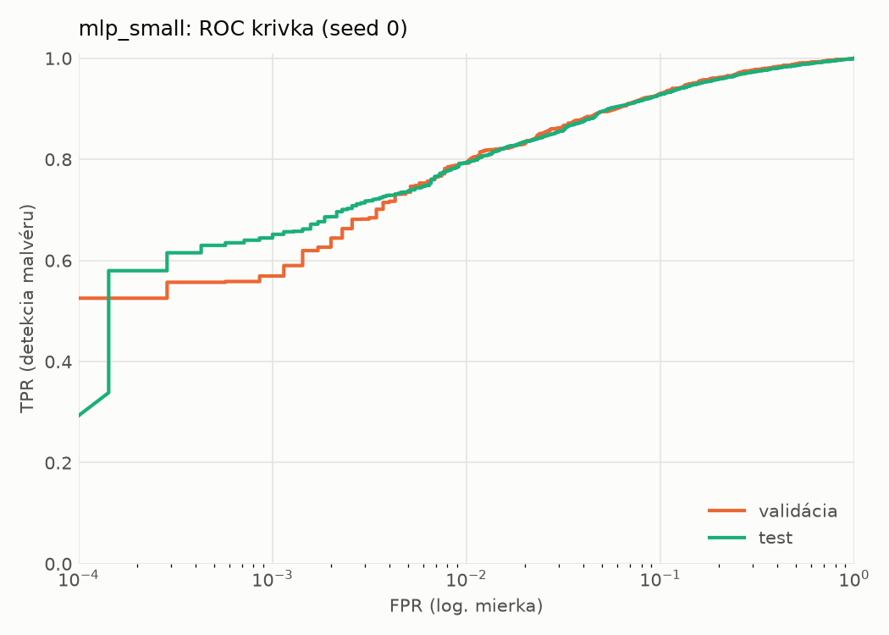
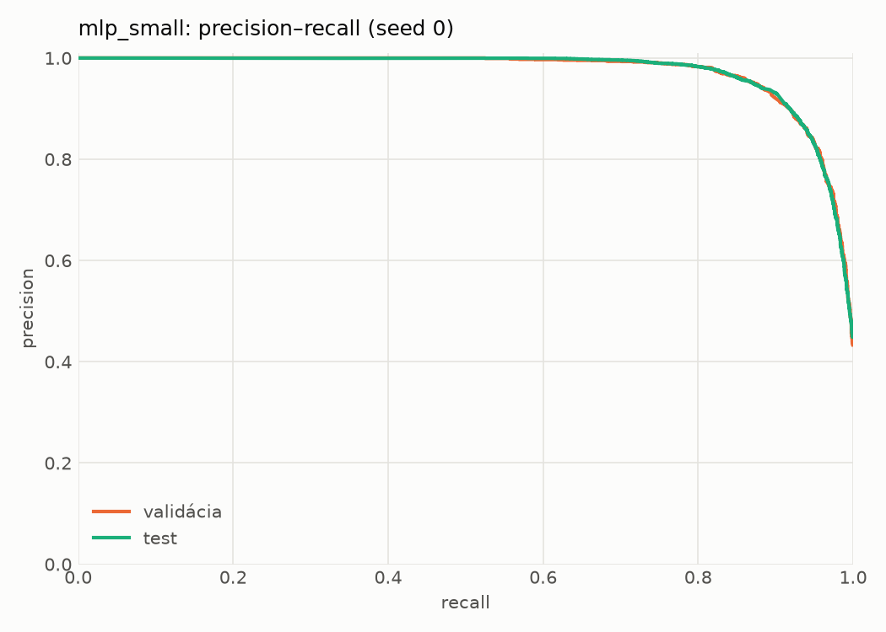
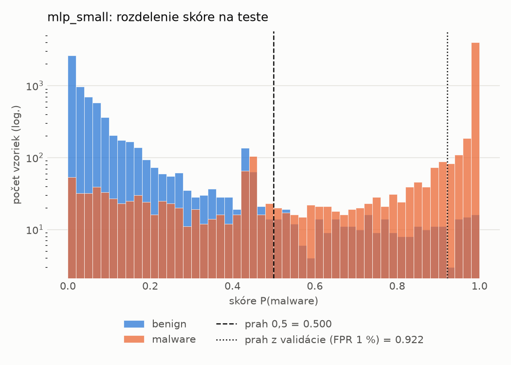
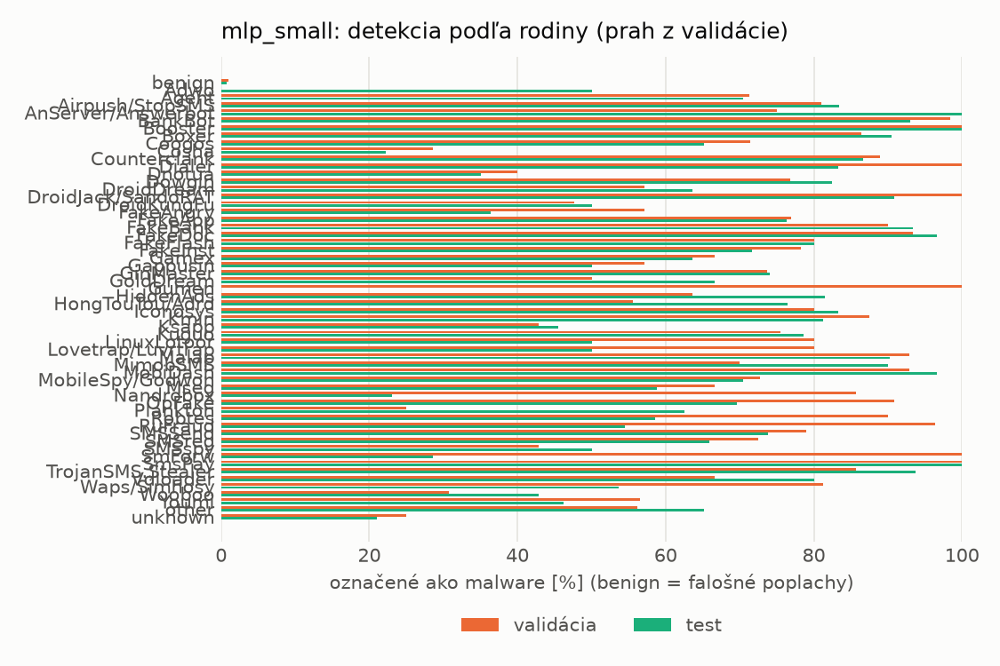
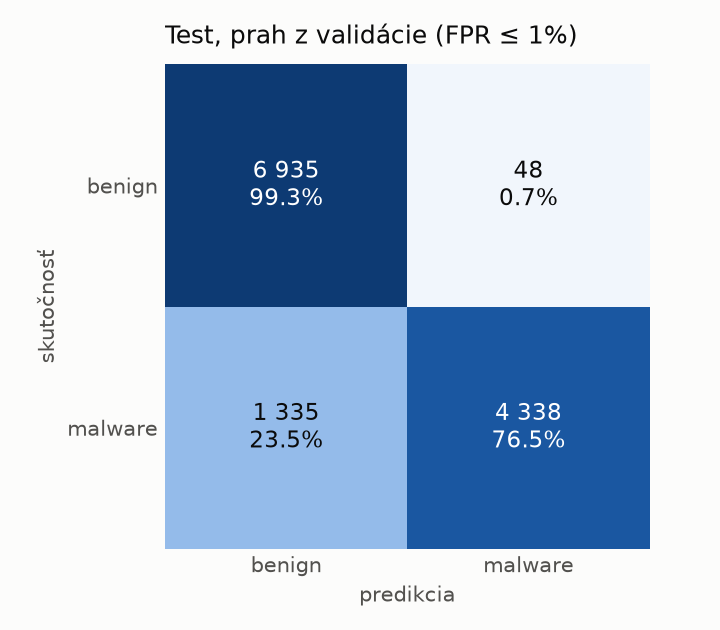
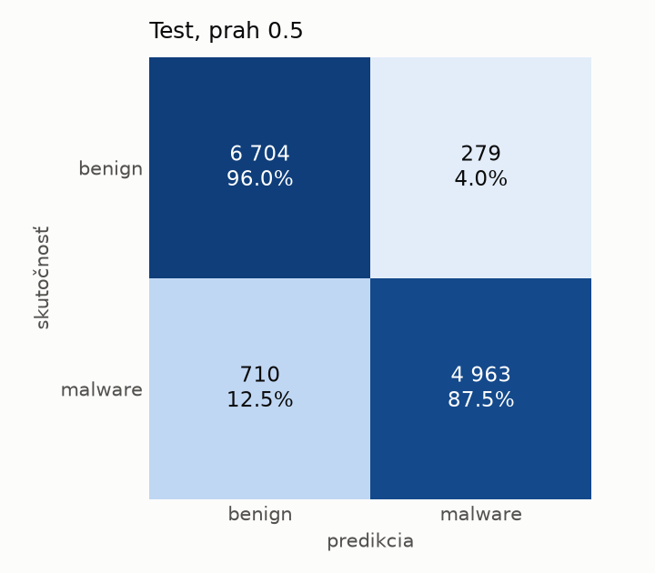
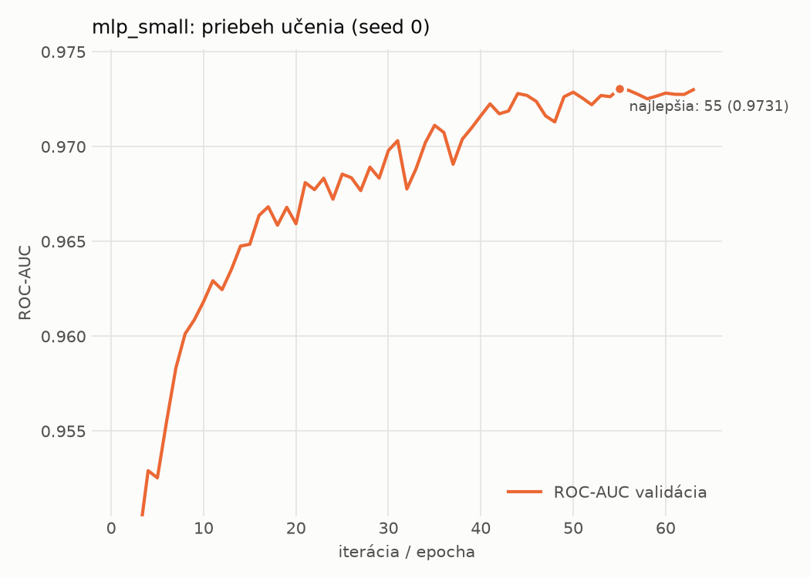

# dynamic/mlp_small – beh `20261123-185642`

> Automaticky generované (`src/training/run_tabular.py`). Konfigurácia: `config.yaml`, protokol: `protocol.yaml`.

- **Model:** `mlp` – malá neurónová sieť (1–2 skryté vrstvy), kandidát na ľahkého študenta
- **Ladenie:** bez ladenia – hyperparametre prevzaté z `runs_v4/real_p/full/dynamic/mlp_small/20261122-234317`
- **Finálne modely:** seedy [0, 1, 2]; hodnoty sú priemer ± smerodajná odchýlka cez seedy
- **Najlepšie hyperparametre:** `{"width_decay": 0.5, "max_epochs": 100, "patience": 8, "hidden_layers": 2, "hidden_width": 256, "dropout": 0.2449160262890371, "lr": 0.002872548733508973, "weight_decay": 4.509331245708397e-06, "batch_size": 256}`

## Detekčná kvalita (bez prahu)
| metrika | train (podvzorka) | validácia | test |
|---|---|---|---|
| ROC-AUC | 0.9875 ± 0.0003 | 0.9731 ± 0.0003 | 0.9715 ± 0.0005 |
| PR-AUC | 0.9866 ± 0.0003 | 0.9728 ± 0.0002 | 0.9731 ± 0.0004 |
| TPR pri FPR 1 % | 0.8927 ± 0.0039 | 0.7916 ± 0.0062 | 0.7938 ± 0.0006 |
| TPR pri FPR 0,1 % | 0.8036 ± 0.0074 | 0.5600 ± 0.0110 | 0.6485 ± 0.0090 |
| log loss | 0.1305 ± 0.0012 | 0.2052 ± 0.0011 | 0.2068 ± 0.0011 |
| Brier skóre | 0.0373 ± 0.0002 | 0.0576 ± 0.0006 | 0.0580 ± 0.0003 |

Rozdiel ROC-AUC train − validácia: **0.0143** (veľký rozdiel = preučenie).

## Pri prahu z validácie (FPR ≤ 1% na validácii)
| metrika | train (podvzorka) | validácia | test |
|---|---|---|---|
| accuracy | 0.9255 ± 0.0035 | 0.9043 ± 0.0027 | 0.8908 ± 0.0019 |
| balanced accuracy | 0.9125 ± 0.0041 | 0.8910 ± 0.0031 | 0.8790 ± 0.0022 |
| precision | 0.9964 ± 0.0004 | 0.9843 ± 0.0003 | 0.9888 ± 0.0003 |
| recall (TPR) | 0.8272 ± 0.0081 | 0.7916 ± 0.0062 | 0.7650 ± 0.0046 |
| FPR | 0.0022 ± 0.0003 | 0.0096 ± 0.0002 | 0.0070 ± 0.0002 |
| F1 | 0.9039 ± 0.0049 | 0.8775 ± 0.0039 | 0.8626 ± 0.0028 |
| MCC | 0.8537 ± 0.0066 | 0.8133 ± 0.0051 | 0.7920 ± 0.0034 |

## Pri pevnom prahu 0.5
| metrika | train (podvzorka) | validácia | test |
|---|---|---|---|
| accuracy | 0.9518 ± 0.0005 | 0.9234 ± 0.0021 | 0.9222 ± 0.0003 |
| balanced accuracy | 0.9479 ± 0.0008 | 0.9193 ± 0.0020 | 0.9180 ± 0.0006 |
| precision | 0.9620 ± 0.0030 | 0.9311 ± 0.0039 | 0.9447 ± 0.0030 |
| recall (TPR) | 0.9227 ± 0.0038 | 0.8889 ± 0.0026 | 0.8778 ± 0.0038 |
| FPR | 0.0268 ± 0.0023 | 0.0503 ± 0.0030 | 0.0418 ± 0.0025 |
| F1 | 0.9419 ± 0.0007 | 0.9095 ± 0.0024 | 0.9100 ± 0.0007 |
| MCC | 0.9013 ± 0.0010 | 0.8439 ± 0.0042 | 0.8434 ± 0.0004 |

## Výpočtové nároky (seed 0, testovacia množina)
| meranie | hodnota |
|---|---|
| tréning finálneho modelu | 18.1 s (priemer cez seedy) |
| ladenie spolu | 0 s |
| počet parametrov / uzlov | 65 537 |
| veľkosť modelu na disku | 0.27 MB |
| transformácia vstupu – latencia (1 vlákno) | 0.006 ms |
| transformácia vstupu – priepustnosť | 1 193 051 vzoriek/s |
| CPU latencia modelu (batch 1, 1 vlákno) | 0.077 ms (p95 0.091) |
| CPU priepustnosť (24 vlákien) | 2 775 378 vzoriek/s |
| GPU latencia (batch 1) | 0.662 ms (p95 0.709) |
| GPU priepustnosť | 2 391 218 vzoriek/s |
| GPU špičková pamäť | 66 MB |

## Grafy
| | |
|---|---|
|  |  |
|  |  |
|  |  |
|  |  |

## Súbory
`metrics.json` (všetky metriky po seedoch vrátane rodín), `timing.json`, `hpo_trials.csv`,
`predictions/<časť>_seed<N>.parquet` (sha256, family, label, score), `model/seed_<N>/`, `log.txt`.
