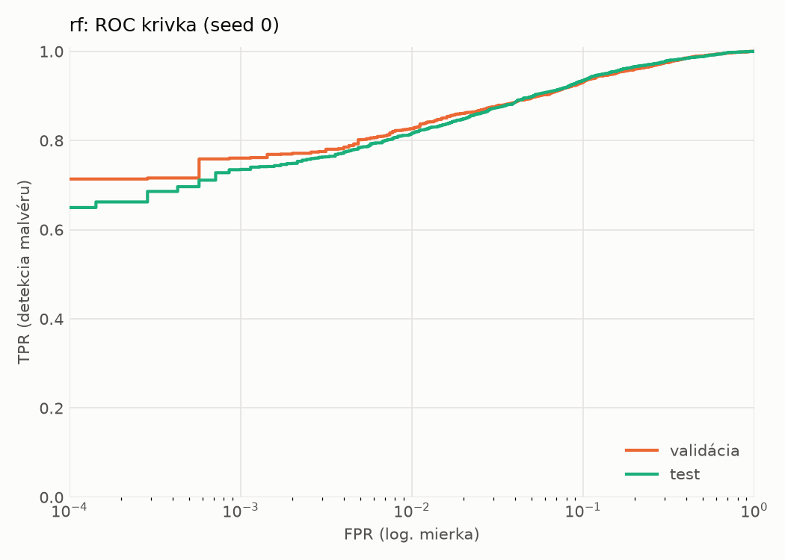
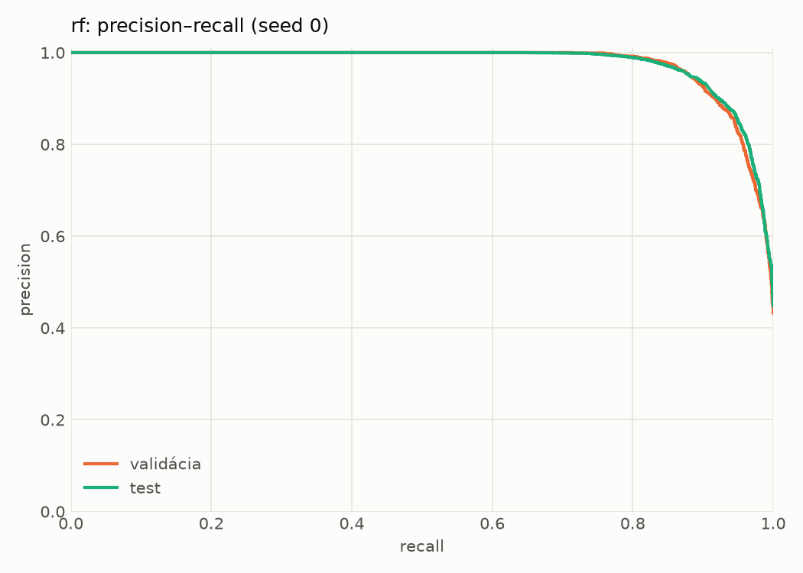
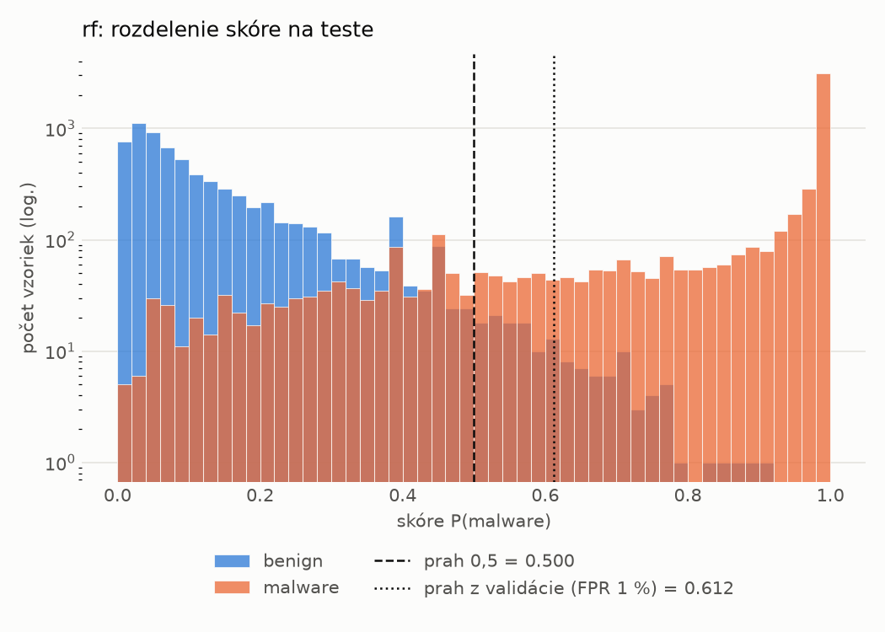
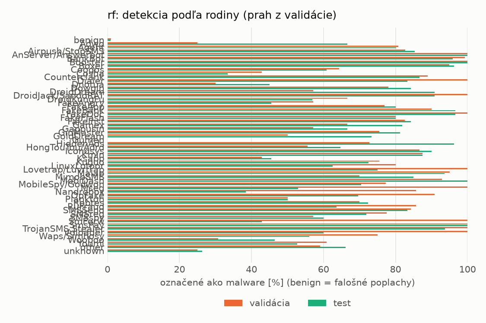
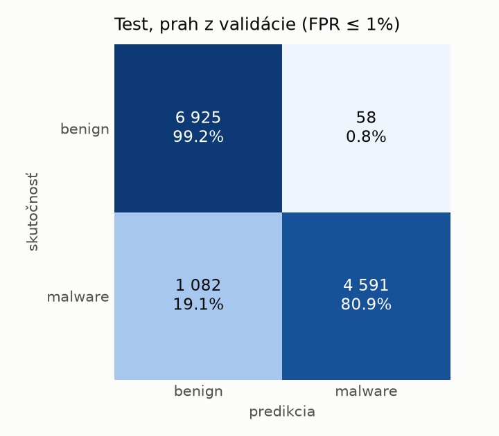
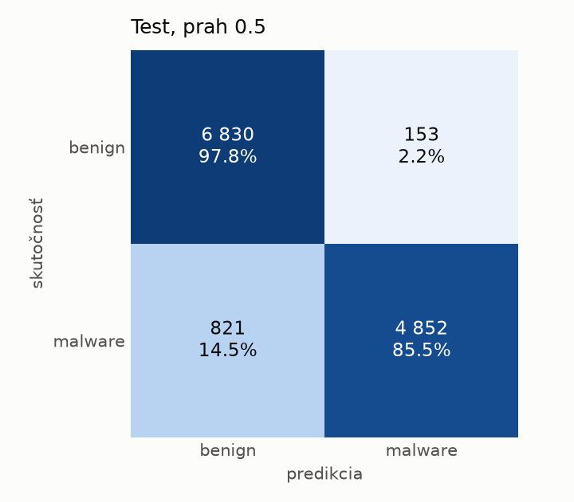

# dynamic/rf – beh `20261123-185546`

> Automaticky generované (`src/training/run_tabular.py`). Konfigurácia: `config.yaml`, protokol: `protocol.yaml`.

- **Model:** `random_forest` – Random Forest (pôvodné hodnoty príznakov)
- **Ladenie:** bez ladenia – hyperparametre prevzaté z `runs_v4/real_p/full/dynamic/rf/20261122-233325`
- **Finálne modely:** seedy [0, 1, 2]; hodnoty sú priemer ± smerodajná odchýlka cez seedy
- **Najlepšie hyperparametre:** `{"n_estimators": 500, "max_depth": 24, "min_samples_leaf": 1, "max_features": "sqrt"}`

## Detekčná kvalita (bez prahu)
| metrika | train (podvzorka) | validácia | test |
|---|---|---|---|
| ROC-AUC | 0.9981 ± 0.0000 | 0.9752 ± 0.0002 | 0.9757 ± 0.0001 |
| PR-AUC | 0.9979 ± 0.0000 | 0.9756 ± 0.0002 | 0.9768 ± 0.0001 |
| TPR pri FPR 1 % | 0.9741 ± 0.0001 | 0.8283 ± 0.0015 | 0.8163 ± 0.0016 |
| TPR pri FPR 0,1 % | 0.9659 ± 0.0007 | 0.7622 ± 0.0097 | 0.7267 ± 0.0070 |
| log loss | 0.0873 ± 0.0001 | 0.1980 ± 0.0002 | 0.2041 ± 0.0004 |
| Brier skóre | 0.0178 ± 0.0000 | 0.0566 ± 0.0001 | 0.0591 ± 0.0001 |

Rozdiel ROC-AUC train − validácia: **0.0230** (veľký rozdiel = preučenie).

## Pri prahu z validácie (FPR ≤ 1% na validácii)
| metrika | train (podvzorka) | validácia | test |
|---|---|---|---|
| accuracy | 0.9803 ± 0.0003 | 0.9201 ± 0.0007 | 0.9107 ± 0.0007 |
| balanced accuracy | 0.9768 ± 0.0003 | 0.9093 ± 0.0008 | 0.9014 ± 0.0008 |
| precision | 0.9998 ± 0.0000 | 0.9848 ± 0.0000 | 0.9869 ± 0.0005 |
| recall (TPR) | 0.9538 ± 0.0006 | 0.8283 ± 0.0015 | 0.8114 ± 0.0020 |
| FPR | 0.0002 ± 0.0000 | 0.0097 ± 0.0000 | 0.0087 ± 0.0004 |
| F1 | 0.9762 ± 0.0003 | 0.8998 ± 0.0009 | 0.8906 ± 0.0010 |
| MCC | 0.9602 ± 0.0005 | 0.8428 ± 0.0012 | 0.8275 ± 0.0012 |

## Pri pevnom prahu 0.5
| metrika | train (podvzorka) | validácia | test |
|---|---|---|---|
| accuracy | 0.9842 ± 0.0004 | 0.9288 ± 0.0009 | 0.9224 ± 0.0007 |
| balanced accuracy | 0.9814 ± 0.0004 | 0.9215 ± 0.0009 | 0.9160 ± 0.0007 |
| precision | 0.9995 ± 0.0000 | 0.9656 ± 0.0012 | 0.9688 ± 0.0009 |
| recall (TPR) | 0.9632 ± 0.0009 | 0.8665 ± 0.0014 | 0.8543 ± 0.0009 |
| FPR | 0.0003 ± 0.0000 | 0.0236 ± 0.0008 | 0.0223 ± 0.0006 |
| F1 | 0.9810 ± 0.0004 | 0.9134 ± 0.0011 | 0.9079 ± 0.0008 |
| MCC | 0.9680 ± 0.0007 | 0.8569 ± 0.0019 | 0.8462 ± 0.0014 |

## Výpočtové nároky (seed 0, testovacia množina)
| meranie | hodnota |
|---|---|
| tréning finálneho modelu | 2.4 s (priemer cez seedy) |
| ladenie spolu | 0 s |
| počet parametrov / uzlov | 3 224 024 |
| veľkosť modelu na disku | 258.30 MB |
| CPU latencia modelu (batch 1, 1 vlákno) | 14.692 ms (p95 15.385) |
| CPU priepustnosť (24 vlákien) | 111 887 vzoriek/s |

## Grafy
| | |
|---|---|
|  |  |
|  |  |
|  |  |
|  |  |

## Súbory
`metrics.json` (všetky metriky po seedoch vrátane rodín), `timing.json`, `hpo_trials.csv`,
`predictions/<časť>_seed<N>.parquet` (sha256, family, label, score), `model/seed_<N>/`, `log.txt`.
