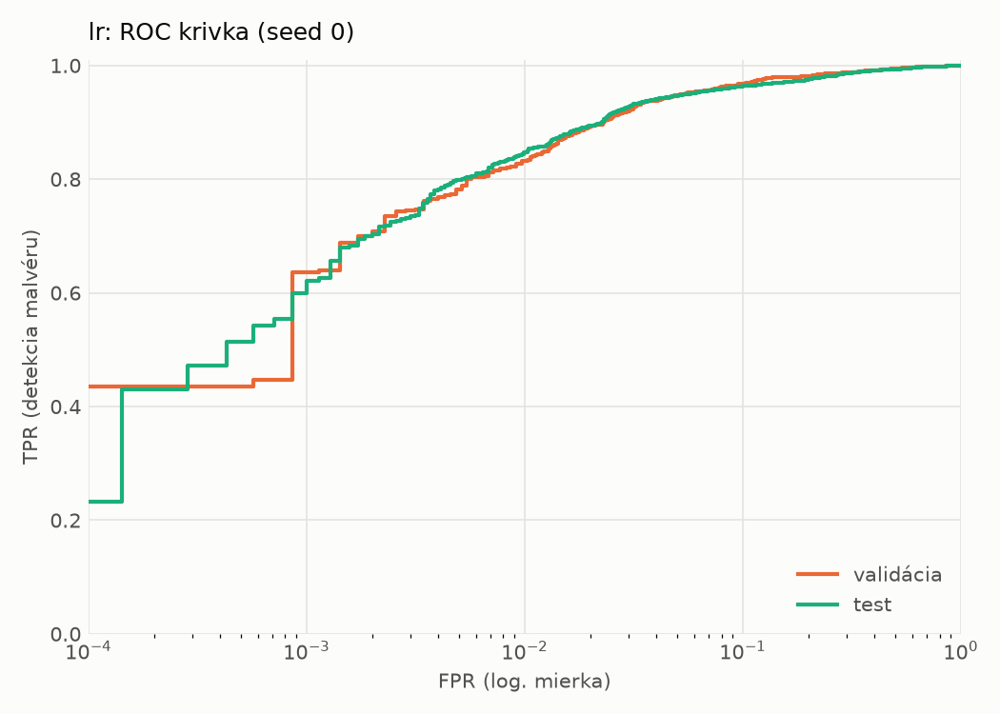
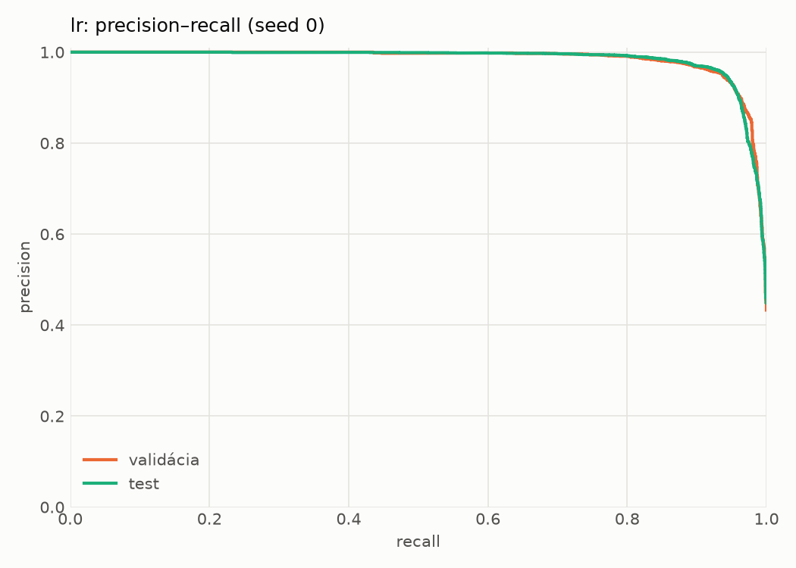
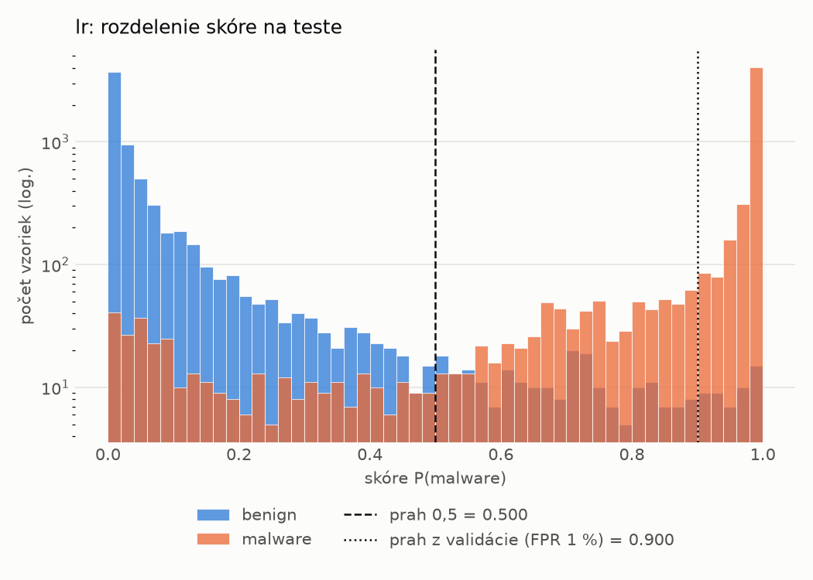
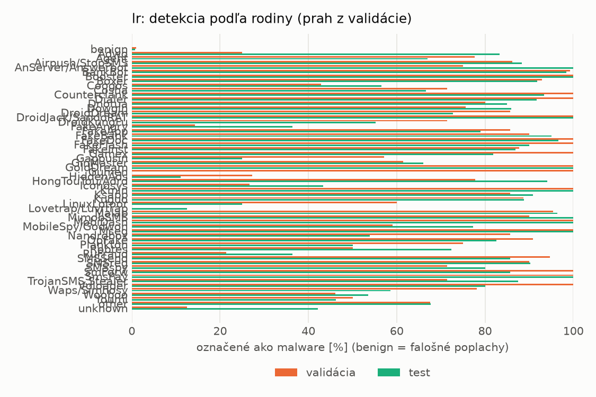
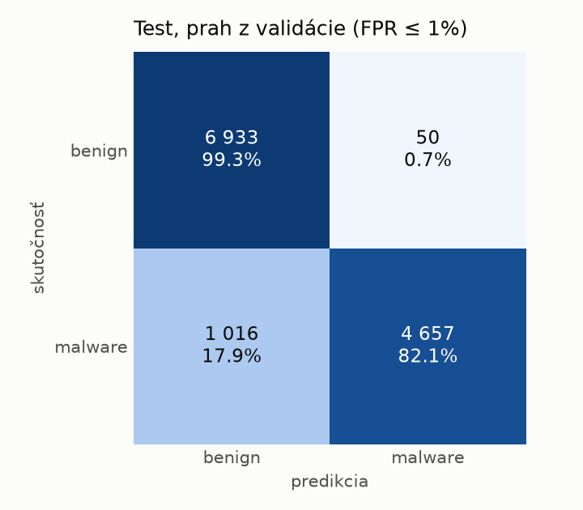
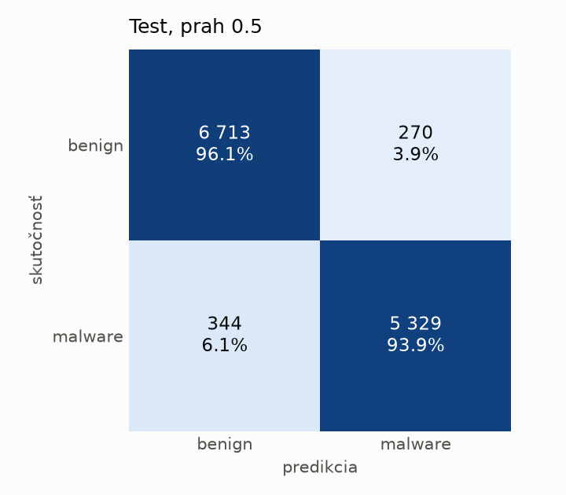

# hybrid/lr – beh `20261123-185807`

> Automaticky generované (`src/training/run_tabular.py`). Konfigurácia: `config.yaml`, protokol: `protocol.yaml`.

- **Model:** `logreg` – logistická regresia s L2 regularizáciou (vstup signed log1p + štandardizácia)
- **Ladenie:** bez ladenia – hyperparametre prevzaté z `runs_v4/real_p/full/hybrid/lr/20261122-235738`
- **Finálne modely:** seedy [0, 1, 2]; hodnoty sú priemer ± smerodajná odchýlka cez seedy
- **Najlepšie hyperparametre:** `{"max_iter": 2000, "C": 0.07124252843547843}`

## Detekčná kvalita (bez prahu)
| metrika | train (podvzorka) | validácia | test |
|---|---|---|---|
| ROC-AUC | 0.9889 ± 0.0000 | 0.9855 ± 0.0000 | 0.9839 ± 0.0000 |
| PR-AUC | 0.9881 ± 0.0000 | 0.9846 ± 0.0000 | 0.9843 ± 0.0000 |
| TPR pri FPR 1 % | 0.8700 ± 0.0000 | 0.8326 ± 0.0000 | 0.8465 ± 0.0000 |
| TPR pri FPR 0,1 % | 0.6812 ± 0.0000 | 0.6360 ± 0.0000 | 0.6002 ± 0.0000 |
| log loss | 0.1231 ± 0.0000 | 0.1432 ± 0.0000 | 0.1484 ± 0.0000 |
| Brier skóre | 0.0332 ± 0.0000 | 0.0393 ± 0.0000 | 0.0400 ± 0.0000 |

Rozdiel ROC-AUC train − validácia: **0.0035** (veľký rozdiel = preučenie).

## Pri prahu z validácie (FPR ≤ 1% na validácii)
| metrika | train (podvzorka) | validácia | test |
|---|---|---|---|
| accuracy | 0.9285 ± 0.0000 | 0.9220 ± 0.0000 | 0.9158 ± 0.0000 |
| balanced accuracy | 0.9168 ± 0.0000 | 0.9115 ± 0.0000 | 0.9069 ± 0.0000 |
| precision | 0.9900 ± 0.0000 | 0.9849 ± 0.0000 | 0.9894 ± 0.0000 |
| recall (TPR) | 0.8398 ± 0.0000 | 0.8326 ± 0.0000 | 0.8209 ± 0.0000 |
| FPR | 0.0062 ± 0.0000 | 0.0097 ± 0.0000 | 0.0072 ± 0.0000 |
| F1 | 0.9087 ± 0.0000 | 0.9024 ± 0.0000 | 0.8973 ± 0.0000 |
| MCC | 0.8584 ± 0.0000 | 0.8464 ± 0.0000 | 0.8373 ± 0.0000 |

## Pri pevnom prahu 0.5
| metrika | train (podvzorka) | validácia | test |
|---|---|---|---|
| accuracy | 0.9591 ± 0.0000 | 0.9501 ± 0.0000 | 0.9515 ± 0.0000 |
| balanced accuracy | 0.9577 ± 0.0000 | 0.9488 ± 0.0000 | 0.9503 ± 0.0000 |
| precision | 0.9549 ± 0.0000 | 0.9456 ± 0.0000 | 0.9518 ± 0.0000 |
| recall (TPR) | 0.9483 ± 0.0000 | 0.9388 ± 0.0000 | 0.9394 ± 0.0000 |
| FPR | 0.0330 ± 0.0000 | 0.0413 ± 0.0000 | 0.0387 ± 0.0000 |
| F1 | 0.9516 ± 0.0000 | 0.9422 ± 0.0000 | 0.9455 ± 0.0000 |
| MCC | 0.9162 ± 0.0000 | 0.8983 ± 0.0000 | 0.9019 ± 0.0000 |

## Výpočtové nároky (seed 0, testovacia množina)
| meranie | hodnota |
|---|---|
| tréning finálneho modelu | 0.2 s (priemer cez seedy) |
| ladenie spolu | 0 s |
| počet parametrov / uzlov | 287 |
| veľkosť modelu na disku | 0.01 MB |
| transformácia vstupu – latencia (1 vlákno) | 0.007 ms |
| transformácia vstupu – priepustnosť | 503 591 vzoriek/s |
| CPU latencia modelu (batch 1, 1 vlákno) | 0.004 ms (p95 0.004) |
| CPU priepustnosť (24 vlákien) | 2 435 954 vzoriek/s |

## Grafy
| | |
|---|---|
|  |  |
|  |  |
|  |  |
|  |  |

## Súbory
`metrics.json` (všetky metriky po seedoch vrátane rodín), `timing.json`, `hpo_trials.csv`,
`predictions/<časť>_seed<N>.parquet` (sha256, family, label, score), `model/seed_<N>/`, `log.txt`.
