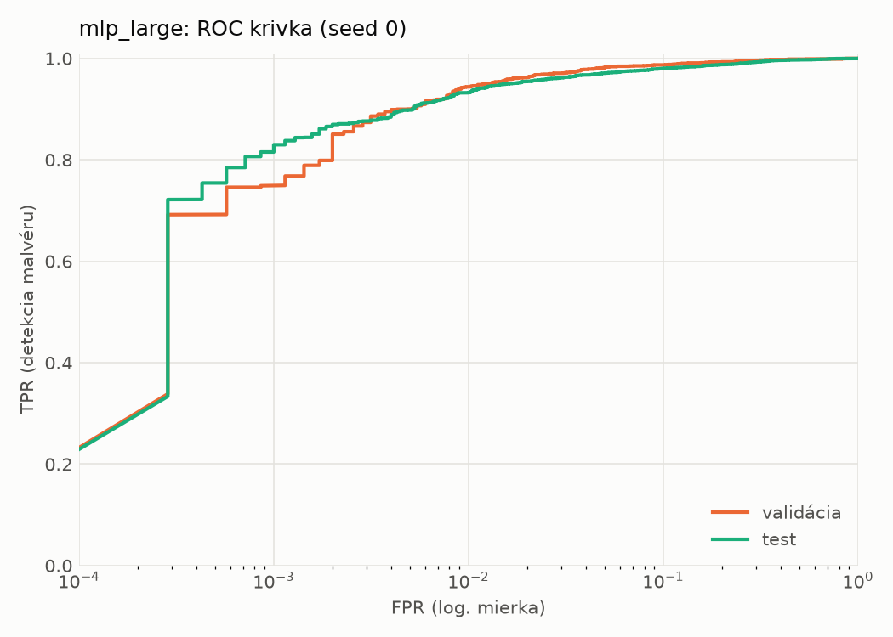
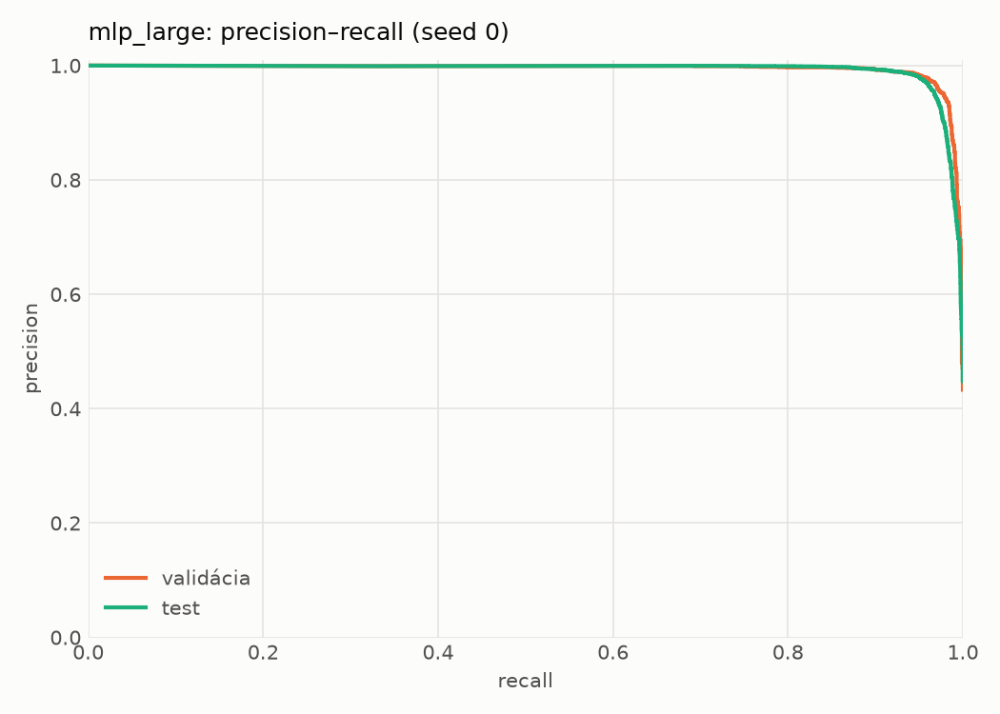
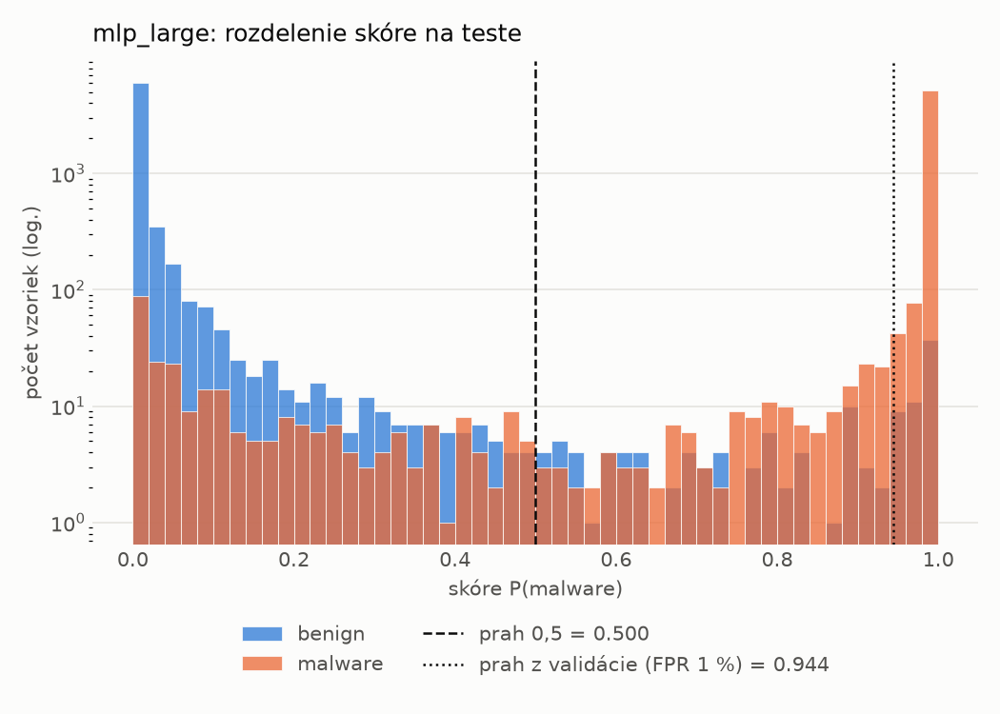
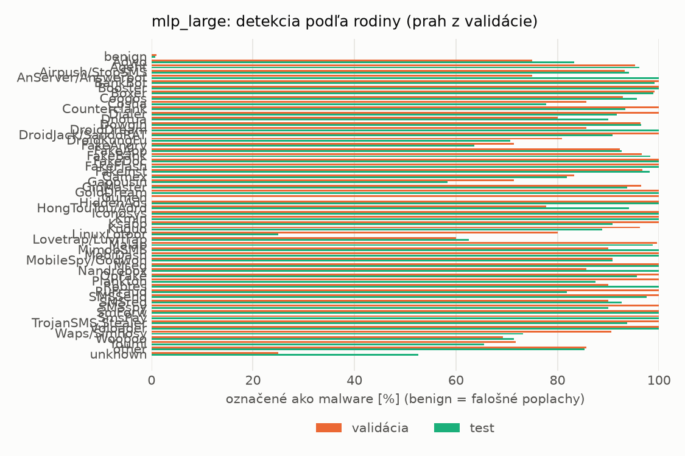
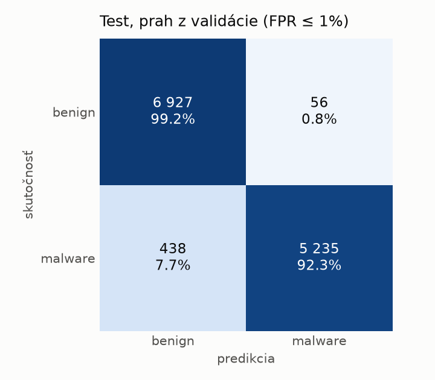
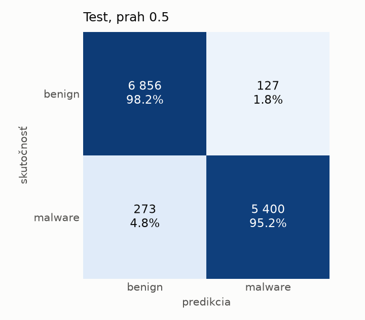
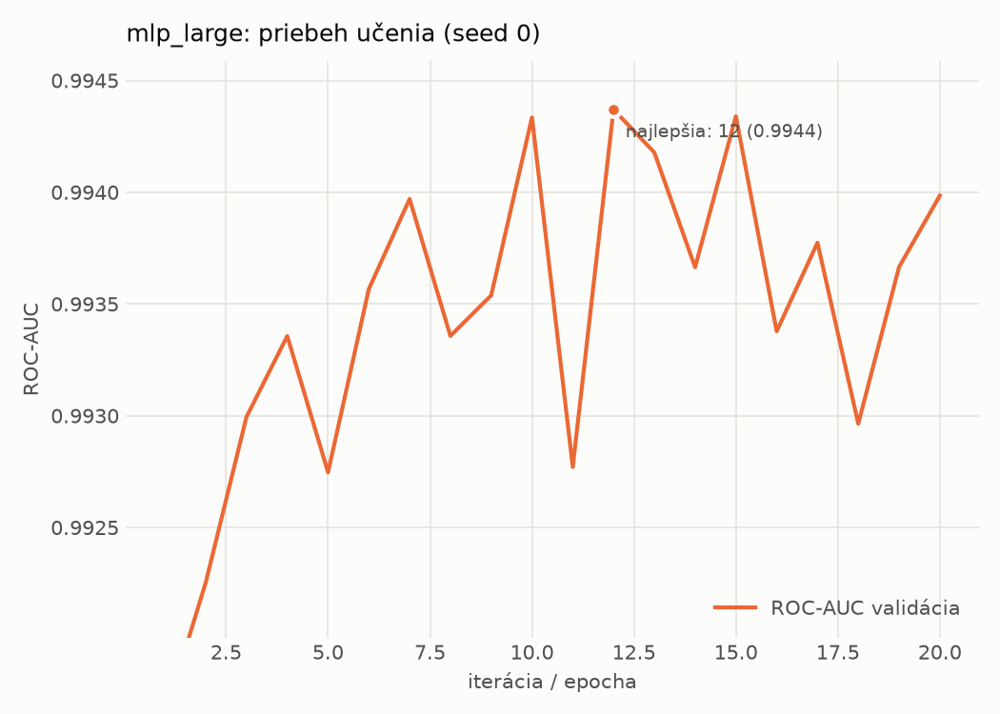

# hybrid/mlp_large – beh `20261123-185848`

> Automaticky generované (`src/training/run_tabular.py`). Konfigurácia: `config.yaml`, protokol: `protocol.yaml`.

- **Model:** `mlp` – veľká neurónová sieť (3–5 skrytých vrstiev, 512–2048 neurónov), kandidát na učiteľa
- **Ladenie:** bez ladenia – hyperparametre prevzaté z `runs_v4/real_p/full/hybrid/mlp_large/20261123-000809`
- **Finálne modely:** seedy [0, 1, 2]; hodnoty sú priemer ± smerodajná odchýlka cez seedy
- **Najlepšie hyperparametre:** `{"max_epochs": 100, "patience": 8, "hidden_layers": 3, "hidden_width": 1024, "width_decay": 1.0, "dropout": 0.11375540844608736, "lr": 0.0022038218939289885, "weight_decay": 1.0842262717330169e-05, "batch_size": 256}`

## Detekčná kvalita (bez prahu)
| metrika | train (podvzorka) | validácia | test |
|---|---|---|---|
| ROC-AUC | 0.9992 ± 0.0005 | 0.9941 ± 0.0003 | 0.9922 ± 0.0002 |
| PR-AUC | 0.9991 ± 0.0005 | 0.9938 ± 0.0002 | 0.9924 ± 0.0004 |
| TPR pri FPR 1 % | 0.9873 ± 0.0059 | 0.9443 ± 0.0124 | 0.9370 ± 0.0081 |
| TPR pri FPR 0,1 % | 0.9634 ± 0.0256 | 0.7593 ± 0.0351 | 0.8096 ± 0.0113 |
| log loss | 0.0291 ± 0.0097 | 0.1002 ± 0.0031 | 0.1139 ± 0.0029 |
| Brier skóre | 0.0077 ± 0.0027 | 0.0218 ± 0.0016 | 0.0258 ± 0.0019 |

Rozdiel ROC-AUC train − validácia: **0.0051** (veľký rozdiel = preučenie).

## Pri prahu z validácie (FPR ≤ 1% na validácii)
| metrika | train (podvzorka) | validácia | test |
|---|---|---|---|
| accuracy | 0.9833 ± 0.0066 | 0.9704 ± 0.0053 | 0.9626 ± 0.0044 |
| balanced accuracy | 0.9804 ± 0.0076 | 0.9673 ± 0.0061 | 0.9592 ± 0.0051 |
| precision | 0.9988 ± 0.0009 | 0.9868 ± 0.0001 | 0.9902 ± 0.0025 |
| recall (TPR) | 0.9616 ± 0.0146 | 0.9443 ± 0.0124 | 0.9258 ± 0.0119 |
| FPR | 0.0008 ± 0.0006 | 0.0096 ± 0.0002 | 0.0075 ± 0.0020 |
| F1 | 0.9798 ± 0.0080 | 0.9651 ± 0.0065 | 0.9569 ± 0.0054 |
| MCC | 0.9661 ± 0.0132 | 0.9402 ± 0.0105 | 0.9256 ± 0.0084 |

## Pri pevnom prahu 0.5
| metrika | train (podvzorka) | validácia | test |
|---|---|---|---|
| accuracy | 0.9905 ± 0.0041 | 0.9742 ± 0.0023 | 0.9691 ± 0.0033 |
| balanced accuracy | 0.9897 ± 0.0042 | 0.9733 ± 0.0023 | 0.9675 ± 0.0034 |
| precision | 0.9928 ± 0.0045 | 0.9731 ± 0.0027 | 0.9781 ± 0.0027 |
| recall (TPR) | 0.9847 ± 0.0052 | 0.9671 ± 0.0025 | 0.9522 ± 0.0048 |
| FPR | 0.0053 ± 0.0032 | 0.0204 ± 0.0021 | 0.0173 ± 0.0021 |
| F1 | 0.9887 ± 0.0048 | 0.9701 ± 0.0026 | 0.9650 ± 0.0037 |
| MCC | 0.9805 ± 0.0083 | 0.9474 ± 0.0046 | 0.9376 ± 0.0066 |

## Výpočtové nároky (seed 0, testovacia množina)
| meranie | hodnota |
|---|---|
| tréning finálneho modelu | 6.8 s (priemer cez seedy) |
| ladenie spolu | 0 s |
| počet parametrov / uzlov | 2 400 257 |
| veľkosť modelu na disku | 9.64 MB |
| transformácia vstupu – latencia (1 vlákno) | 0.017 ms |
| transformácia vstupu – priepustnosť | 287 702 vzoriek/s |
| CPU latencia modelu (batch 1, 1 vlákno) | 0.300 ms (p95 0.575) |
| CPU priepustnosť (24 vlákien) | 129 328 vzoriek/s |
| GPU latencia (batch 1) | 0.521 ms (p95 0.557) |
| GPU priepustnosť | 762 773 vzoriek/s |
| GPU špičková pamäť | 233 MB |

## Grafy
| | |
|---|---|
|  |  |
|  |  |
|  |  |
|  |  |

## Súbory
`metrics.json` (všetky metriky po seedoch vrátane rodín), `timing.json`, `hpo_trials.csv`,
`predictions/<časť>_seed<N>.parquet` (sha256, family, label, score), `model/seed_<N>/`, `log.txt`.
