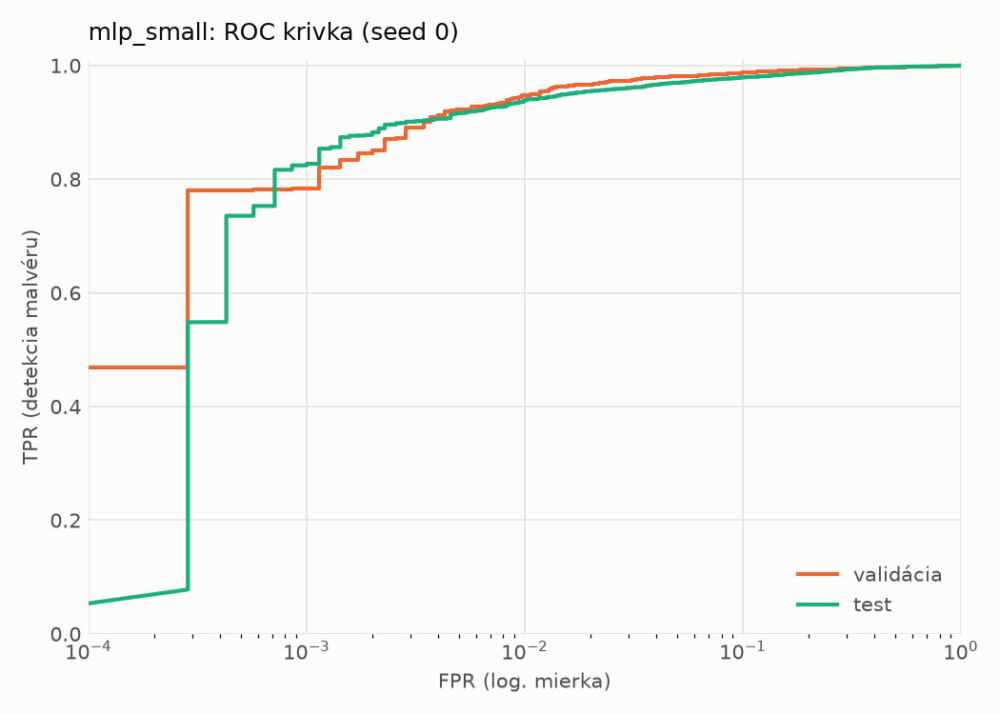
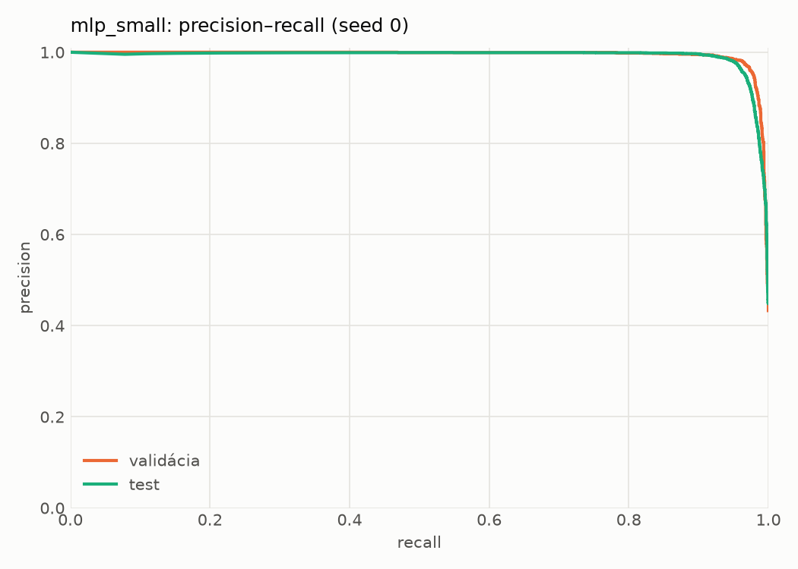
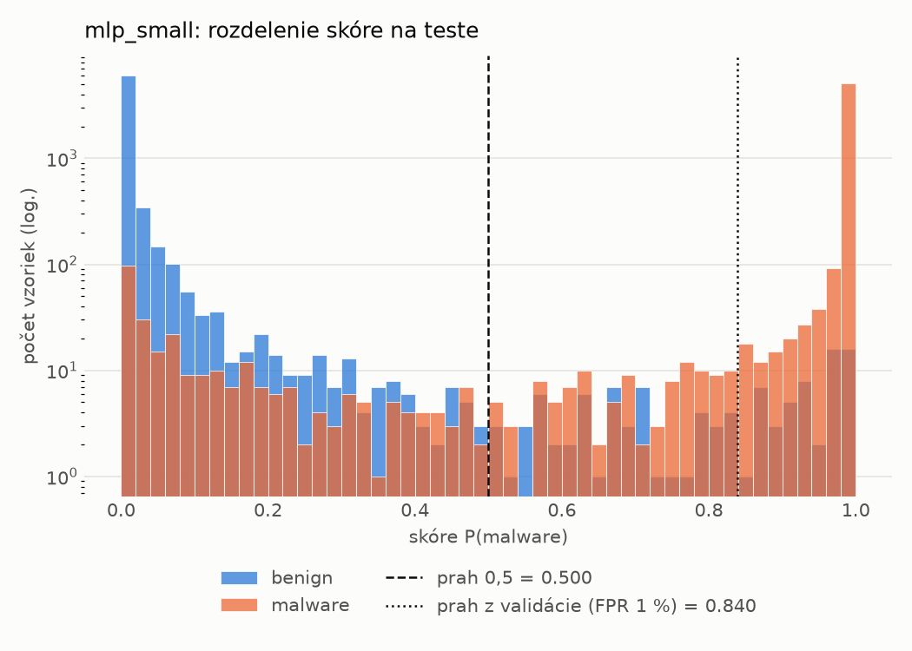
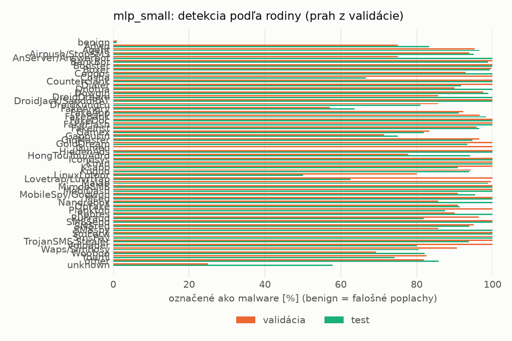
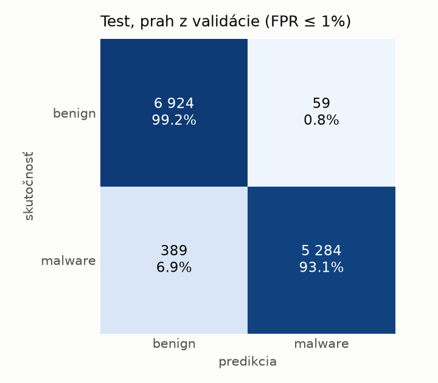
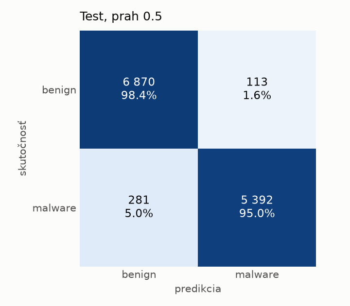
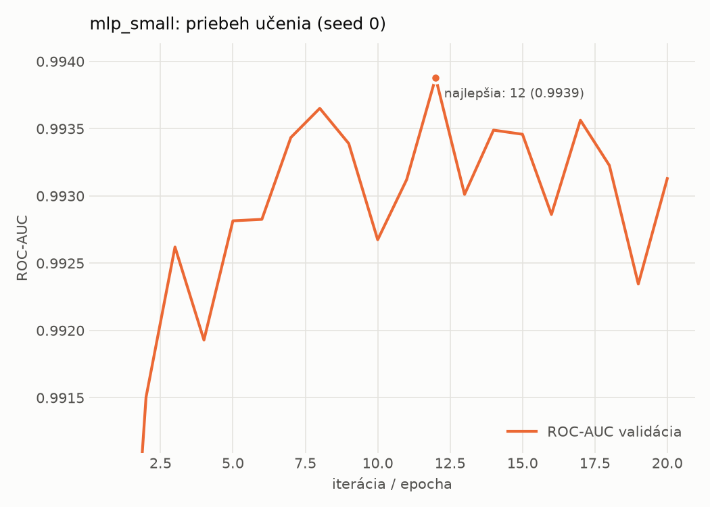

# hybrid/mlp_small – beh `20261123-185840`

> Automaticky generované (`src/training/run_tabular.py`). Konfigurácia: `config.yaml`, protokol: `protocol.yaml`.

- **Model:** `mlp` – malá neurónová sieť (1–2 skryté vrstvy), kandidát na ľahkého študenta
- **Ladenie:** bez ladenia – hyperparametre prevzaté z `runs_v4/real_p/full/hybrid/mlp_small/20261123-000512`
- **Finálne modely:** seedy [0, 1, 2]; hodnoty sú priemer ± smerodajná odchýlka cez seedy
- **Najlepšie hyperparametre:** `{"width_decay": 0.5, "max_epochs": 100, "patience": 8, "hidden_layers": 2, "hidden_width": 256, "dropout": 0.17059205009500078, "lr": 0.0013906274900964423, "weight_decay": 9.337519104222036e-06, "batch_size": 1024}`

## Detekčná kvalita (bez prahu)
| metrika | train (podvzorka) | validácia | test |
|---|---|---|---|
| ROC-AUC | 0.9992 ± 0.0003 | 0.9939 ± 0.0002 | 0.9923 ± 0.0008 |
| PR-AUC | 0.9991 ± 0.0003 | 0.9935 ± 0.0005 | 0.9923 ± 0.0009 |
| TPR pri FPR 1 % | 0.9891 ± 0.0025 | 0.9515 ± 0.0035 | 0.9435 ± 0.0053 |
| TPR pri FPR 0,1 % | 0.9730 ± 0.0060 | 0.7764 ± 0.0209 | 0.8358 ± 0.0101 |
| log loss | 0.0286 ± 0.0046 | 0.0870 ± 0.0007 | 0.1032 ± 0.0064 |
| Brier skóre | 0.0074 ± 0.0013 | 0.0201 ± 0.0005 | 0.0245 ± 0.0015 |

Rozdiel ROC-AUC train − validácia: **0.0054** (veľký rozdiel = preučenie).

## Pri prahu z validácie (FPR ≤ 1% na validácii)
| metrika | train (podvzorka) | validácia | test |
|---|---|---|---|
| accuracy | 0.9873 ± 0.0015 | 0.9735 ± 0.0015 | 0.9667 ± 0.0019 |
| balanced accuracy | 0.9852 ± 0.0017 | 0.9709 ± 0.0017 | 0.9638 ± 0.0020 |
| precision | 0.9991 ± 0.0005 | 0.9868 ± 0.0000 | 0.9897 ± 0.0007 |
| recall (TPR) | 0.9710 ± 0.0031 | 0.9515 ± 0.0035 | 0.9355 ± 0.0036 |
| FPR | 0.0006 ± 0.0004 | 0.0097 ± 0.0000 | 0.0079 ± 0.0005 |
| F1 | 0.9848 ± 0.0018 | 0.9688 ± 0.0018 | 0.9618 ± 0.0022 |
| MCC | 0.9743 ± 0.0030 | 0.9462 ± 0.0030 | 0.9335 ± 0.0037 |

## Pri pevnom prahu 0.5
| metrika | train (podvzorka) | validácia | test |
|---|---|---|---|
| accuracy | 0.9908 ± 0.0019 | 0.9755 ± 0.0004 | 0.9707 ± 0.0016 |
| balanced accuracy | 0.9899 ± 0.0020 | 0.9746 ± 0.0006 | 0.9691 ± 0.0018 |
| precision | 0.9939 ± 0.0018 | 0.9751 ± 0.0009 | 0.9805 ± 0.0010 |
| recall (TPR) | 0.9843 ± 0.0029 | 0.9681 ± 0.0020 | 0.9536 ± 0.0029 |
| FPR | 0.0045 ± 0.0013 | 0.0189 ± 0.0008 | 0.0154 ± 0.0008 |
| F1 | 0.9891 ± 0.0023 | 0.9716 ± 0.0005 | 0.9669 ± 0.0019 |
| MCC | 0.9812 ± 0.0039 | 0.9500 ± 0.0009 | 0.9410 ± 0.0033 |

## Výpočtové nároky (seed 0, testovacia množina)
| meranie | hodnota |
|---|---|
| tréning finálneho modelu | 1.8 s (priemer cez seedy) |
| ladenie spolu | 0 s |
| počet parametrov / uzlov | 107 265 |
| veľkosť modelu na disku | 0.45 MB |
| transformácia vstupu – latencia (1 vlákno) | 0.007 ms |
| transformácia vstupu – priepustnosť | 400 089 vzoriek/s |
| CPU latencia modelu (batch 1, 1 vlákno) | 0.229 ms (p95 0.241) |
| CPU priepustnosť (24 vlákien) | 1 167 829 vzoriek/s |
| GPU latencia (batch 1) | 0.415 ms (p95 0.451) |
| GPU priepustnosť | 1 409 857 vzoriek/s |
| GPU špičková pamäť | 107 MB |

## Grafy
| | |
|---|---|
|  |  |
|  |  |
|  |  |
|  |  |

## Súbory
`metrics.json` (všetky metriky po seedoch vrátane rodín), `timing.json`, `hpo_trials.csv`,
`predictions/<časť>_seed<N>.parquet` (sha256, family, label, score), `model/seed_<N>/`, `log.txt`.
