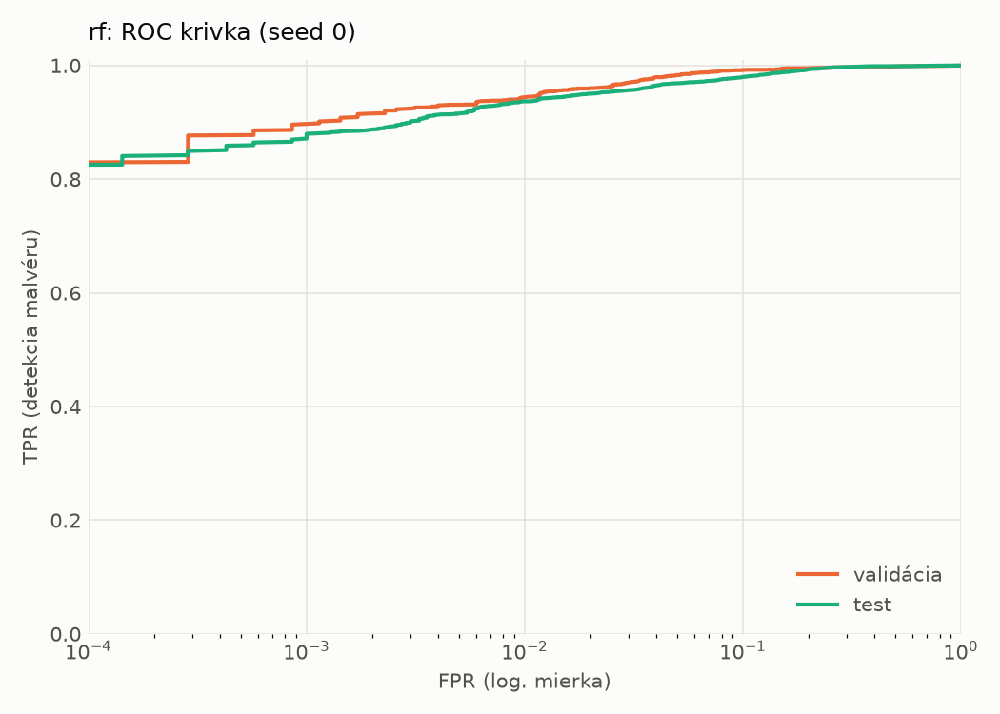
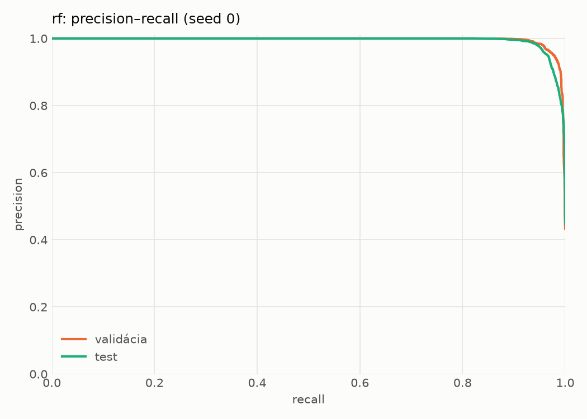
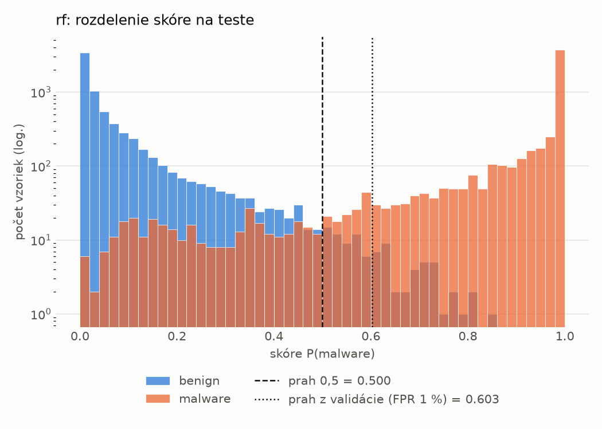
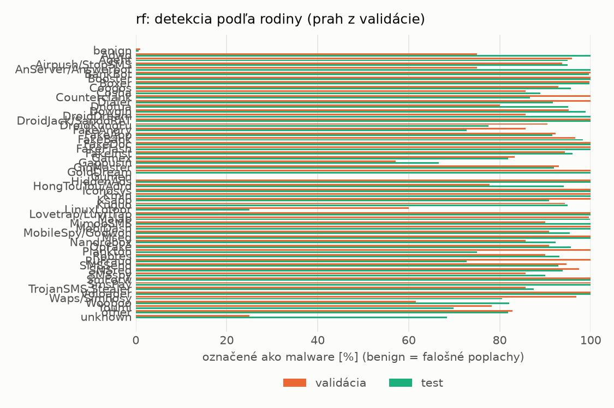
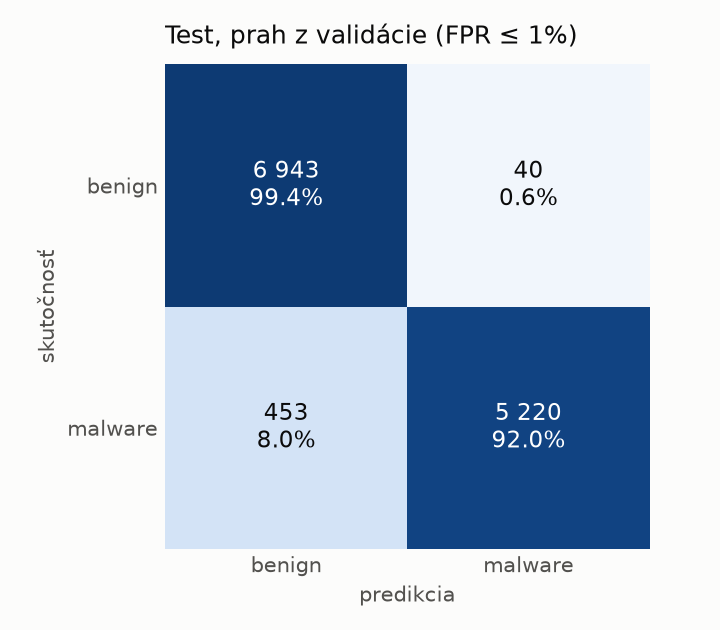
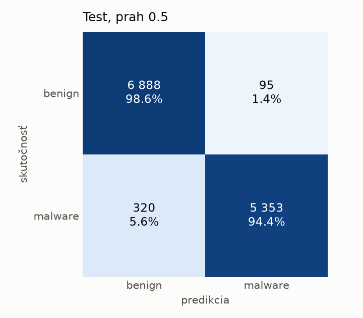

# hybrid/rf – beh `20261123-185810`

> Automaticky generované (`src/training/run_tabular.py`). Konfigurácia: `config.yaml`, protokol: `protocol.yaml`.

- **Model:** `random_forest` – Random Forest (pôvodné hodnoty príznakov)
- **Ladenie:** bez ladenia – hyperparametre prevzaté z `runs_v4/real_p/full/hybrid/rf/20261122-235747`
- **Finálne modely:** seedy [0, 1, 2]; hodnoty sú priemer ± smerodajná odchýlka cez seedy
- **Najlepšie hyperparametre:** `{"n_estimators": 400, "max_depth": null, "min_samples_leaf": 1, "max_features": "sqrt"}`

## Detekčná kvalita (bez prahu)
| metrika | train (podvzorka) | validácia | test |
|---|---|---|---|
| ROC-AUC | 1.0000 ± 0.0000 | 0.9955 ± 0.0000 | 0.9937 ± 0.0001 |
| PR-AUC | 1.0000 ± 0.0000 | 0.9954 ± 0.0000 | 0.9935 ± 0.0001 |
| TPR pri FPR 1 % | 1.0000 ± 0.0000 | 0.9423 ± 0.0012 | 0.9364 ± 0.0005 |
| TPR pri FPR 0,1 % | 1.0000 ± 0.0000 | 0.8974 ± 0.0027 | 0.8658 ± 0.0047 |
| log loss | 0.0258 ± 0.0001 | 0.0940 ± 0.0009 | 0.1082 ± 0.0008 |
| Brier skóre | 0.0028 ± 0.0000 | 0.0233 ± 0.0000 | 0.0289 ± 0.0001 |

Rozdiel ROC-AUC train − validácia: **0.0045** (veľký rozdiel = preučenie).

## Pri prahu z validácie (FPR ≤ 1% na validácii)
| metrika | train (podvzorka) | validácia | test |
|---|---|---|---|
| accuracy | 1.0000 ± 0.0000 | 0.9695 ± 0.0005 | 0.9608 ± 0.0002 |
| balanced accuracy | 1.0000 ± 0.0000 | 0.9663 ± 0.0006 | 0.9570 ± 0.0002 |
| precision | 1.0000 ± 0.0000 | 0.9866 ± 0.0000 | 0.9923 ± 0.0008 |
| recall (TPR) | 1.0000 ± 0.0000 | 0.9423 ± 0.0012 | 0.9197 ± 0.0006 |
| FPR | 0.0000 ± 0.0000 | 0.0097 ± 0.0000 | 0.0058 ± 0.0006 |
| F1 | 1.0000 ± 0.0000 | 0.9640 ± 0.0006 | 0.9546 ± 0.0003 |
| MCC | 1.0000 ± 0.0000 | 0.9383 ± 0.0010 | 0.9223 ± 0.0005 |

## Pri pevnom prahu 0.5
| metrika | train (podvzorka) | validácia | test |
|---|---|---|---|
| accuracy | 1.0000 ± 0.0000 | 0.9711 ± 0.0004 | 0.9666 ± 0.0006 |
| balanced accuracy | 1.0000 ± 0.0000 | 0.9697 ± 0.0005 | 0.9644 ± 0.0007 |
| precision | 1.0000 ± 0.0000 | 0.9731 ± 0.0002 | 0.9821 ± 0.0005 |
| recall (TPR) | 1.0000 ± 0.0000 | 0.9597 ± 0.0009 | 0.9427 ± 0.0010 |
| FPR | 0.0000 ± 0.0000 | 0.0203 ± 0.0002 | 0.0139 ± 0.0004 |
| F1 | 1.0000 ± 0.0000 | 0.9664 ± 0.0005 | 0.9620 ± 0.0007 |
| MCC | 1.0000 ± 0.0000 | 0.9411 ± 0.0009 | 0.9329 ± 0.0013 |

## Výpočtové nároky (seed 0, testovacia množina)
| meranie | hodnota |
|---|---|
| tréning finálneho modelu | 2.5 s (priemer cez seedy) |
| ladenie spolu | 0 s |
| počet parametrov / uzlov | 1 822 302 |
| veľkosť modelu na disku | 146.12 MB |
| CPU latencia modelu (batch 1, 1 vlákno) | 11.460 ms (p95 11.938) |
| CPU priepustnosť (24 vlákien) | 121 367 vzoriek/s |

## Grafy
| | |
|---|---|
|  |  |
|  |  |
|  |  |
|  |  |

## Súbory
`metrics.json` (všetky metriky po seedoch vrátane rodín), `timing.json`, `hpo_trials.csv`,
`predictions/<časť>_seed<N>.parquet` (sha256, family, label, score), `model/seed_<N>/`, `log.txt`.
