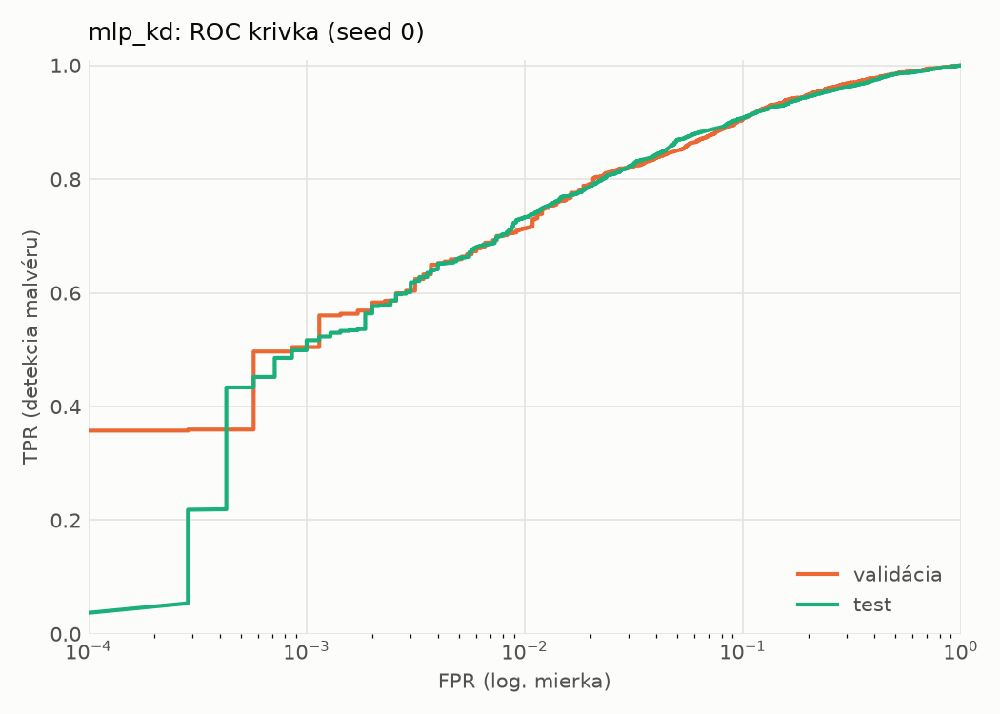
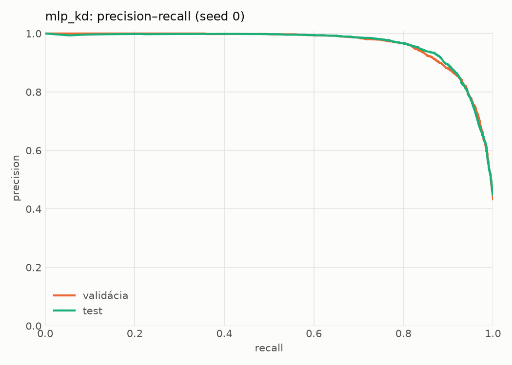
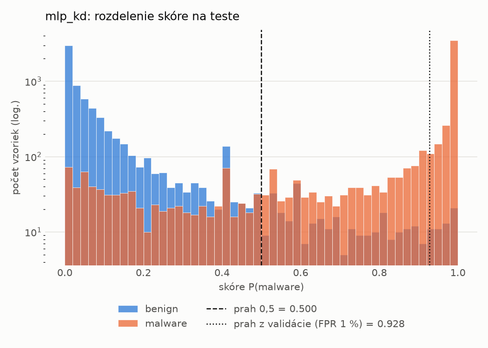
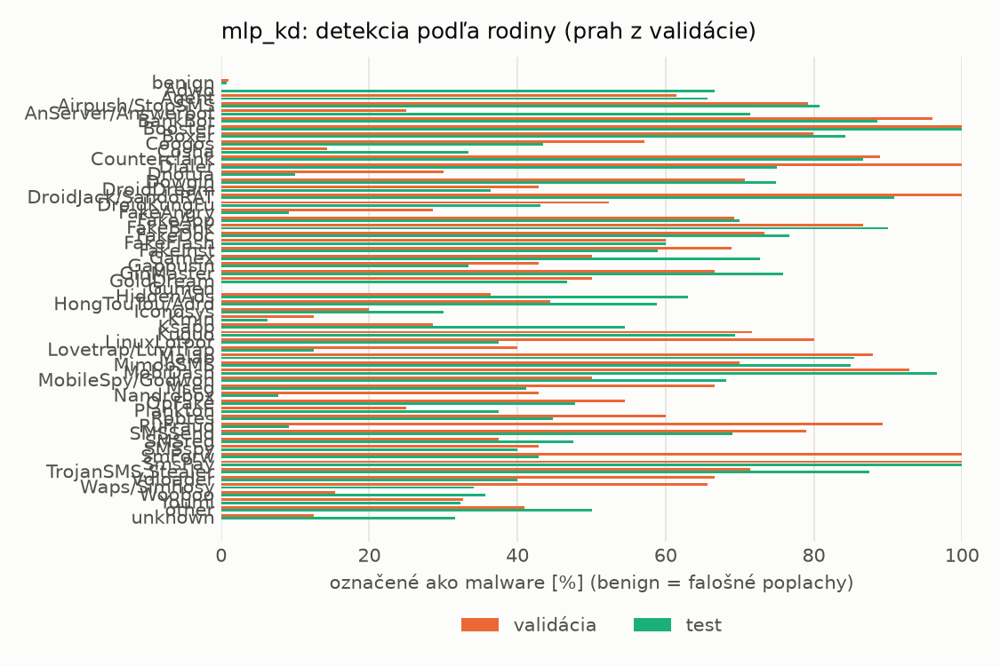
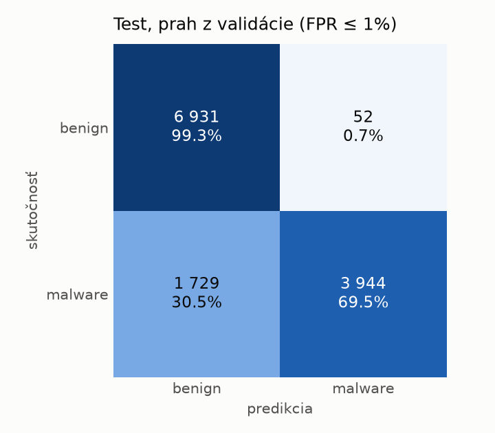
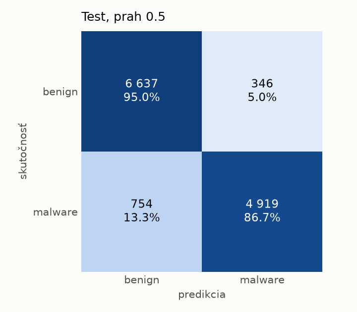
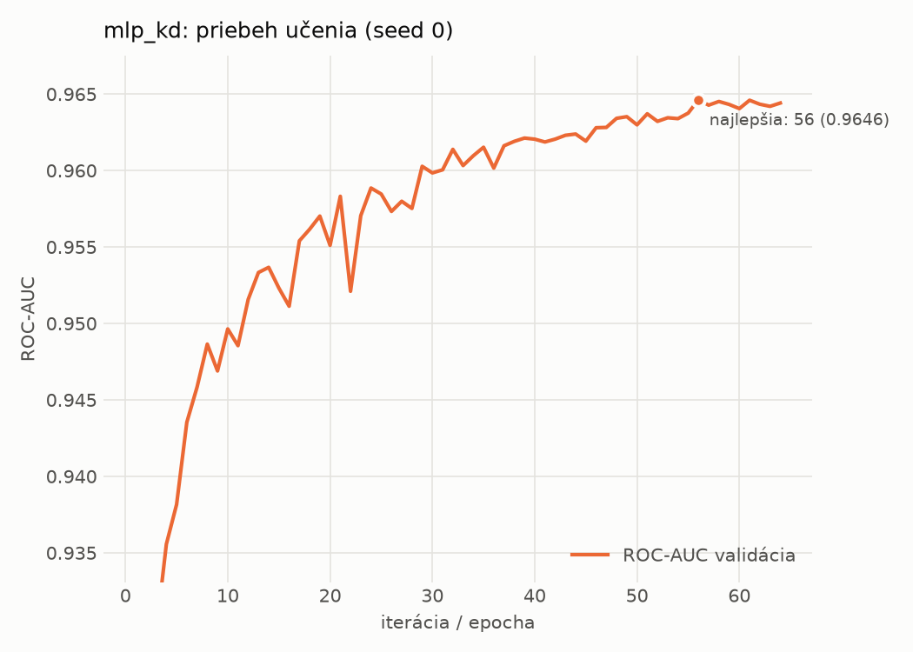

# dynamic/mlp_kd – beh `20261123-190303`

> Automaticky generované (`src/training/run_tabular.py`). Konfigurácia: `config.yaml`, protokol: `protocol.yaml`.

- **Model:** `mlp` – študent – malé MLP učené destiláciou z hybridného učiteľa
- **Ladenie:** bez ladenia – hyperparametre prevzaté z `runs_v4/real_p/full/students_dynamic/mlp_kd/20261123-003616`
- **Finálne modely:** seedy [0, 1, 2]; hodnoty sú priemer ± smerodajná odchýlka cez seedy
- **Najlepšie hyperparametre:** `{"hidden_layers": 1, "max_epochs": 100, "patience": 8, "hidden_width": 64, "dropout": 0.008718220633742228, "lr": 0.002354362488135847, "weight_decay": 3.1986204696979587e-06, "batch_size": 1024, "kd_alpha": 0.2022752781289341, "kd_temperature": 1.263446759011441}`

## Detekčná kvalita (bez prahu)
| metrika | train (podvzorka) | validácia | test |
|---|---|---|---|
| ROC-AUC | 0.9740 ± 0.0003 | 0.9637 ± 0.0009 | 0.9624 ± 0.0005 |
| PR-AUC | 0.9735 ± 0.0002 | 0.9629 ± 0.0007 | 0.9633 ± 0.0003 |
| TPR pri FPR 1 % | 0.8118 ± 0.0042 | 0.7193 ± 0.0092 | 0.7240 ± 0.0079 |
| TPR pri FPR 0,1 % | 0.6358 ± 0.0181 | 0.5047 ± 0.0244 | 0.5137 ± 0.0136 |
| log loss | 0.1875 ± 0.0009 | 0.2352 ± 0.0035 | 0.2406 ± 0.0015 |
| Brier skóre | 0.0541 ± 0.0002 | 0.0678 ± 0.0006 | 0.0681 ± 0.0004 |

Rozdiel ROC-AUC train − validácia: **0.0103** (veľký rozdiel = preučenie).

## Pri prahu z validácie (FPR ≤ 1% na validácii)
| metrika | train (podvzorka) | validácia | test |
|---|---|---|---|
| accuracy | 0.8905 ± 0.0029 | 0.8730 ± 0.0041 | 0.8628 ± 0.0033 |
| balanced accuracy | 0.8716 ± 0.0036 | 0.8548 ± 0.0047 | 0.8479 ± 0.0038 |
| precision | 0.9924 ± 0.0012 | 0.9827 ± 0.0005 | 0.9855 ± 0.0017 |
| recall (TPR) | 0.7474 ± 0.0079 | 0.7193 ± 0.0092 | 0.7043 ± 0.0086 |
| FPR | 0.0042 ± 0.0007 | 0.0096 ± 0.0002 | 0.0084 ± 0.0011 |
| F1 | 0.8527 ± 0.0047 | 0.8306 ± 0.0063 | 0.8215 ± 0.0053 |
| MCC | 0.7879 ± 0.0051 | 0.7557 ± 0.0075 | 0.7417 ± 0.0053 |

## Pri pevnom prahu 0.5
| metrika | train (podvzorka) | validácia | test |
|---|---|---|---|
| accuracy | 0.9292 ± 0.0009 | 0.9090 ± 0.0013 | 0.9110 ± 0.0019 |
| balanced accuracy | 0.9250 ± 0.0009 | 0.9043 ± 0.0012 | 0.9064 ± 0.0021 |
| precision | 0.9329 ± 0.0063 | 0.9161 ± 0.0064 | 0.9340 ± 0.0041 |
| recall (TPR) | 0.8974 ± 0.0060 | 0.8695 ± 0.0058 | 0.8623 ± 0.0055 |
| FPR | 0.0475 ± 0.0050 | 0.0609 ± 0.0054 | 0.0495 ± 0.0035 |
| F1 | 0.9148 ± 0.0009 | 0.8922 ± 0.0014 | 0.8967 ± 0.0024 |
| MCC | 0.8547 ± 0.0018 | 0.8144 ± 0.0027 | 0.8207 ± 0.0037 |

## Výpočtové nároky (seed 0, testovacia množina)
| meranie | hodnota |
|---|---|
| tréning finálneho modelu | 5.2 s (priemer cez seedy) |
| ladenie spolu | 0 s |
| počet parametrov / uzlov | 8 129 |
| veľkosť modelu na disku | 0.04 MB |
| transformácia vstupu – latencia (1 vlákno) | 0.006 ms |
| transformácia vstupu – priepustnosť | 1 187 688 vzoriek/s |
| CPU latencia modelu (batch 1, 1 vlákno) | 0.055 ms (p95 0.066) |
| CPU priepustnosť (24 vlákien) | 6 401 619 vzoriek/s |
| GPU latencia (batch 1) | 0.255 ms (p95 0.302) |
| GPU priepustnosť | 3 051 845 vzoriek/s |
| GPU špičková pamäť | 53 MB |

## Grafy
| | |
|---|---|
|  |  |
|  |  |
|  |  |
|  |  |

## Súbory
`metrics.json` (všetky metriky po seedoch vrátane rodín), `timing.json`, `hpo_trials.csv`,
`predictions/<časť>_seed<N>.parquet` (sha256, family, label, score), `model/seed_<N>/`, `log.txt`.
