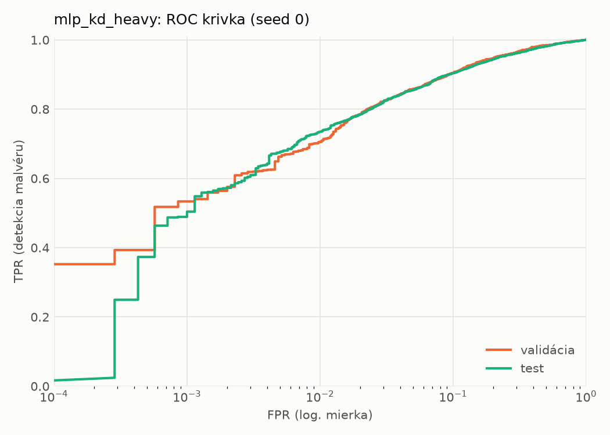
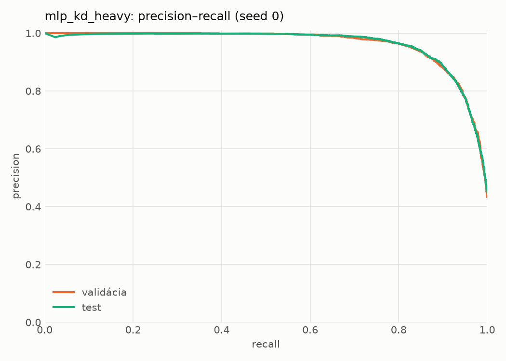
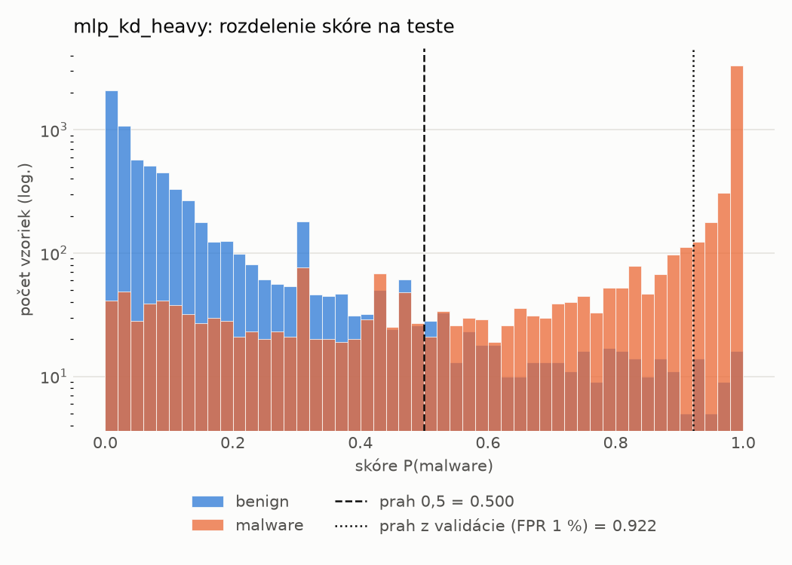
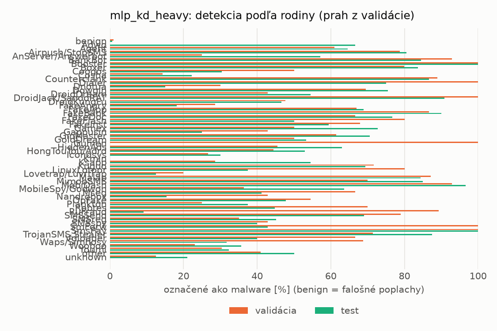
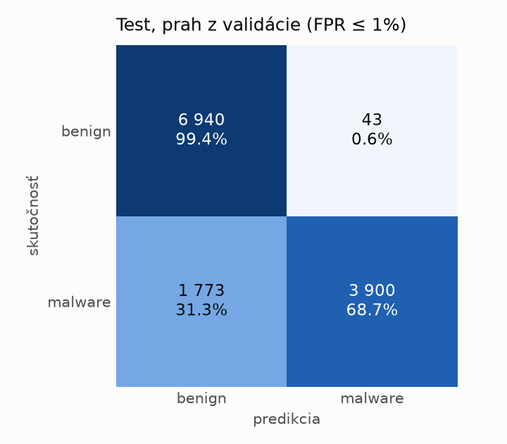
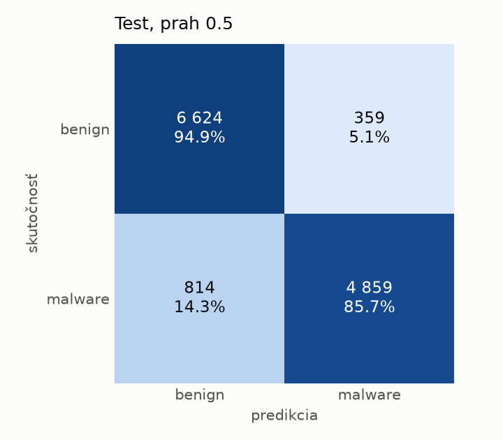
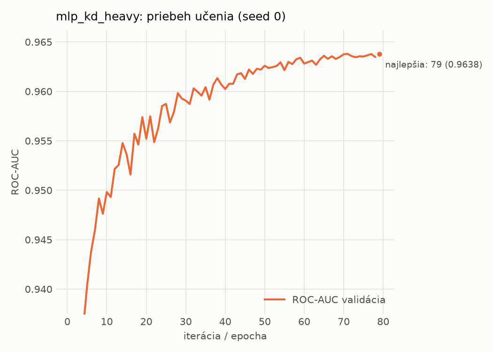

# dynamic/mlp_kd_heavy – beh `20261123-190434`

> Automaticky generované (`src/training/run_tabular.py`). Konfigurácia: `config.yaml`, protokol: `protocol.yaml`.

- **Model:** `mlp` – študent – malé MLP učené destiláciou z mlp_large hybridu (V4)
- **Ladenie:** bez ladenia – hyperparametre prevzaté z `runs_v4/real_p/full/students_dynamic/mlp_kd_heavy/20261123-005328`
- **Finálne modely:** seedy [0, 1, 2]; hodnoty sú priemer ± smerodajná odchýlka cez seedy
- **Najlepšie hyperparametre:** `{"hidden_layers": 1, "max_epochs": 100, "patience": 8, "hidden_width": 64, "dropout": 0.020410116354877387, "lr": 0.0023709262856920267, "weight_decay": 2.3924155608522853e-05, "batch_size": 1024, "kd_alpha": 0.37221474320301356, "kd_temperature": 1.1598739057164045}`

## Detekčná kvalita (bez prahu)
| metrika | train (podvzorka) | validácia | test |
|---|---|---|---|
| ROC-AUC | 0.9734 ± 0.0016 | 0.9633 ± 0.0013 | 0.9618 ± 0.0006 |
| PR-AUC | 0.9728 ± 0.0017 | 0.9625 ± 0.0012 | 0.9627 ± 0.0009 |
| TPR pri FPR 1 % | 0.8065 ± 0.0065 | 0.7197 ± 0.0139 | 0.7258 ± 0.0111 |
| TPR pri FPR 0,1 % | 0.6240 ± 0.0370 | 0.5256 ± 0.0193 | 0.5095 ± 0.0205 |
| log loss | 0.1923 ± 0.0052 | 0.2320 ± 0.0028 | 0.2382 ± 0.0034 |
| Brier skóre | 0.0553 ± 0.0019 | 0.0679 ± 0.0012 | 0.0688 ± 0.0013 |

Rozdiel ROC-AUC train − validácia: **0.0101** (veľký rozdiel = preučenie).

## Pri prahu z validácie (FPR ≤ 1% na validácii)
| metrika | train (podvzorka) | validácia | test |
|---|---|---|---|
| accuracy | 0.8891 ± 0.0064 | 0.8731 ± 0.0060 | 0.8627 ± 0.0064 |
| balanced accuracy | 0.8699 ± 0.0077 | 0.8550 ± 0.0070 | 0.8477 ± 0.0073 |
| precision | 0.9927 ± 0.0019 | 0.9826 ± 0.0003 | 0.9868 ± 0.0021 |
| recall (TPR) | 0.7439 ± 0.0162 | 0.7197 ± 0.0139 | 0.7031 ± 0.0160 |
| FPR | 0.0040 ± 0.0011 | 0.0097 ± 0.0000 | 0.0077 ± 0.0014 |
| F1 | 0.8504 ± 0.0101 | 0.8308 ± 0.0094 | 0.8210 ± 0.0102 |
| MCC | 0.7854 ± 0.0116 | 0.7559 ± 0.0110 | 0.7418 ± 0.0107 |

## Pri pevnom prahu 0.5
| metrika | train (podvzorka) | validácia | test |
|---|---|---|---|
| accuracy | 0.9271 ± 0.0035 | 0.9087 ± 0.0010 | 0.9069 ± 0.0014 |
| balanced accuracy | 0.9219 ± 0.0041 | 0.9032 ± 0.0016 | 0.9017 ± 0.0019 |
| precision | 0.9368 ± 0.0025 | 0.9219 ± 0.0039 | 0.9352 ± 0.0044 |
| recall (TPR) | 0.8878 ± 0.0083 | 0.8622 ± 0.0063 | 0.8515 ± 0.0074 |
| FPR | 0.0441 ± 0.0019 | 0.0558 ± 0.0034 | 0.0480 ± 0.0038 |
| F1 | 0.9116 ± 0.0046 | 0.8910 ± 0.0017 | 0.8913 ± 0.0022 |
| MCC | 0.8505 ± 0.0070 | 0.8140 ± 0.0019 | 0.8130 ± 0.0023 |

## Výpočtové nároky (seed 0, testovacia množina)
| meranie | hodnota |
|---|---|
| tréning finálneho modelu | 5.3 s (priemer cez seedy) |
| ladenie spolu | 0 s |
| počet parametrov / uzlov | 8 129 |
| veľkosť modelu na disku | 0.04 MB |
| transformácia vstupu – latencia (1 vlákno) | 0.015 ms |
| transformácia vstupu – priepustnosť | 778 639 vzoriek/s |
| CPU latencia modelu (batch 1, 1 vlákno) | 0.153 ms (p95 0.162) |
| CPU priepustnosť (24 vlákien) | 5 566 502 vzoriek/s |
| GPU latencia (batch 1) | 0.451 ms (p95 0.476) |
| GPU priepustnosť | 2 938 609 vzoriek/s |
| GPU špičková pamäť | 77 MB |

## Grafy
| | |
|---|---|
|  |  |
|  |  |
|  |  |
|  |  |

## Súbory
`metrics.json` (všetky metriky po seedoch vrátane rodín), `timing.json`, `hpo_trials.csv`,
`predictions/<časť>_seed<N>.parquet` (sha256, family, label, score), `model/seed_<N>/`, `log.txt`.
