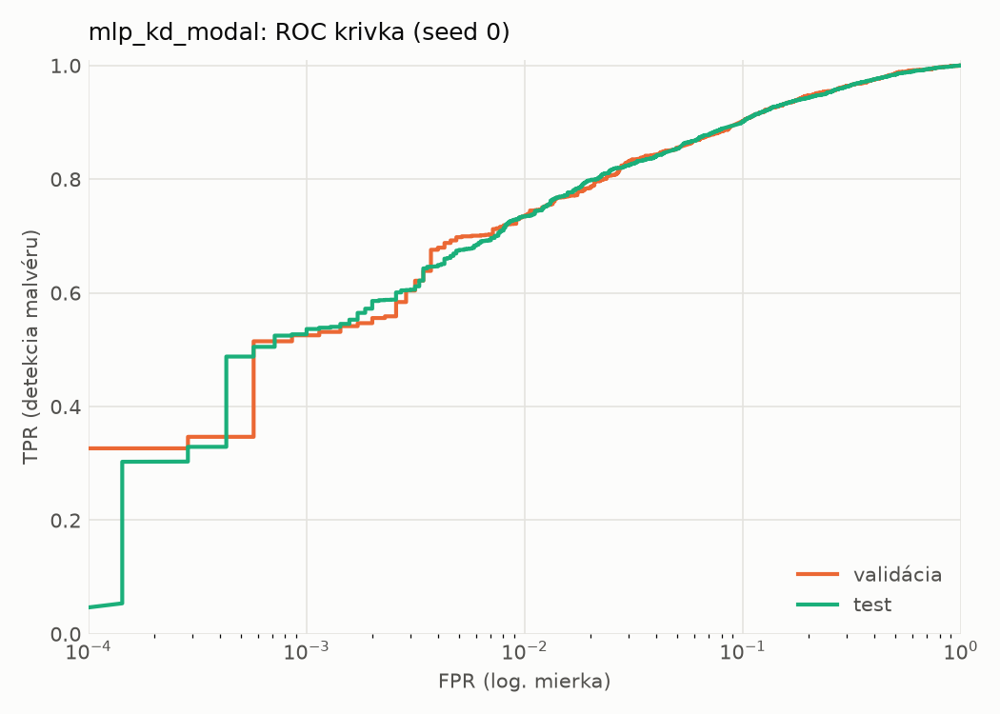
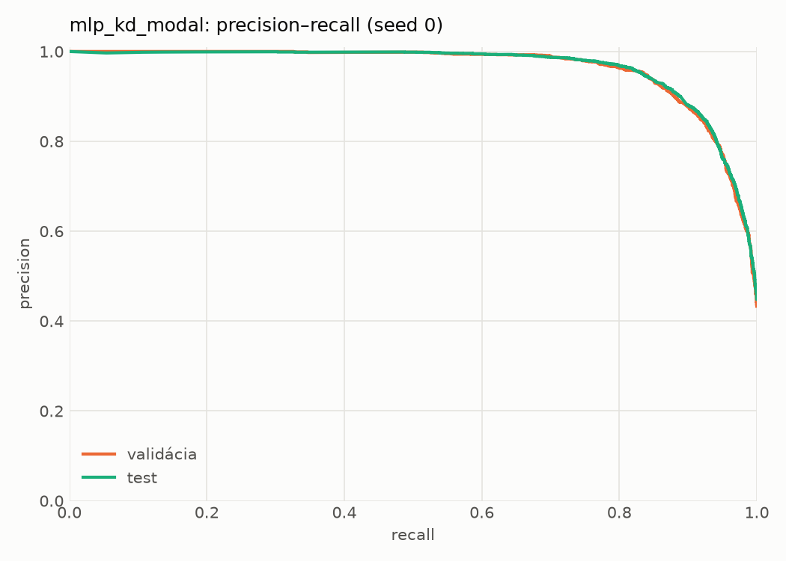
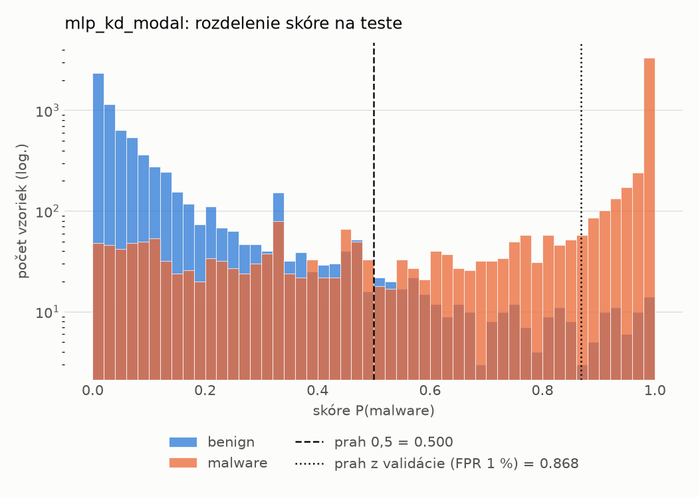
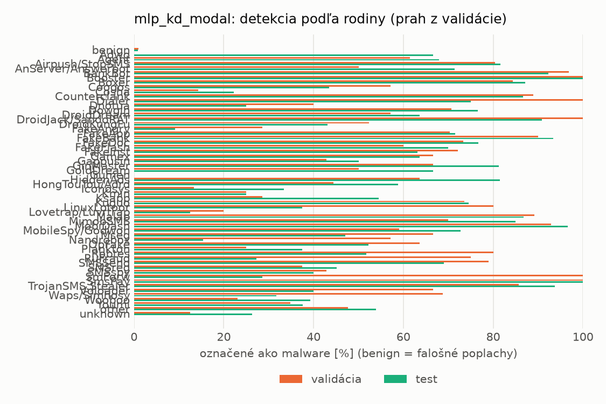
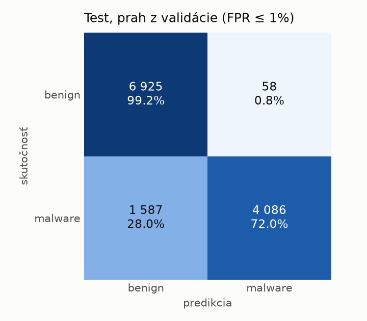
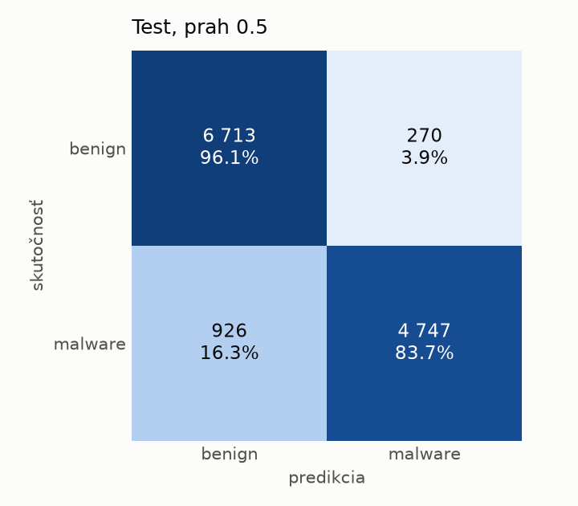
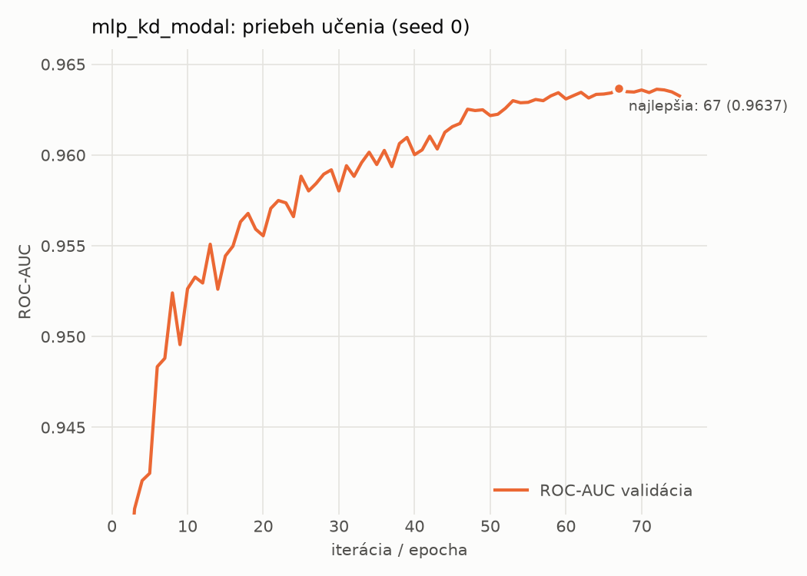

# dynamic/mlp_kd_modal – beh `20261123-190359`

> Automaticky generované (`src/training/run_tabular.py`). Konfigurácia: `config.yaml`, protokol: `protocol.yaml`.

- **Model:** `mlp` – študent – malé MLP učené destiláciou z učiteľa rovnakej modality (variant A)
- **Ladenie:** bez ladenia – hyperparametre prevzaté z `runs_v4/real_p/full/students_dynamic/mlp_kd_modal/20261123-004749`
- **Finálne modely:** seedy [0, 1, 2]; hodnoty sú priemer ± smerodajná odchýlka cez seedy
- **Najlepšie hyperparametre:** `{"hidden_layers": 1, "max_epochs": 100, "patience": 8, "hidden_width": 64, "dropout": 0.23306226533454044, "lr": 0.0029211055962699408, "weight_decay": 1.2442051354380418e-06, "batch_size": 512, "kd_alpha": 0.38098578248234166, "kd_temperature": 1.6615545083860346}`

## Detekčná kvalita (bez prahu)
| metrika | train (podvzorka) | validácia | test |
|---|---|---|---|
| ROC-AUC | 0.9716 ± 0.0012 | 0.9633 ± 0.0009 | 0.9622 ± 0.0012 |
| PR-AUC | 0.9710 ± 0.0013 | 0.9626 ± 0.0009 | 0.9635 ± 0.0009 |
| TPR pri FPR 1 % | 0.7957 ± 0.0103 | 0.7281 ± 0.0075 | 0.7307 ± 0.0039 |
| TPR pri FPR 0,1 % | 0.6143 ± 0.0022 | 0.5330 ± 0.0070 | 0.5304 ± 0.0109 |
| log loss | 0.1969 ± 0.0051 | 0.2316 ± 0.0025 | 0.2371 ± 0.0029 |
| Brier skóre | 0.0570 ± 0.0016 | 0.0682 ± 0.0012 | 0.0693 ± 0.0010 |

Rozdiel ROC-AUC train − validácia: **0.0083** (veľký rozdiel = preučenie).

## Pri prahu z validácie (FPR ≤ 1% na validácii)
| metrika | train (podvzorka) | validácia | test |
|---|---|---|---|
| accuracy | 0.8943 ± 0.0032 | 0.8768 ± 0.0032 | 0.8674 ± 0.0026 |
| balanced accuracy | 0.8763 ± 0.0038 | 0.8592 ± 0.0037 | 0.8531 ± 0.0029 |
| precision | 0.9903 ± 0.0014 | 0.9829 ± 0.0001 | 0.9861 ± 0.0014 |
| recall (TPR) | 0.7581 ± 0.0081 | 0.7281 ± 0.0075 | 0.7143 ± 0.0064 |
| FPR | 0.0054 ± 0.0009 | 0.0096 ± 0.0002 | 0.0082 ± 0.0009 |
| F1 | 0.8588 ± 0.0049 | 0.8365 ± 0.0050 | 0.8285 ± 0.0040 |
| MCC | 0.7944 ± 0.0057 | 0.7626 ± 0.0057 | 0.7499 ± 0.0044 |

## Pri pevnom prahu 0.5
| metrika | train (podvzorka) | validácia | test |
|---|---|---|---|
| accuracy | 0.9254 ± 0.0033 | 0.9090 ± 0.0019 | 0.9057 ± 0.0021 |
| balanced accuracy | 0.9191 ± 0.0032 | 0.9025 ± 0.0018 | 0.8996 ± 0.0024 |
| precision | 0.9422 ± 0.0065 | 0.9306 ± 0.0050 | 0.9432 ± 0.0027 |
| recall (TPR) | 0.8778 ± 0.0049 | 0.8535 ± 0.0041 | 0.8404 ± 0.0053 |
| FPR | 0.0396 ± 0.0047 | 0.0486 ± 0.0039 | 0.0411 ± 0.0022 |
| F1 | 0.9088 ± 0.0039 | 0.8904 ± 0.0022 | 0.8888 ± 0.0028 |
| MCC | 0.8473 ± 0.0068 | 0.8151 ± 0.0039 | 0.8115 ± 0.0041 |

## Výpočtové nároky (seed 0, testovacia množina)
| meranie | hodnota |
|---|---|
| tréning finálneho modelu | 11.1 s (priemer cez seedy) |
| ladenie spolu | 0 s |
| počet parametrov / uzlov | 8 129 |
| veľkosť modelu na disku | 0.04 MB |
| transformácia vstupu – latencia (1 vlákno) | 0.015 ms |
| transformácia vstupu – priepustnosť | 790 595 vzoriek/s |
| CPU latencia modelu (batch 1, 1 vlákno) | 0.154 ms (p95 0.163) |
| CPU priepustnosť (24 vlákien) | 6 326 418 vzoriek/s |
| GPU latencia (batch 1) | 0.444 ms (p95 0.470) |
| GPU priepustnosť | 2 506 983 vzoriek/s |
| GPU špičková pamäť | 53 MB |

## Grafy
| | |
|---|---|
|  |  |
|  |  |
|  |  |
|  |  |

## Súbory
`metrics.json` (všetky metriky po seedoch vrátane rodín), `timing.json`, `hpo_trials.csv`,
`predictions/<časť>_seed<N>.parquet` (sha256, family, label, score), `model/seed_<N>/`, `log.txt`.
