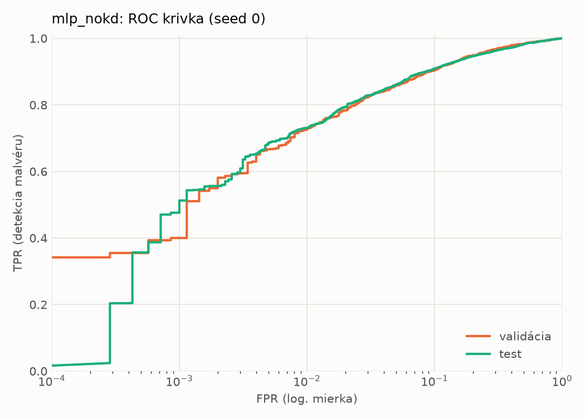
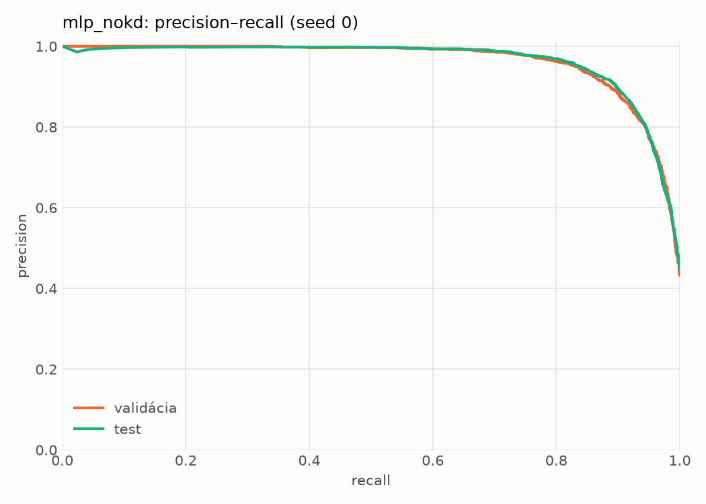
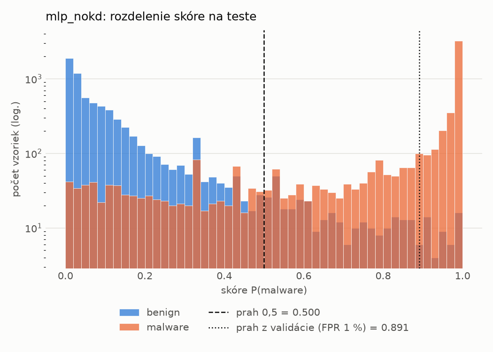
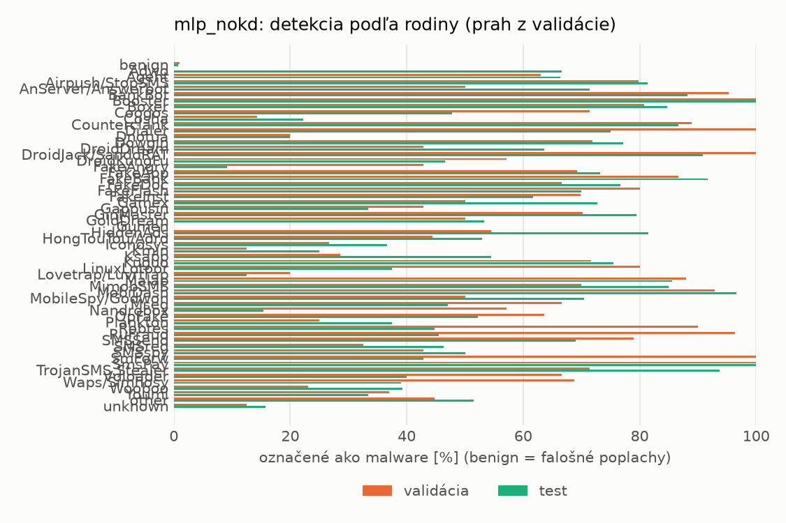
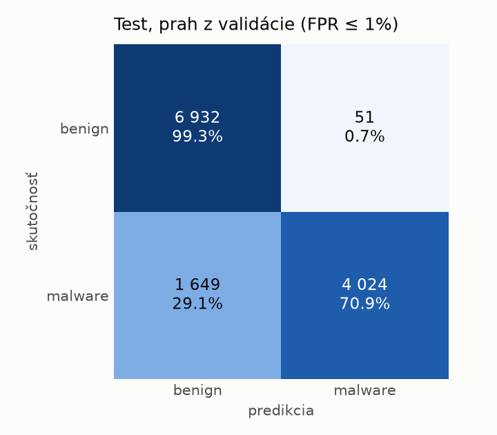
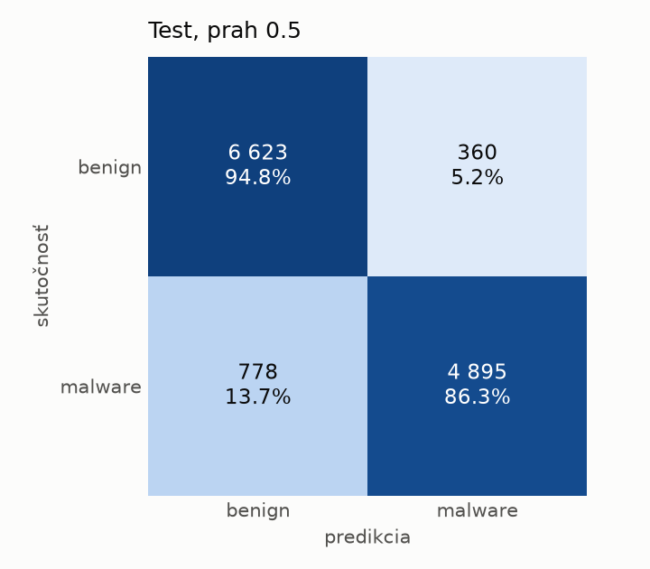
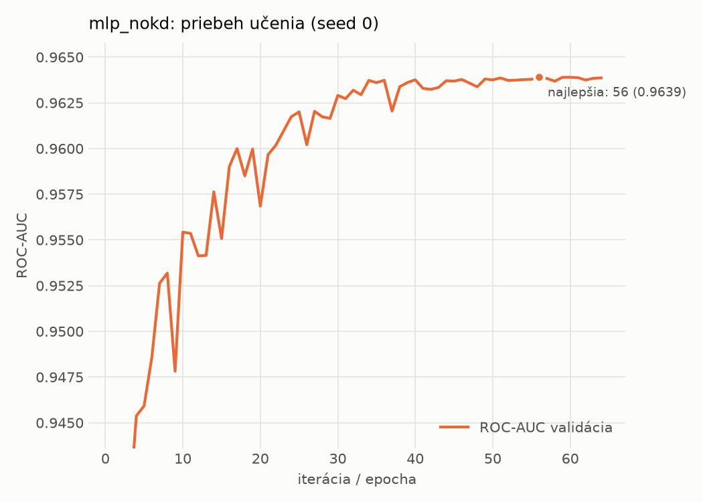

# dynamic/mlp_nokd – beh `20261123-190320`

> Automaticky generované (`src/training/run_tabular.py`). Konfigurácia: `config.yaml`, protokol: `protocol.yaml`.

- **Model:** `mlp` – kontrola – rovnaké malé MLP bez destilácie (iba skutočné označenia)
- **Ladenie:** bez ladenia – hyperparametre prevzaté z `runs_v4/real_p/full/students_dynamic/mlp_nokd/20261123-004046`
- **Finálne modely:** seedy [0, 1, 2]; hodnoty sú priemer ± smerodajná odchýlka cez seedy
- **Najlepšie hyperparametre:** `{"hidden_layers": 1, "max_epochs": 100, "patience": 8, "hidden_width": 64, "dropout": 0.01960392869507369, "lr": 0.0014251751351833603, "weight_decay": 1.336267730425129e-05, "batch_size": 256}`

## Detekčná kvalita (bez prahu)
| metrika | train (podvzorka) | validácia | test |
|---|---|---|---|
| ROC-AUC | 0.9767 ± 0.0024 | 0.9651 ± 0.0021 | 0.9634 ± 0.0018 |
| PR-AUC | 0.9761 ± 0.0022 | 0.9641 ± 0.0019 | 0.9644 ± 0.0018 |
| TPR pri FPR 1 % | 0.8216 ± 0.0128 | 0.7281 ± 0.0075 | 0.7292 ± 0.0073 |
| TPR pri FPR 0,1 % | 0.6649 ± 0.0212 | 0.4909 ± 0.0788 | 0.5114 ± 0.0307 |
| log loss | 0.1795 ± 0.0097 | 0.2277 ± 0.0050 | 0.2332 ± 0.0057 |
| Brier skóre | 0.0515 ± 0.0029 | 0.0660 ± 0.0019 | 0.0665 ± 0.0021 |

Rozdiel ROC-AUC train − validácia: **0.0116** (veľký rozdiel = preučenie).

## Pri prahu z validácie (FPR ≤ 1% na validácii)
| metrika | train (podvzorka) | validácia | test |
|---|---|---|---|
| accuracy | 0.8955 ± 0.0028 | 0.8767 ± 0.0033 | 0.8650 ± 0.0023 |
| balanced accuracy | 0.8774 ± 0.0033 | 0.8592 ± 0.0038 | 0.8503 ± 0.0025 |
| precision | 0.9937 ± 0.0011 | 0.9828 ± 0.0002 | 0.9875 ± 0.0010 |
| recall (TPR) | 0.7583 ± 0.0063 | 0.7281 ± 0.0075 | 0.7079 ± 0.0045 |
| FPR | 0.0035 ± 0.0006 | 0.0097 ± 0.0000 | 0.0073 ± 0.0006 |
| F1 | 0.8602 ± 0.0043 | 0.8365 ± 0.0050 | 0.8246 ± 0.0034 |
| MCC | 0.7973 ± 0.0054 | 0.7625 ± 0.0059 | 0.7461 ± 0.0043 |

## Pri pevnom prahu 0.5
| metrika | train (podvzorka) | validácia | test |
|---|---|---|---|
| accuracy | 0.9334 ± 0.0044 | 0.9102 ± 0.0008 | 0.9115 ± 0.0026 |
| balanced accuracy | 0.9295 ± 0.0045 | 0.9059 ± 0.0009 | 0.9069 ± 0.0027 |
| precision | 0.9367 ± 0.0052 | 0.9148 ± 0.0020 | 0.9341 ± 0.0026 |
| recall (TPR) | 0.9039 ± 0.0057 | 0.8740 ± 0.0028 | 0.8633 ± 0.0043 |
| FPR | 0.0449 ± 0.0037 | 0.0622 ± 0.0017 | 0.0495 ± 0.0020 |
| F1 | 0.9200 ± 0.0053 | 0.8939 ± 0.0011 | 0.8973 ± 0.0031 |
| MCC | 0.8633 ± 0.0090 | 0.8168 ± 0.0016 | 0.8217 ± 0.0052 |

## Výpočtové nároky (seed 0, testovacia množina)
| meranie | hodnota |
|---|---|
| tréning finálneho modelu | 12.4 s (priemer cez seedy) |
| ladenie spolu | 0 s |
| počet parametrov / uzlov | 8 129 |
| veľkosť modelu na disku | 0.04 MB |
| transformácia vstupu – latencia (1 vlákno) | 0.015 ms |
| transformácia vstupu – priepustnosť | 783 314 vzoriek/s |
| CPU latencia modelu (batch 1, 1 vlákno) | 0.153 ms (p95 0.163) |
| CPU priepustnosť (24 vlákien) | 5 964 747 vzoriek/s |
| GPU latencia (batch 1) | 0.445 ms (p95 0.472) |
| GPU priepustnosť | 3 462 275 vzoriek/s |
| GPU špičková pamäť | 77 MB |

## Grafy
| | |
|---|---|
|  |  |
|  |  |
|  |  |
|  |  |

## Súbory
`metrics.json` (všetky metriky po seedoch vrátane rodín), `timing.json`, `hpo_trials.csv`,
`predictions/<časť>_seed<N>.parquet` (sha256, family, label, score), `model/seed_<N>/`, `log.txt`.
