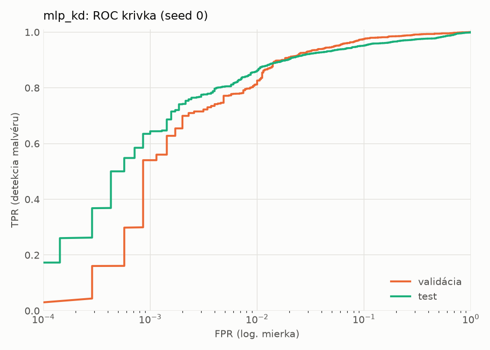
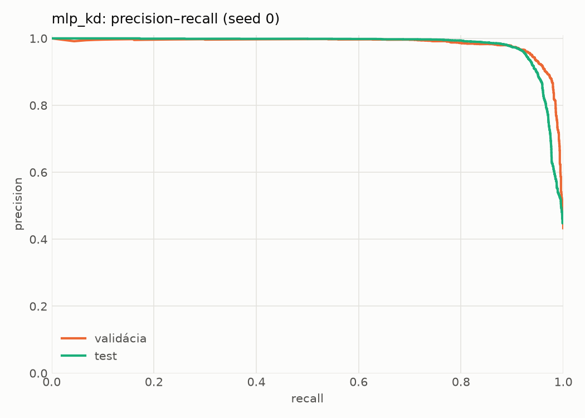
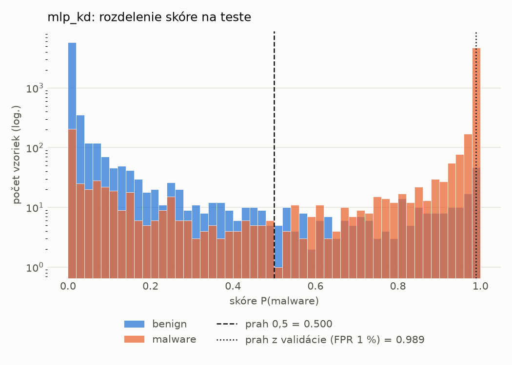
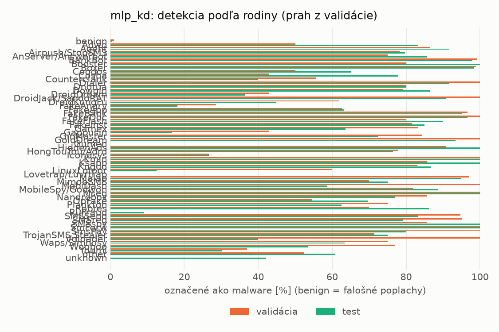
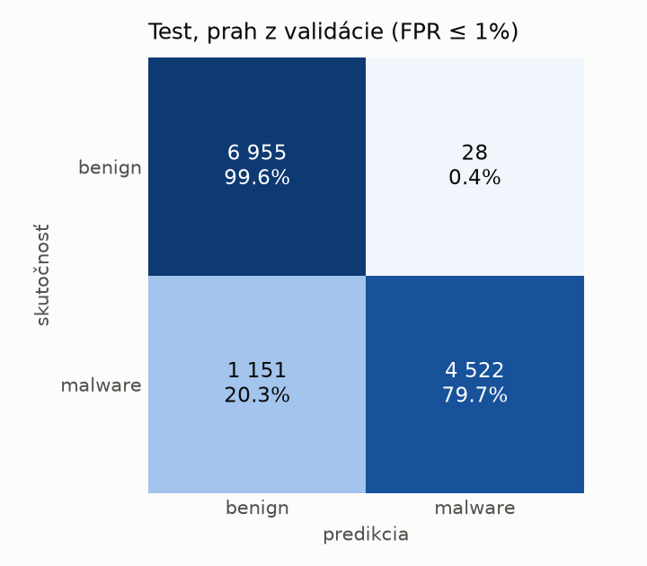
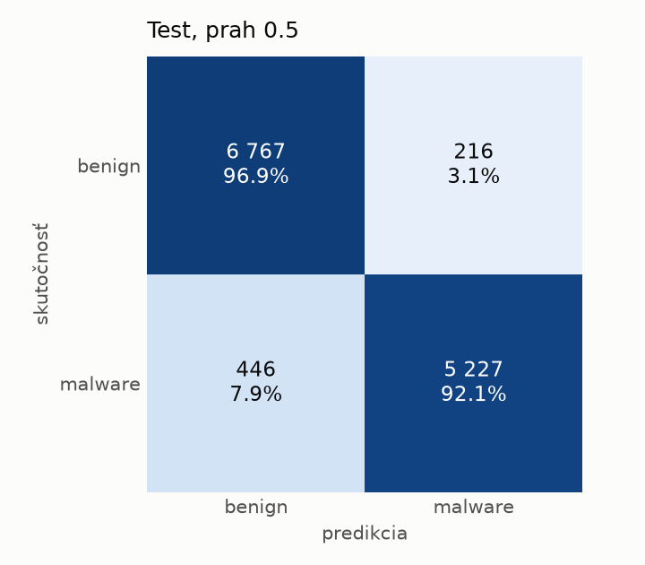
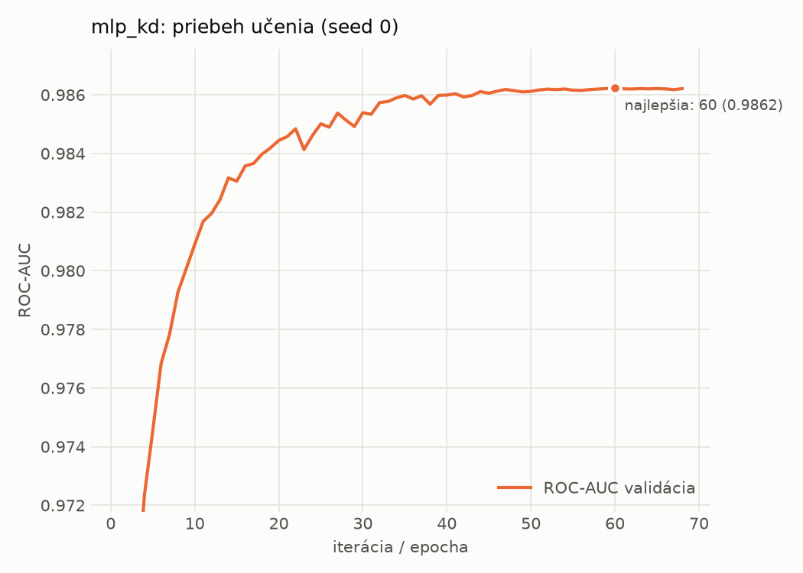

# static/mlp_kd – beh `20261123-190146`

> Automaticky generované (`src/training/run_tabular.py`). Konfigurácia: `config.yaml`, protokol: `protocol.yaml`.

- **Model:** `mlp` – študent – malé MLP učené destiláciou z hybridného učiteľa
- **Ladenie:** bez ladenia – hyperparametre prevzaté z `runs_v4/real_p/full/students_static/mlp_kd/20261123-002115`
- **Finálne modely:** seedy [0, 1, 2]; hodnoty sú priemer ± smerodajná odchýlka cez seedy
- **Najlepšie hyperparametre:** `{"hidden_layers": 1, "max_epochs": 100, "patience": 8, "hidden_width": 64, "dropout": 0.0632721567978865, "lr": 0.0009421311632910299, "weight_decay": 0.0003612082656275497, "batch_size": 1024, "kd_alpha": 0.17546922159086176, "kd_temperature": 1.684481613505065}`

## Detekčná kvalita (bez prahu)
| metrika | train (podvzorka) | validácia | test |
|---|---|---|---|
| ROC-AUC | 0.9907 ± 0.0001 | 0.9865 ± 0.0002 | 0.9779 ± 0.0018 |
| PR-AUC | 0.9901 ± 0.0002 | 0.9842 ± 0.0003 | 0.9805 ± 0.0010 |
| TPR pri FPR 1 % | 0.9118 ± 0.0015 | 0.8271 ± 0.0131 | 0.8639 ± 0.0045 |
| TPR pri FPR 0,1 % | 0.6924 ± 0.0307 | 0.4957 ± 0.0423 | 0.6225 ± 0.0252 |
| log loss | 0.1218 ± 0.0009 | 0.1676 ± 0.0004 | 0.2119 ± 0.0098 |
| Brier skóre | 0.0291 ± 0.0003 | 0.0393 ± 0.0001 | 0.0437 ± 0.0009 |

Rozdiel ROC-AUC train − validácia: **0.0042** (veľký rozdiel = preučenie).

## Pri prahu z validácie (FPR ≤ 1% na validácii)
| metrika | train (podvzorka) | validácia | test |
|---|---|---|---|
| accuracy | 0.9322 ± 0.0060 | 0.9196 ± 0.0057 | 0.9138 ± 0.0061 |
| balanced accuracy | 0.9209 ± 0.0072 | 0.9087 ± 0.0066 | 0.9045 ± 0.0069 |
| precision | 0.9919 ± 0.0003 | 0.9848 ± 0.0002 | 0.9912 ± 0.0024 |
| recall (TPR) | 0.8469 ± 0.0145 | 0.8271 ± 0.0131 | 0.8149 ± 0.0155 |
| FPR | 0.0051 ± 0.0003 | 0.0097 ± 0.0000 | 0.0059 ± 0.0017 |
| F1 | 0.9136 ± 0.0084 | 0.8991 ± 0.0079 | 0.8944 ± 0.0085 |
| MCC | 0.8657 ± 0.0115 | 0.8419 ± 0.0107 | 0.8340 ± 0.0106 |

## Pri pevnom prahu 0.5
| metrika | train (podvzorka) | validácia | test |
|---|---|---|---|
| accuracy | 0.9649 ± 0.0004 | 0.9518 ± 0.0014 | 0.9489 ± 0.0010 |
| balanced accuracy | 0.9629 ± 0.0004 | 0.9506 ± 0.0014 | 0.9465 ± 0.0011 |
| precision | 0.9671 ± 0.0009 | 0.9473 ± 0.0020 | 0.9610 ± 0.0009 |
| recall (TPR) | 0.9495 ± 0.0007 | 0.9412 ± 0.0011 | 0.9234 ± 0.0018 |
| FPR | 0.0238 ± 0.0007 | 0.0400 ± 0.0016 | 0.0305 ± 0.0007 |
| F1 | 0.9582 ± 0.0004 | 0.9442 ± 0.0016 | 0.9418 ± 0.0012 |
| MCC | 0.9281 ± 0.0007 | 0.9019 ± 0.0028 | 0.8968 ± 0.0021 |

## Výpočtové nároky (seed 0, testovacia množina)
| meranie | hodnota |
|---|---|
| tréning finálneho modelu | 4.5 s (priemer cez seedy) |
| ladenie spolu | 0 s |
| počet parametrov / uzlov | 10 689 |
| veľkosť modelu na disku | 0.05 MB |
| transformácia vstupu – latencia (1 vlákno) | 0.006 ms |
| transformácia vstupu – priepustnosť | 1 014 363 vzoriek/s |
| CPU latencia modelu (batch 1, 1 vlákno) | 0.051 ms (p95 0.058) |
| CPU priepustnosť (24 vlákien) | 3 877 689 vzoriek/s |
| GPU latencia (batch 1) | 0.274 ms (p95 0.314) |
| GPU priepustnosť | 2 340 799 vzoriek/s |
| GPU špičková pamäť | 62 MB |

## Grafy
| | |
|---|---|
|  |  |
|  |  |
|  |  |
|  |  |

## Súbory
`metrics.json` (všetky metriky po seedoch vrátane rodín), `timing.json`, `hpo_trials.csv`,
`predictions/<časť>_seed<N>.parquet` (sha256, family, label, score), `model/seed_<N>/`, `log.txt`.
