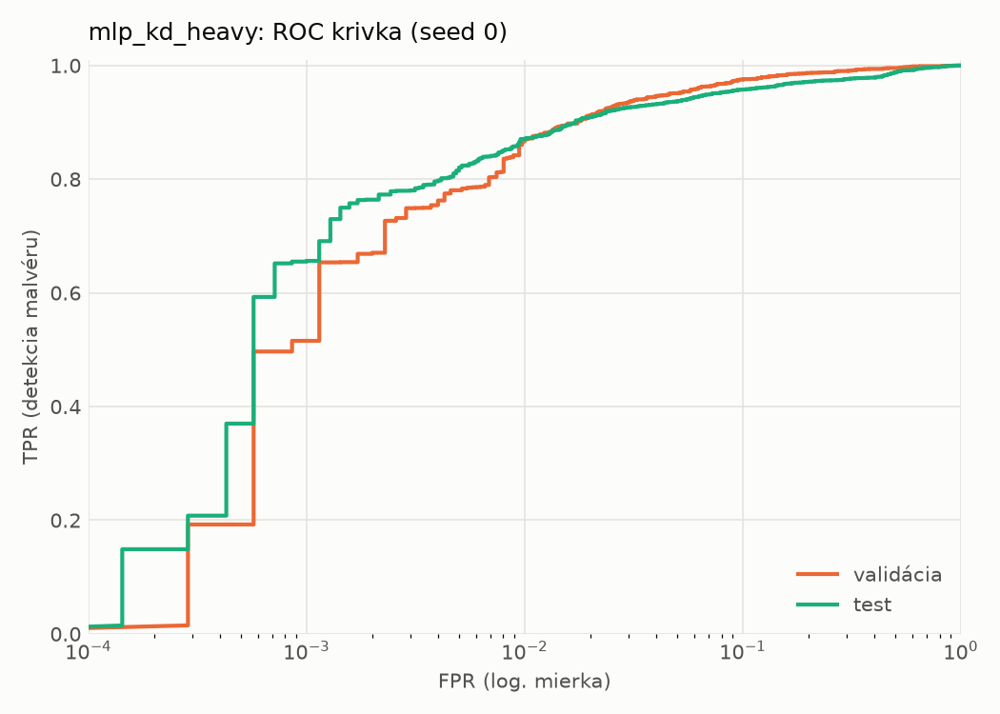
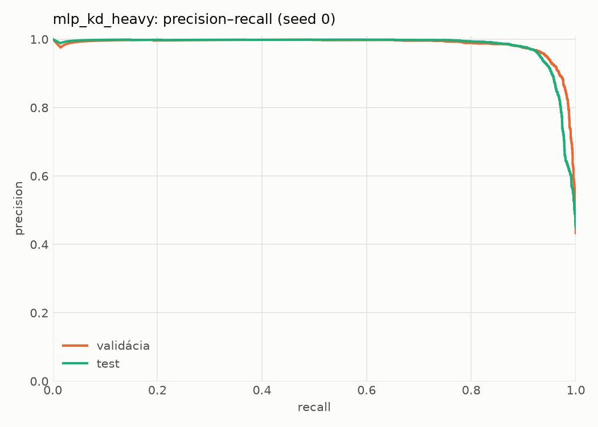
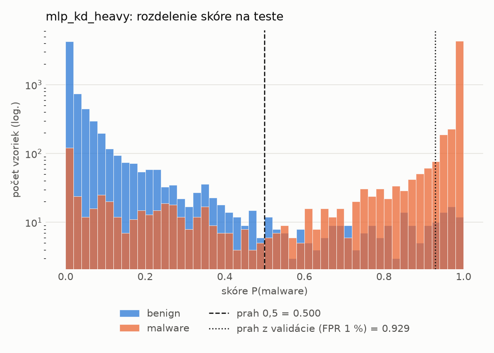
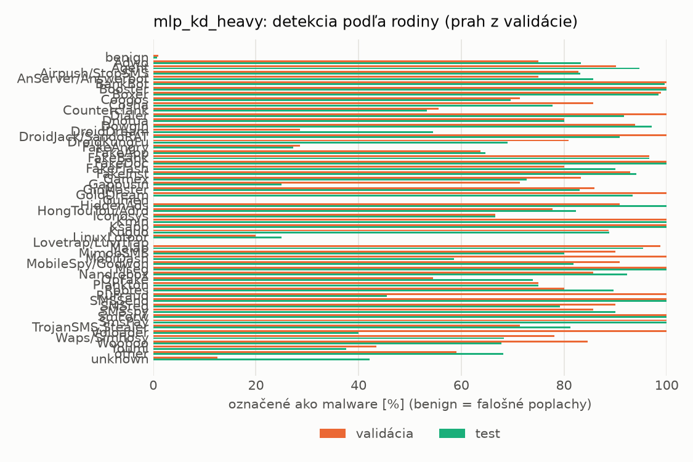
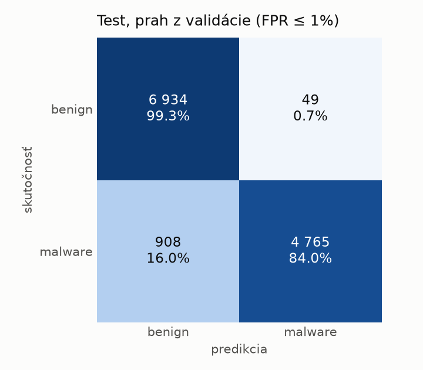
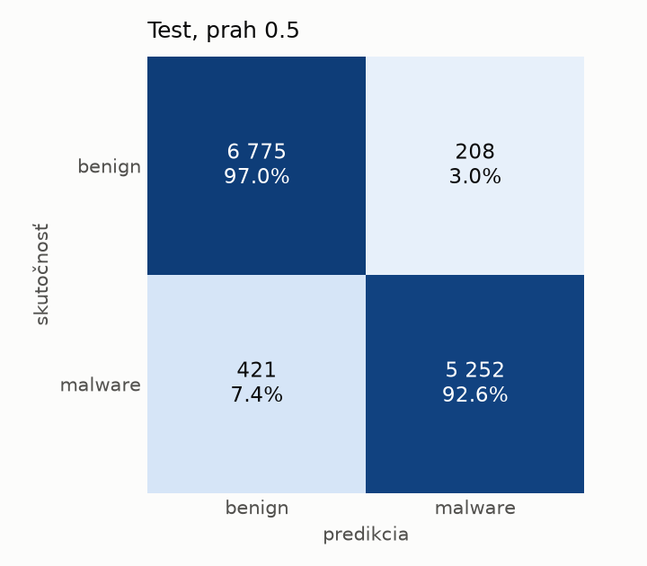
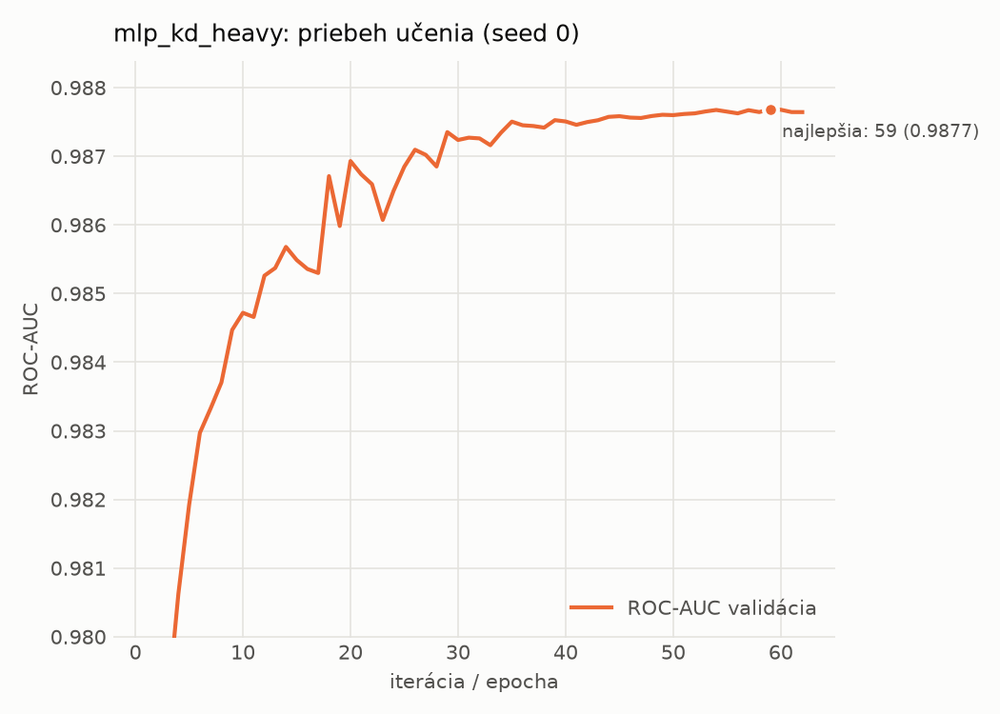

# static/mlp_kd_heavy – beh `20261123-190246`

> Automaticky generované (`src/training/run_tabular.py`). Konfigurácia: `config.yaml`, protokol: `protocol.yaml`.

- **Model:** `mlp` – študent – malé MLP učené destiláciou z mlp_large hybridu (V4)
- **Ladenie:** bez ladenia – hyperparametre prevzaté z `runs_v4/real_p/full/students_static/mlp_kd_heavy/20261123-003302`
- **Finálne modely:** seedy [0, 1, 2]; hodnoty sú priemer ± smerodajná odchýlka cez seedy
- **Najlepšie hyperparametre:** `{"hidden_layers": 1, "max_epochs": 100, "patience": 8, "hidden_width": 64, "dropout": 0.09027280410892091, "lr": 0.002542283406985367, "weight_decay": 5.0021287493134016e-05, "batch_size": 1024, "kd_alpha": 0.49398181049265616, "kd_temperature": 1.0496155846554518}`

## Detekčná kvalita (bez prahu)
| metrika | train (podvzorka) | validácia | test |
|---|---|---|---|
| ROC-AUC | 0.9934 ± 0.0001 | 0.9875 ± 0.0004 | 0.9798 ± 0.0007 |
| PR-AUC | 0.9926 ± 0.0002 | 0.9851 ± 0.0003 | 0.9817 ± 0.0004 |
| TPR pri FPR 1 % | 0.9237 ± 0.0039 | 0.8629 ± 0.0131 | 0.8716 ± 0.0033 |
| TPR pri FPR 0,1 % | 0.7645 ± 0.0159 | 0.5448 ± 0.0277 | 0.6335 ± 0.0282 |
| log loss | 0.0934 ± 0.0013 | 0.1342 ± 0.0015 | 0.1608 ± 0.0033 |
| Brier skóre | 0.0251 ± 0.0003 | 0.0359 ± 0.0002 | 0.0410 ± 0.0004 |

Rozdiel ROC-AUC train − validácia: **0.0058** (veľký rozdiel = preučenie).

## Pri prahu z validácie (FPR ≤ 1% na validácii)
| metrika | train (podvzorka) | validácia | test |
|---|---|---|---|
| accuracy | 0.9428 ± 0.0037 | 0.9352 ± 0.0056 | 0.9245 ± 0.0024 |
| balanced accuracy | 0.9333 ± 0.0044 | 0.9266 ± 0.0065 | 0.9165 ± 0.0027 |
| precision | 0.9932 ± 0.0004 | 0.9856 ± 0.0001 | 0.9906 ± 0.0007 |
| recall (TPR) | 0.8710 ± 0.0088 | 0.8629 ± 0.0131 | 0.8395 ± 0.0056 |
| FPR | 0.0044 ± 0.0003 | 0.0096 ± 0.0002 | 0.0064 ± 0.0005 |
| F1 | 0.9281 ± 0.0050 | 0.9201 ± 0.0075 | 0.9088 ± 0.0032 |
| MCC | 0.8862 ± 0.0071 | 0.8714 ± 0.0106 | 0.8536 ± 0.0044 |

## Pri pevnom prahu 0.5
| metrika | train (podvzorka) | validácia | test |
|---|---|---|---|
| accuracy | 0.9685 ± 0.0003 | 0.9550 ± 0.0003 | 0.9501 ± 0.0009 |
| balanced accuracy | 0.9666 ± 0.0003 | 0.9537 ± 0.0002 | 0.9477 ± 0.0009 |
| precision | 0.9712 ± 0.0004 | 0.9516 ± 0.0013 | 0.9619 ± 0.0010 |
| recall (TPR) | 0.9541 ± 0.0004 | 0.9441 ± 0.0010 | 0.9252 ± 0.0010 |
| FPR | 0.0208 ± 0.0003 | 0.0367 ± 0.0010 | 0.0297 ± 0.0008 |
| F1 | 0.9625 ± 0.0004 | 0.9478 ± 0.0003 | 0.9432 ± 0.0010 |
| MCC | 0.9355 ± 0.0006 | 0.9083 ± 0.0006 | 0.8992 ± 0.0017 |

## Výpočtové nároky (seed 0, testovacia množina)
| meranie | hodnota |
|---|---|
| tréning finálneho modelu | 3.8 s (priemer cez seedy) |
| ladenie spolu | 0 s |
| počet parametrov / uzlov | 10 689 |
| veľkosť modelu na disku | 0.05 MB |
| transformácia vstupu – latencia (1 vlákno) | 0.015 ms |
| transformácia vstupu – priepustnosť | 724 056 vzoriek/s |
| CPU latencia modelu (batch 1, 1 vlákno) | 0.156 ms (p95 0.167) |
| CPU priepustnosť (24 vlákien) | 4 322 404 vzoriek/s |
| GPU latencia (batch 1) | 0.458 ms (p95 0.490) |
| GPU priepustnosť | 2 433 425 vzoriek/s |
| GPU špičková pamäť | 94 MB |

## Grafy
| | |
|---|---|
|  |  |
|  |  |
|  |  |
|  |  |

## Súbory
`metrics.json` (všetky metriky po seedoch vrátane rodín), `timing.json`, `hpo_trials.csv`,
`predictions/<časť>_seed<N>.parquet` (sha256, family, label, score), `model/seed_<N>/`, `log.txt`.
