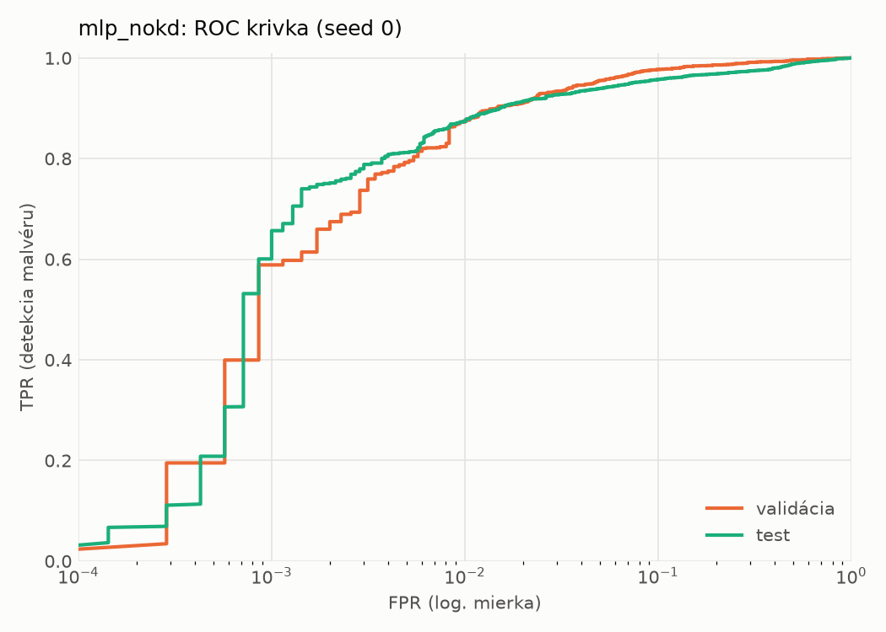
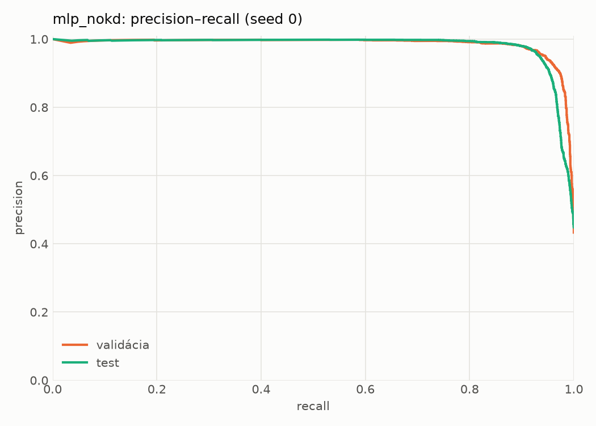
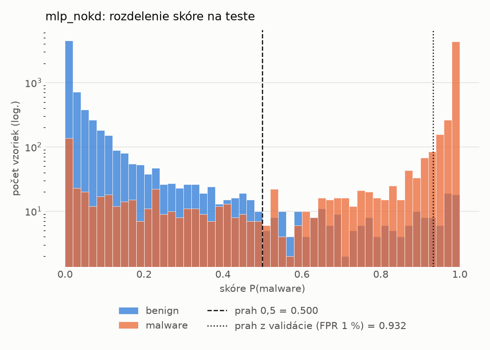
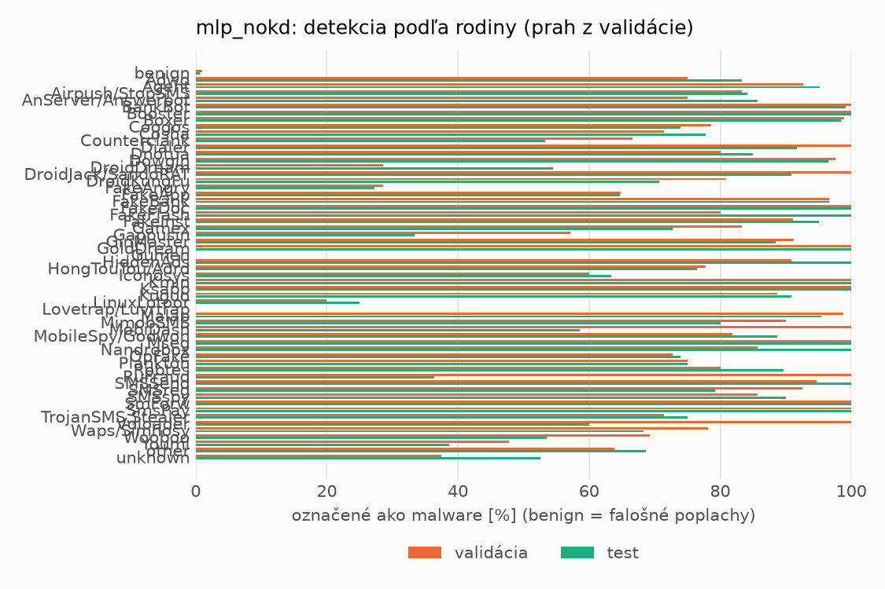
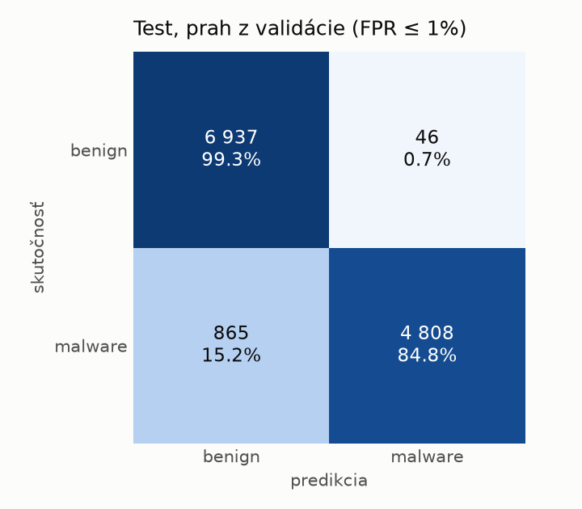
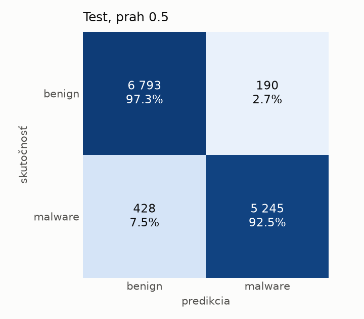
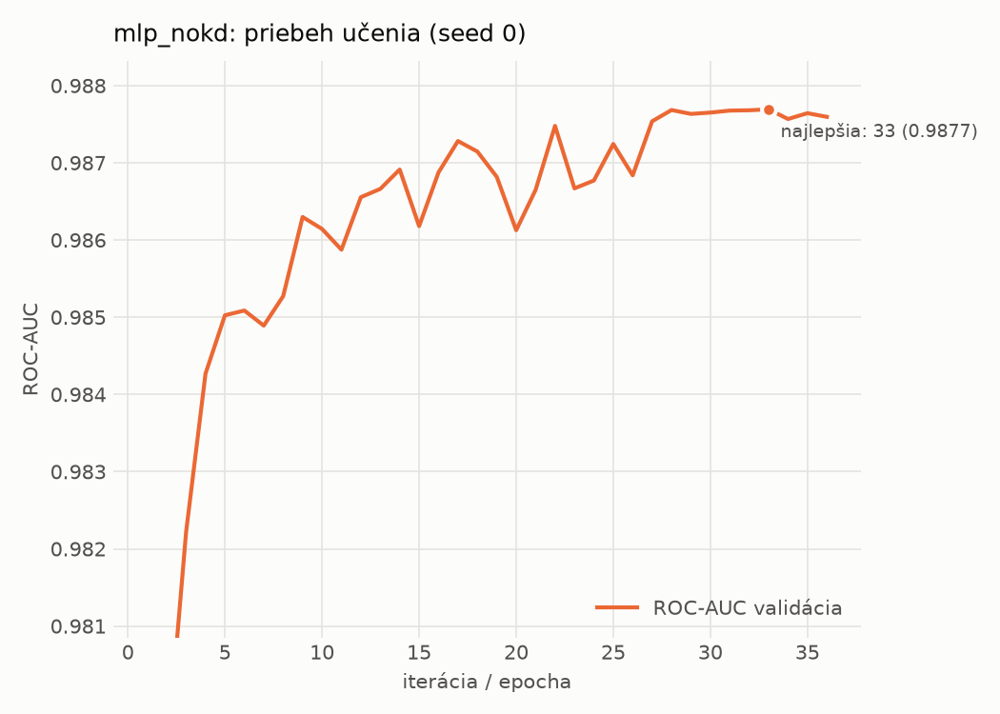

# static/mlp_nokd – beh `20261123-190201`

> Automaticky generované (`src/training/run_tabular.py`). Konfigurácia: `config.yaml`, protokol: `protocol.yaml`.

- **Model:** `mlp` – kontrola – rovnaké malé MLP bez destilácie (iba skutočné označenia)
- **Ladenie:** bez ladenia – hyperparametre prevzaté z `runs_v4/real_p/full/students_static/mlp_nokd/20261123-002453`
- **Finálne modely:** seedy [0, 1, 2]; hodnoty sú priemer ± smerodajná odchýlka cez seedy
- **Najlepšie hyperparametre:** `{"hidden_layers": 1, "max_epochs": 100, "patience": 8, "hidden_width": 64, "dropout": 0.15022694447625398, "lr": 0.0027248227778296176, "weight_decay": 1.7062100113192703e-06, "batch_size": 256}`

## Detekčná kvalita (bez prahu)
| metrika | train (podvzorka) | validácia | test |
|---|---|---|---|
| ROC-AUC | 0.9946 ± 0.0000 | 0.9875 ± 0.0002 | 0.9790 ± 0.0006 |
| PR-AUC | 0.9939 ± 0.0001 | 0.9852 ± 0.0003 | 0.9813 ± 0.0008 |
| TPR pri FPR 1 % | 0.9335 ± 0.0037 | 0.8597 ± 0.0139 | 0.8772 ± 0.0028 |
| TPR pri FPR 0,1 % | 0.7953 ± 0.0187 | 0.5119 ± 0.1096 | 0.6169 ± 0.0278 |
| log loss | 0.0855 ± 0.0006 | 0.1359 ± 0.0018 | 0.1639 ± 0.0027 |
| Brier skóre | 0.0230 ± 0.0002 | 0.0357 ± 0.0004 | 0.0405 ± 0.0001 |

Rozdiel ROC-AUC train − validácia: **0.0071** (veľký rozdiel = preučenie).

## Pri prahu z validácie (FPR ≤ 1% na validácii)
| metrika | train (podvzorka) | validácia | test |
|---|---|---|---|
| accuracy | 0.9434 ± 0.0039 | 0.9338 ± 0.0061 | 0.9252 ± 0.0028 |
| balanced accuracy | 0.9339 ± 0.0047 | 0.9250 ± 0.0070 | 0.9173 ± 0.0032 |
| precision | 0.9943 ± 0.0001 | 0.9855 ± 0.0005 | 0.9913 ± 0.0007 |
| recall (TPR) | 0.8716 ± 0.0094 | 0.8597 ± 0.0139 | 0.8405 ± 0.0070 |
| FPR | 0.0037 ± 0.0001 | 0.0096 ± 0.0002 | 0.0060 ± 0.0005 |
| F1 | 0.9289 ± 0.0053 | 0.9183 ± 0.0082 | 0.9097 ± 0.0038 |
| MCC | 0.8875 ± 0.0076 | 0.8687 ± 0.0117 | 0.8551 ± 0.0051 |

## Pri pevnom prahu 0.5
| metrika | train (podvzorka) | validácia | test |
|---|---|---|---|
| accuracy | 0.9709 ± 0.0007 | 0.9541 ± 0.0008 | 0.9502 ± 0.0008 |
| balanced accuracy | 0.9691 ± 0.0008 | 0.9529 ± 0.0009 | 0.9479 ± 0.0007 |
| precision | 0.9731 ± 0.0003 | 0.9498 ± 0.0013 | 0.9620 ± 0.0029 |
| recall (TPR) | 0.9577 ± 0.0016 | 0.9440 ± 0.0013 | 0.9256 ± 0.0011 |
| FPR | 0.0194 ± 0.0002 | 0.0381 ± 0.0010 | 0.0297 ± 0.0024 |
| F1 | 0.9654 ± 0.0009 | 0.9469 ± 0.0010 | 0.9434 ± 0.0008 |
| MCC | 0.9403 ± 0.0015 | 0.9065 ± 0.0017 | 0.8996 ± 0.0018 |

## Výpočtové nároky (seed 0, testovacia množina)
| meranie | hodnota |
|---|---|
| tréning finálneho modelu | 7.1 s (priemer cez seedy) |
| ladenie spolu | 0 s |
| počet parametrov / uzlov | 10 689 |
| veľkosť modelu na disku | 0.05 MB |
| transformácia vstupu – latencia (1 vlákno) | 0.015 ms |
| transformácia vstupu – priepustnosť | 725 688 vzoriek/s |
| CPU latencia modelu (batch 1, 1 vlákno) | 0.155 ms (p95 0.166) |
| CPU priepustnosť (24 vlákien) | 3 928 361 vzoriek/s |
| GPU latencia (batch 1) | 0.457 ms (p95 0.491) |
| GPU priepustnosť | 2 388 736 vzoriek/s |
| GPU špičková pamäť | 94 MB |

## Grafy
| | |
|---|---|
|  |  |
|  |  |
|  |  |
|  |  |

## Súbory
`metrics.json` (všetky metriky po seedoch vrátane rodín), `timing.json`, `hpo_trials.csv`,
`predictions/<časť>_seed<N>.parquet` (sha256, family, label, score), `model/seed_<N>/`, `log.txt`.
